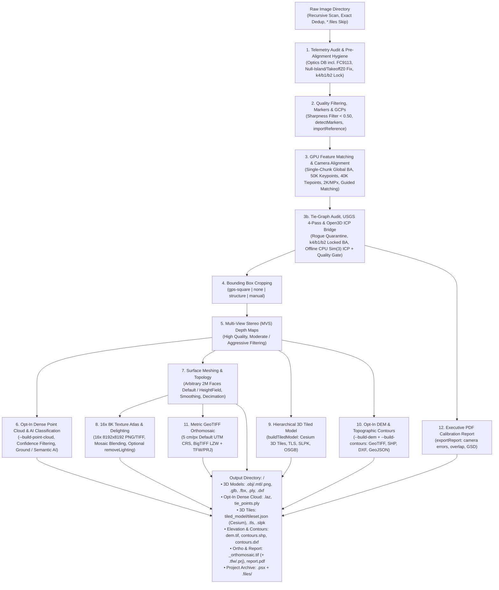

# AutoMetashape

[](LICENSE)
[](https://github.com/ngviettam82/AutoMetashape/releases/tag/v1.4.0)
[](https://www.python.org/)
[](https://developer.nvidia.com/cuda-zone)
[]()
[](https://www.agisoft.com/)

**AutoMetashape** is an autonomous, high-precision photogrammetry and aerial survey pipeline that transforms drone imagery and ground camera captures into millimeter-accurate 3D models (`.obj`, `.mtl`, `.glb`, `.fbx`, `.ply`), classified dense point clouds (`.laz`, `.las`, `.ply`, `.e57`), hierarchical 3D Tiled Models (Cesium 3D Tiles, TLS, SLPK), Digital Elevation Models (`dem.tif`), topographic contour vector maps (`.shp`, `.dxf`), GeoTIFF orthomosaics (`.tif`, `.tfw`), executive calibration reports (`report.pdf`), and native Agisoft Metashape projects (`.psx`) with **NVIDIA CUDA** GPU acceleration.

Available as a scriptable command-line engine, autonomous cluster supervisor, and browser telemetry dashboard.

---

## Download v1.4.0

Download the standalone v1.4.0 release package directly from GitHub Releases:

📦 **[AutoMetashape-v1.4.0.zip](https://github.com/ngviettam82/AutoMetashape/releases/download/v1.4.0/AutoMetashape-v1.4.0.zip)**  
Release details and release notes: [GitHub Release v1.4.0](https://github.com/ngviettam82/AutoMetashape/releases/tag/v1.4.0)

---

## Quickstart

### 0. 1-Click In-Place Updater (Zero Git Dependency)

Update any node (coordinator or remote worker) directly from GitHub `main` with zero folder nesting:
```powershell
# Update in-place:
.\update.bat

# Update and immediately launch worker daemon:
.\update.bat --worker

# Update and immediately launch cluster server:
.\update.bat --server
```

### 1. Launch Distributed Cluster Daemons (1-Click)

**Worker Node Workstations (Run on any network PC with a GPU):**
```powershell
# Windows 1-Click (interactively saves configuration on first run):
.\launch_worker.bat
```

**Coordinator Workstation (Starts the Cluster Server):**
```powershell
# Windows 1-Click:
.\launch_server.bat
```

### 2. Autonomous CLI Execution

AutoMetashape provides two equivalent execution methods:

#### Option A: Direct via Metashape Pro (Canonical)
Executes directly through Agisoft Metashape's embedded Python runtime:
```powershell
& "metashape.exe" -r scripts/metashape_reconstruction.py --images "C:/path/to/your/images" --preset pro
```

#### Option B: Standard Python (Automatic Runtime Auto-Handoff)
Executes under standard Python, which automatically discovers `metashape.exe` across `%ProgramFiles%` and all drives (`C:`, `D:`, `E:`, `F:`, `G:`) and delegates execution into Metashape's embedded runtime with zero path configuration:
```powershell
python scripts/metashape_reconstruction.py --images "C:/path/to/your/images" --preset pro
```

#### Production Survey Recipes:
```powershell
# Default Pro Preset (50K Keypoints, 40K Tiepoints, 2K/MPx, 5 cm/px Orthomosaic, Dense Cloud Opt-In):
python scripts/metashape_reconstruction.py --images "C:/path/to/your/images" --preset pro

# Drone Survey with Opt-In Dense Point Cloud, DEM, Contours & Cesium 3D Tiles:
python scripts/metashape_reconstruction.py \
    --images "C:/path/to/your/images" \
    --preset pro \
    --build-point-cloud --build-dem --build-contours --build-tiled-model

# Dual Shared Folder (Multi-SSD) Cluster Batch (SSD #1 Read-Only Source -> SSD #2 Writable Results):
python scripts/cluster_supervisor.py \
    --source-share "\\SERVER\DataSSD_Photos" \
    --result-share "\\SERVER\ResultSSD_Output" \
    --network-enable --network-host 192.168.1.100 --network-independent-workers --concurrent

# Building Facade with Coded Target Detection, Delighting & FBX Export:
python scripts/metashape_reconstruction.py \
    --images "C:/path/to/your/images" \
    --preset building \
    --detect-markers --remove-lighting --export-fbx
```

All production deliverables are automatically placed in `<export_folder>/<project_name>/` (or `<images_dir>/<project_name>/`).

---

## Key Features

### 1. Complete Agisoft Metashape Processing Pipeline
AutoMetashape supports all core photogrammetric operations in Agisoft Metashape Professional:
- **🎯 Target & Marker Detection (`--detect-markers`, `--target-type`)**: Automatically identifies coded targets (Circular 12, 14, 16, 20-bit, Cross targets, AprilTags 16h5, 25h9, 36h11) across photos via `chunk.detectMarkers()`.
- **📍 GCP Reference & RTK Georeferencing (`--import-reference`)**: Imports ground survey control points (GCPs) or antenna offsets CSV/TXT via `chunk.importReference()` and computes coordinate system transformations.
- **🎨 Radiometric Color Calibration (`--calibrate-colors`)**: Equalizes camera sensor exposure, vignetting, and white balance across photos via `chunk.calibrateColors()`.
- **☁️ Dense Point Clouds & Semantic AI (`--build-point-cloud`, `--classify-ground`, `--classify-points`)**: Computes dense 3D point clouds with RGB colors, filters low-confidence points, classifies bare-earth ground topography, and applies deep learning multi-class semantic segmentation (ASPRS LiDAR classes: Ground, Vegetation, Building, Road, Car).
- **🌐 Hierarchical 3D Tiled Models (`--build-tiled-model`, `--tiled-model-format`)**: Generates multiresolution LOD tilesets in Cesium 3D Tiles (`tileset.json` + `b3dm`) for streaming in CesiumJS and Unreal Engine, Agisoft TLS (`.tls`), Esri Scene Layer Package (`.slpk`), or OpenSceneGraph (`.osgb`).
- **🗺️ Digital Elevation Models (DEM) & Topographic Contours (`--build-dem`, `--build-contours`)**: Reconstructs metric elevation rasters (GeoTIFF with BigTIFF LZW) and vector contour lines at custom intervals (0.5m, 1m, 2m, 5m) exported as ESRI Shapefile (`.shp`), AutoCAD (`.dxf`), GeoJSON, or KML.
- **☀️ Texture Delighting / Shadow Removal (`--remove-lighting`)**: Removes harsh sunlight shadows and ambient occlusion using `chunk.removeLighting()` to output true photographic diffuse albedo textures for game engines and VFX.
- **📐 Mesh Topology, Smoothing & Multi-Format Export**: Arbitrary or HeightField meshing, planar hole closing (`closeHoles`), Laplacian mesh smoothing (`--smooth-mesh`), decimation (`--decimate-mesh`), and exports to Autodesk FBX (`.fbx`), Stanford PLY (`.ply`), AutoCAD DXF (`.dxf`), binary glTF (`.glb`), and Wavefront OBJ (`.obj` + `.mtl` + `.tif`).

### 2. Pro Photogrammetry & Geomatics Engine
- **🔬 Survey Physics & Optics Telemetry Audit (`--profile`, `--preset pro`, Default)**:
  - Audits physical sensor geometry, pixel pitch in $\mu\text{m}$, mean flying height $H_{AGL}$, and calculates the exact Ground Sampling Distance (GSD in cm/pixel).
  - Evaluates pairwise camera baselines to estimate forward and lateral overlap percentages.
  - Samples luminance histograms to detect underexposed shadows ($Y < 20$) and highlight clipping ($Y > 235$), triggering texture delighting when shadow clipping exceeds $15\%$.
- **⚙️ Camera Shutter Physics Conformance**:
  - Automatically identifies mechanical leaf shutters (e.g. DJI FC3411, Phantom 4 Pro FC6310, Zenmuse P1, Phase One, Hasselblad) and **disables rolling shutter compensation** to eliminate synthetic bundle adjustment drift.
  - Enables `Regularized` rolling shutter compensation on aerial CMOS rolling shutter payloads (DJI Air 3S `FC9113`, `FC9589`, Hasselblad Mavic 3 `L2D-20c`, Mini/Air series, consumer smartphones), while **explicitly disabling rolling shutter on isolated close-range hovering ICP island orbits** to prevent bundle-adjustment scale collapse.
- **📐 USGS 4-Pass Gradual Selection Bundle Adjustment (`k4=b1=b2=0` Lens Lock)**:
  - Staged parameter unfreezing schedule with gentle architectural thresholds (`<= 10%` removal cap per pass): Pass 1 (RU $\le 15.0 \to f, cx, cy$) $\to$ Pass 2 (PA $\le 3.0\text{ px} \to f, cx, cy, k_1..k_3, p_1, p_2$) $\to$ Pass 3 (RE $\le 0.50\text{ px} \to f, cx, cy, k_1..k_3, p_1, p_2$ with tie-point covariance) $\to$ Pass 4 (Image multiplicity $\ge 2$).
  - **Hard-locks `k4 = b1 = b2 = 0` and `adaptive_fitting = False`** across alignment and all 4 optimization passes to eliminate consumer UAV wide-angle radial dome blowup (`--adaptive-fitting` remains available as an explicit opt-in override).
  - Reports initial vs optimized RMS reprojection errors with reduction percentages.
- **🎨 1:1 Ground Texel Density Budgeting**:
  - Dynamically calculates the exact 8K texture atlas page count needed to match optical camera resolution on the 3D mesh surface, preventing blurry textures or bloated empty UV sheets.
- **⛰️ Slope-Adaptive Ground Point Filtering & Morphological Meshing**:
  - Derives terrain relief ratio $R = \Delta Z / D_{diag}$: sets planar sites ($R < 0.08$) to `HeightField` meshing with large ground cell sizes ($35\text{m}$), and complex 3D structures ($R \ge 0.08$) to `Arbitrary` meshing with steep slope angles ($28^\circ$).
- **🏢 Building Preset (`--preset building`)**:
  - 600K polygon faces, 16-page 8K texture atlas, Level-30 planar hole closing, and `gps-square` bounding box.
- **🗺️ Aerial Map Preset (`--preset map`)**:
  - 2M polygon faces, 4-page 8K texture atlas, full uncropped terrain extent, and GeoTIFF orthomosaic.

### 3. Zero-Neural Universal Alignment Hygiene & Open3D ICP Bridge
- **Single-Chunk Global Alignment (Default, `--multi-chunk disable`)**: Loads all photos across subfolders into a unified chunk while automatically deduplicating exact duplicate photos, skipping stray `.files` directories, registering DJI Air 3S (`FC9113`) optics, and supporting optional `--exclude-folders`.
- **Pre-Alignment GPS & Barometer Hygiene (`--alignment-hygiene`, Default: On)**:
  - Neutralizes Null-Island `(0, 0)` and `> 5 km` GPS outliers before matching.
  - Normalizes per-flight barometer datum drift via `TakeoffZ0 = AbsoluteAltitude - RelativeAltitude` keyed by full parent directory path, while preserving RTK Fixed surveys untouched and setting anisotropic `(5, 5, 15) m` non-RTK GPS accuracy.
  - Hard-locks `k4 = b1 = b2 = 0` and `adaptive_fitting = False` to prevent radial dome distortion on wide-angle UAV sensors.
- **Tie-Graph Topology Audit & Quarantine**: Builds the shared-track camera graph (`edge >= 15`) after global alignment to quarantine torn/folded/tiny rogue strips and main-block GPS spikes (`|dZ| > 7 m` or `dXY > 10 m`), while preserving coherent distant compounds and automatically queueing disconnected overlapping rigid islands (`>= 12` cameras) or unaligned close-range folders (`< 35%` aligned) regardless of folder naming.
- **Zero-Neural CPU Open3D Sim(3) ICP Bridge (`--icp-bridge`, Default: On)**:
  - **Zero-Overhead Fast Path**: Skips ICP completely when the project aligns cleanly into a single coherent block.
  - **Portable Offline Runtime (`.cluster/bridge_runtime/`)**: Auto-provisions a SHA-256-verified standalone CPython 3.11 + Open3D + NumPy + SciPy bundle into `%LOCALAPPDATA%\AutoMetashape\` (~2.5 s one-time extraction; zero system Python, PyTorch, CUDA, admin rights, or internet required).
  - **Pre-MVS Quality Gate & Scale Protection**: Disables rolling shutter on isolated close-range hovering orbits to prevent scale collapse, runs 4 cm uniform Stage-0 point-cloud extraction (32 GB RAM safe) + multi-scale Tukey Sim(3) Point-to-Plane and gated Colored ICP + pure-Python 3×3 SVD UTM→ECEF alignment, enforces strict acceptance gates (`fitness_15cm >= 35%`, `MedErr <= 10 cm`, `0.90 <= scale <= 1.10`, `tilt <= 5°`, `|k4| < 0.05`), merges via `mergeChunks(merge_tiepoints=False)` with bridged GPS references disabled, and clears Stage-0 assets before unified MVS.
- **Optional Legacy Multi-Chunk Mode (`--multi-chunk auto`)**: Assigns nested flight subfolders to independent chunks with camera/GPS (`method=2`) or point-based RANSAC ICP (`method=0`) chunk registration.

### 4. Comprehensive Image & Sensor Format Ingestion
Recursively scans image folders and nested directories for all supported formats:
- **Standard Raster**: `.jpg`, `.jpeg`, `.png`, `.tif`, `.tiff`, `.bmp`, `.webp`, `.jp2`, `.jxl`, `.exr`, `.tga`
- **Drone & Camera RAW**: DJI DNG RAW (Mavic 3 Enterprise, Matrice 300/350 RTK, Phantom 4 RTK, Autel EVO II/MAX), Canon CR2/CR3, Nikon NEF, Sony ARW, Phase One IIQ, Hasselblad 3FR, Fujifilm RAF, Panasonic RW2
- **Radiometric Thermal**: FLIR SEQ, ARA

---

## Distributed Network Processing & Resilient Worker Launcher

AutoMetashape runs as a lean, production-grade, headless engine orchestrated directly by AI Agents and CLI workflows:

- **1-Click Resilient Worker Node (`launch_worker.bat`)**:
  - Automatically loads server address and shared Result network root (`--root`) plus optional read-only Data Source share (`--source-root`) from `worker_config.json`.
  - First-run interactive setup wizard with LAN auto-discovery.
  - Built-in pre-flight health diagnostics (Metashape executable discovery, TCP port 5840 reachability test, and Shared UNC storage access check).
  - Resilient auto-reconnect loop: automatically reconnects if the coordinator restarts or network drops temporarily.
- **Dual Shared Folder (Multi-SSD) Topology**:
  - Supports separating **Data Source Share** (SSD #1, read-only raw survey photos via `--source-share`) from **Result Share** (SSD #2, writable `.psx` + deliverables acting as Metashape `--root` via `--result-share`), doubling aggregate storage I/O bandwidth and protecting raw captures.
- **Pro Production Defaults (`--preset pro`)**:
  - `keypoint_limit = 50,000`, `tiepoint_limit = 40,000`, `keypoint_limit_per_mpx = 2,000` (eliminating guided-matching RAM explosions).
  - Dense point cloud generation (`build_point_cloud`) is **disabled by default** in `pro` (explicit opt-in via `--build-point-cloud`).
  - Orthomosaic build and export default to **5 cm/px (`--ortho-resolution 0.05`)** (~25x lighter storage than 1 cm/px).
- **Atomic Monolithic `RunScript` Delegation & Exclusive Offline Execution (Default)**:
  - Independent project mode (`--network-independent-workers`, **enabled by default**, `worker_limit = 1`) and **Local NVMe Scratch Staging (`--local-scratch-staging`, enabled by default)** are the canonical cluster defaults across `submit_cluster_batch.py`, `cluster_supervisor.py`, and `metashape_reconstruction.py` (opt out via `--no-network-independent-workers` or `--no-local-scratch-staging`).
  - Each project runs atomically on 1 dedicated worker using local NVMe scratch with zero worker hopping and zero inter-worker LAN traffic, reconciling staged PSX chunk IDs (`reconcile_staged_psx_chunk_id`) before syncing deliverables back to shared storage.
  - Intermediate checkpoints saved to `.files` for instant resumption (`--resume`).
- **Autonomous AI Agent Skill Protocol**:
  - Managed via [`skills/user/image-to-3d-model`](skills/user/image-to-3d-model/SKILL.md) for 1-hour automated progress audits and self-healing dropped network workers.

---

## Pipeline Architecture



---

## Production Deliverables

All outputs are automatically organized inside the dedicated `<images_dir>/model/` folder:

| File | Format | Description |
|---|---|---|
| `model.obj` + `model.mtl` | Wavefront OBJ | Metric polygonal mesh with vertex normals and material definitions |
| `model.tif` (pages 1..N) | 8K TIFF | Uncompressed $8192\times 8192$ multi-page photogrammetric texture atlas |
| `model.glb` | Binary glTF | Standalone 3D model with embedded PBR textures for instant web and viewer loading |
| `model.fbx` | Autodesk FBX | Production 3D asset with embedded textures for 3ds Max, Maya, Blender, and Unreal |
| `model_mesh.ply` | Stanford PLY | Metric 3D mesh with vertex normals and vertex color definitions |
| `point_cloud.laz` (or `.las`, `.ply`, `.e57`) | Dense Point Cloud | 3D point cloud with RGB colors, normals, confidence, and ASPRS ground/semantic classifications |
| `tiled_model/tileset.json` | Cesium 3D Tiles | Multiresolution hierarchical LOD 3D tileset for streaming web GIS viewers |
| `dem.tif` + `dem.tfw` | GeoTIFF DEM | Digital Elevation Model (DSM/DTM) raster with BigTIFF LZW compression and world file |
| `contours.shp` (or `.dxf`) | Topographic Contours | Vector elevation contour polylines with metric height attributes |
| `orthomosaic.tif` + `orthomosaic.tfw` | GeoTIFF Ortho | Geo-referenced orthomosaic raster with LZW BigTIFF compression and world file |
| `report.pdf` | PDF Report | Executive processing, camera calibration, reprojection error, and flight overlap report |
| `building_reconstruction.psx` | Agisoft PSX | Native editable Metashape Professional project preserving all calibrations and depth maps |

---

## Agent Skills & Architecture

This repository adheres to the **NVIDIA Isaac Lab** multi-asset skill architecture and governance standards:

- [`skills/user/autonomous-photogrammetry`](skills/user/autonomous-photogrammetry/SKILL.md): Master coordinator for end-to-end multi-dataset photogrammetry operations across single or dual-SSD shared folder topologies.
- [`skills/user/image-to-3d-model`](skills/user/image-to-3d-model/SKILL.md): Autonomous end-to-end photogrammetry pipeline with survey telemetry profiling, 4-stage zero-neural alignment hygiene & Open3D ICP bridging, `k4=b1=b2=0` lens lock, target detection, GCP georeferencing, opt-in dense point clouds, 3D tiles, DEM, contours, texture delighting, and PDF reporting.
- [`skills/user/cluster-fleet-operations`](skills/user/cluster-fleet-operations/SKILL.md): Distributed cluster provisioning, dynamic multi-GPU discovery, fixed-NVMe local scratch staging, portable offline `.cluster/bridge_runtime/` provisioning, canary fleet updates, and signal-based worker abort & self-healing restarts.
- [`skills/user/cluster-supervisor`](skills/user/cluster-supervisor/SKILL.md): Strict read-only cluster supervision under the Operator Authority Gate, storage headroom watchdogs, canonical batch submission & queue/worker controls, and deterministic deliverable quality gates.
- [`skills/user/photogrammetry-export`](skills/user/photogrammetry-export/SKILL.md): Production asset export, 3D tiles, contours, point clouds, DEM, FBX/PLY, and texture delighting from existing projects.
- [`skills/developer/coding-style`](skills/developer/coding-style/SKILL.md): Repository coding conventions, SPDX license headers, line limits, and formatting hygiene.
- [`skills/developer/pr-workflow`](skills/developer/pr-workflow/SKILL.md): Conventional commits, DCO sign-offs, and presubmit validation pipelines.
- [`skills/developer/test-audit`](skills/developer/test-audit/SKILL.md): Test suite quality gates and mutation resistance verification.

Validate all repository agent skills:
```powershell
python tools/skills/cli.py check
```

---

## System Requirements

- **Operating System**: Windows 10/11 (64-bit) or Linux (Ubuntu 20.04/22.04 LTS).
- **Engine**: Agisoft Metashape Professional 2.0 or 2.1+ (verified on 2.2.2 Pro, build 20889).
- **Python**: Python 3.10, 3.11, or 3.12 (or Metashape bundled Python environment).
- **GPU**: NVIDIA GPU with CUDA support (RTX 30-series, RTX 40-series, RTX 50-series, or Quadro/Tesla).
- **RAM**: 32 GB RAM recommended for Building preset; 32-64 GB RAM recommended for 2M-face Map presets and dense point clouds.

---

## Contributing

Contributions are welcome! Please read [`CONTRIBUTING.md`](CONTRIBUTING.md) and [`AGENTS.md`](AGENTS.md) before submitting pull requests:
- Sign all commits with Developer Certificate of Origin (`git commit -s`).
- Follow Conventional Commits format (`feat:`, `fix:`, `docs:`, etc.).
- Validate skills (`python tools/skills/cli.py check`) and license compliance (`python tools/check_licenses.py`).
- Run code formatting via `.\format_code.bat` or `./format_code.sh`.

---

## License

This project is licensed under the Apache 2.0 License - see the [LICENSE](LICENSE) file for details.
