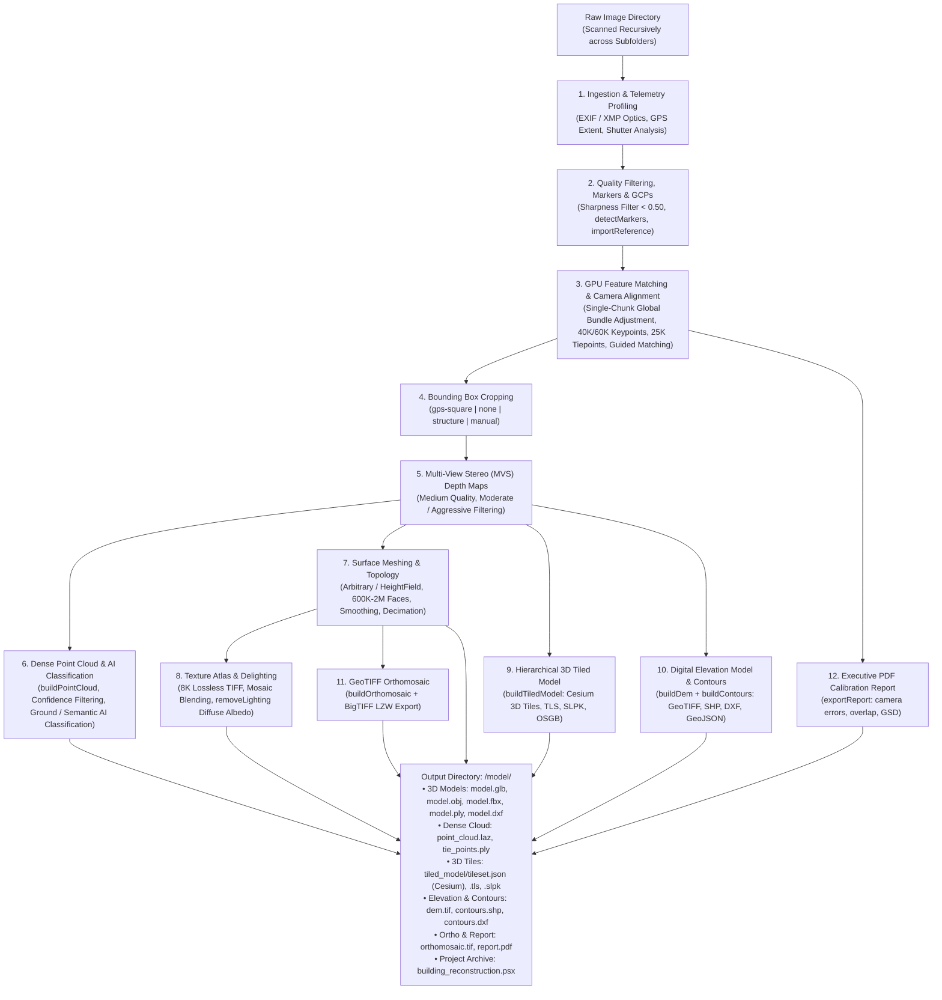

# AutoMetashape

[](LICENSE)
[](https://github.com/ngviettam82/AutoMetashape/releases/tag/v1.3.0)
[](https://www.python.org/)
[](https://developer.nvidia.com/cuda-zone)
[]()
[](https://www.agisoft.com/)

**AutoMetashape** is an autonomous, high-precision photogrammetry and aerial survey pipeline that transforms drone imagery and ground camera captures into millimeter-accurate 3D models (`.obj`, `.mtl`, `.glb`, `.fbx`, `.ply`), classified dense point clouds (`.laz`, `.las`, `.ply`, `.e57`), hierarchical 3D Tiled Models (Cesium 3D Tiles, TLS, SLPK), Digital Elevation Models (`dem.tif`), topographic contour vector maps (`.shp`, `.dxf`), GeoTIFF orthomosaics (`.tif`, `.tfw`), executive calibration reports (`report.pdf`), and native Agisoft Metashape projects (`.psx`) with **NVIDIA CUDA** GPU acceleration.

Available both as an interactive desktop studio application (**AutoMetashape Studio**) and as a scriptable command-line interface.

---

## Download v1.3.0

Download the standalone v1.3.0 release package directly from GitHub Releases:

📦 **[AutoMetashape-v1.3.0.zip](https://github.com/ngviettam82/AutoMetashape/releases/download/v1.3.0/AutoMetashape-v1.3.0.zip)**  
Release details and release notes: [GitHub Release v1.3.0](https://github.com/ngviettam82/AutoMetashape/releases/tag/v1.3.0)

---

## Quickstart

### 1. Launch AutoMetashape Studio (Desktop GUI)

Run the desktop launcher:

```powershell
# Windows:
.\gui.bat

# Linux / macOS:
./gui.sh
```

Or run directly with Python:
```powershell
python scripts/autometashape_gui.py
```

### 2. Autonomous CLI Execution

Run photogrammetry reconstruction directly from PowerShell or terminal:

```powershell
# Autonomous Mode (Profiles dataset and learns optimal parameters dynamically):
& "C:/Program Files/Agisoft/Metashape Pro/metashape.exe" -r scripts/metashape_reconstruction.py --images "C:/path/to/your/images" --preset auto

# Drone Survey with Dense Point Cloud, DEM, Contours & Cesium 3D Tiles:
& "C:/Program Files/Agisoft/Metashape Pro/metashape.exe" -r scripts/metashape_reconstruction.py \
    --images "C:/path/to/your/images" \
    --preset map \
    --build-point-cloud --build-dem --build-contours --build-tiled-model

# Building Facade with Coded Target Detection, Delighting & FBX Export:
& "C:/Program Files/Agisoft/Metashape Pro/metashape.exe" -r scripts/metashape_reconstruction.py \
    --images "C:/path/to/your/images" \
    --preset building \
    --detect-markers --remove-lighting --export-fbx
```

All production deliverables are automatically placed in `C:/path/to/your/images/model/`.

---

## Key Features

### 1. Complete Agisoft Metashape Processing Pipeline
AutoMetashape supports all core photogrammetric operations in Agisoft Metashape Professional:
- **🎯 Target & Marker Detection (`--detect-markers`, `--target-type`)**: Automatically identifies coded targets (Circular 12, 14, 16, 20-bit, Cross targets, AprilTags 16h5, 25h9, 36h11) across photos via `chunk.detectMarkers()`.
- **📍 GCP Reference & RTK Georeferencing (`--import-reference`)**: Imports ground survey control points (GCPs) or antenna offsets CSV/TXT via `chunk.importReference()` and computes coordinate system transformations.
- **🎨 Radiometric Color Calibration (`--calibrate-colors`)**: Equalizes camera sensor exposure, vignetting, and white balance across photos via `chunk.calibrateColors()`.
- **☁️ Dense Point Clouds & Semantic AI (`--build-point-cloud`, `--classify-ground`, `--classify-points`)**: Computes dense 3D point clouds with RGB colors, filters low-confidence points, classifies bare-earth ground topography, and applies deep learning multi-class semantic segmentation (ASPRS LiDAR classes: Ground, Vegetation, Building, Road, Car).
- **🌐 Hierarchical 3D Tiled Models (`--build-tiled-model`, `--tiled-model-format`)**: Generates multiresolution LOD tilesets in Cesium 3D Tiles (`tileset.json` + `b3dm`) for streaming in CesiumJS and Unreal Engine, Agisoft TLS (`.tls`), Esri Scene Layer Package (`.slpk`), or OpenSceneGraph (`.osgb`).
- **🗺️ Digital Elevation Models (DEM) & Topographic Contours (`--build-dem`, `--build-contours`)**: Reconstructs metric elevation rasters (GeoTIFF with BigTIFF LZW) and vector contour lines at custom intervals (0.5m, 1m, 2m, 5m) exported as ESRI Shapefile (`.shp`), AutoCAD (`.dxf`), GeoJSON, or KML.
- **☀️ Texture Delighting / Shadow Removal (`--remove-lighting`)**: Removes harsh sunlight shadows and ambient occlusion using `chunk.removeLighting()` to output true photographic diffuse albedo textures for game engines and VFX.
- **📐 Mesh Topology, Smoothing & Multi-Format Export**: Arbitrary or HeightField meshing, planar hole closing (`closeHoles`), Laplacian mesh smoothing (`--smooth-mesh`), decimation (`--decimate-mesh`), and exports to Autodesk FBX (`.fbx`), Stanford PLY (`.ply`), AutoCAD DXF (`.dxf`), binary glTF (`.glb`), and Wavefront OBJ (`.obj` + `.mtl` + `.tif`).

### 2. Autonomous Telemetry Profiling & Learned Parameters
- **🧠 Dataset Profiling Engine (`--profile`, `--preset auto`)**:
  - Automatically samples and extracts EXIF/XMP camera telemetry, focal lengths, megapixels, shutter models, and GPS flight bounds.
  - Dynamically classifies dataset into **Nadir Aerial Survey**, **Oblique Facade Survey**, or **Terrestrial Close-Range Walkthrough**.
  - Dynamically calculates optimal keypoint limits (60K for $\ge 30\text{MP}$, 40K otherwise), tiepoints (25K), bounding box cropping strategy, face budgets ($600\text{K} - 2\text{M}$), texture page counts, and toggles for DEM, point cloud, and orthomosaic generation.
- **🏢 Building Preset (`--preset building`, Default)**:
  - Tailored for architectural structures, towers, facades, and vertical monuments.
  - **600,000 polygon faces (600K)** with Level-30 planar hole closing across window and door voids.
  - **16-Page 8K Texture Atlas** ($16 \times 8192 \times 8192$) uncompressed TIFF mosaic blending with hole filling and ghosting filter.
  - **`gps-square` Bounding Box**: Calculates the enclosing horizontal square of camera GPS poses while leaving vertical bounds uncropped to guarantee rooftops, spires, and foundations are never sliced.
- **🗺️ Aerial Map Preset (`--preset map`)**:
  - Tailored for site surveys, civil engineering, topography, and agricultural mapping.
  - **2,000,000 polygon faces (2M)** capturing micro-topographical terrain details.
  - **4-Page 8K Texture Atlas** for sharp aerial orthophoto texture projection.
  - **Full Uncropped Extent (`--no-crop`)**: Preserves the complete surveyed terrain, boundary roads, and environmental perimeter.
  - **GeoTIFF Orthomosaic**: Surface-mesh projected mosaic orthophoto with BigTIFF LZW compression, ESRI `.tfw` world file, and automatic persistence inside the `.psx` project chunk.

### 3. Robust Single-Chunk Global Alignment & Multi-Chunk Registration
- **Single-Chunk Global Alignment (Default, `--multi-chunk disable`)**: To prevent false alignment artifacts or coordinate shifts caused by chunk merging, AutoMetashape defaults to loading all photos across all subfolders into a single unified chunk, solving bundle adjustment globally.
- **Optional Multi-Chunk Mode (`--multi-chunk auto`)**: When enabled, automatically assigns nested flight subfolders (`flight_1/`, `flight_2/`) to independent chunks and solves sensor calibrations independently.
- **Camera/GPS-Based Registration (`method=2`, Default)**: Aligns secondary chunks to the anchor flight using camera reference coordinates to prevent 180-degree rotation flips on symmetric structures.
- **Point-Based RANSAC ICP Fallback (`method=0`)**: If camera reference coordinates are unavailable or degraded, automatically falls back to point-based ICP (`fit_scale=True`).

### 4. Comprehensive Image & Sensor Format Ingestion
Recursively scans image folders and nested directories for all supported formats:
- **Standard Raster**: `.jpg`, `.jpeg`, `.png`, `.tif`, `.tiff`, `.bmp`, `.webp`, `.jp2`, `.jxl`, `.exr`, `.tga`
- **Drone & Camera RAW**: DJI DNG RAW (Mavic 3 Enterprise, Matrice 300/350 RTK, Phantom 4 RTK, Autel EVO II/MAX), Canon CR2/CR3, Nikon NEF, Sony ARW, Phase One IIQ, Hasselblad 3FR, Fujifilm RAF, Panasonic RW2
- **Radiometric Thermal**: FLIR SEQ, ARA

---

## Desktop GUI Studio (AutoMetashape Studio)

`gui.bat` launches the desktop studio application:

- **Dual-Column Responsive Layout**: Parameter configuration and hardware monitor on the left, live execution console and visual stepper on the right.
- **8 Categorized Process Sections in Parameters**:
  1. `ALIGN`: Matching quality, keypoints (40K/60K), tiepoints (25K), guided matching, adaptive fitting, CMOS rolling shutter, tie-point filtering, target marker detection, GCP reference CSV import, and color calibration.
  2. `REGION`: Bounding box cropping strategy (`gps-square`, `none`, `structure`, `manual`) and pause toggle.
  3. `MODEL`: Depth map downscale, filtering mode, surface type (Arbitrary / HeightField), custom face budget ($600\text{K} - 2\text{M}$), hole closing, Laplacian smoothing, and export toggles for FBX, PLY, and DXF.
  4. `POINT CLOUD`: Dense point cloud toggle, format selection (`laz`, `las`, `ply`, `e57`, `xyz`), ground point classification, semantic multiclass AI, confidence filter, and sparse tie points export.
  5. `TILED MODEL`: Hierarchical 3D Tiled Model (LOD) toggle, format selection (`cesium`, `tls`, `slpk`, `osgb`), and tile size (`256`, `512`).
  6. `ELEVATION & CONTOURS`: DEM generation toggle, GeoTIFF orthomosaic toggle, topographic contours toggle, elevation interval (0.5m - 10m), and format (`shp`, `dxf`, `geojson`, `kml`).
  7. `TEXTURE`: UV parameterization, 8K texture atlas page budget (4 to 16 pages), hole filling, ghosting filters, and texture delighting (shadow removal).
  8. `REPORT`: Executive PDF calibration report toggle, custom report title, and execution lifecycle (`--resume`).
- **Dynamic Preset Switching**: Instant auto-fill of all parameters when switching between **Autonomous (Learned)**, **Building (600K faces, 16-page 8K)**, and **Map (2M faces, 4-page 8K, DEM & Ortho)** presets.
- **Export & Texture Re-Baking Tab**: Re-bake UV textures with delighting, export 3D Tiled Models (Cesium), topographic contours (SHP/DXF), dense point clouds, DEMs, orthomosaics, FBX, PLY, and PDF reports directly from existing `.psx` projects without re-aligning.

---

## Pipeline Architecture



---

## Production Deliverables

All outputs are automatically organized inside the dedicated `<images_dir>/model/` folder:

| File | Format | Description |
|---|---|---|
| `model.obj` + `model.mtl` | Wavefront OBJ | Metric polygonal mesh with vertex normals and material definitions |
| `model.tif` (pages 1..N) | 8K TIFF | Uncompressed $8192\times 8192$ multi-page photogrammetric texture atlas |
| `model.glb` | Binary glTF | Standalone 3D model with embedded PBR textures for instant web and viewer loading |
| `model.fbx` | Autodesk FBX | Production 3D asset with embedded textures for 3ds Max, Maya, Blender, and Unreal |
| `model_mesh.ply` | Stanford PLY | Metric 3D mesh with vertex normals and vertex color definitions |
| `point_cloud.laz` (or `.las`, `.ply`, `.e57`) | Dense Point Cloud | 3D point cloud with RGB colors, normals, confidence, and ASPRS ground/semantic classifications |
| `tiled_model/tileset.json` | Cesium 3D Tiles | Multiresolution hierarchical LOD 3D tileset for streaming web GIS viewers |
| `dem.tif` + `dem.tfw` | GeoTIFF DEM | Digital Elevation Model (DSM/DTM) raster with BigTIFF LZW compression and world file |
| `contours.shp` (or `.dxf`) | Topographic Contours | Vector elevation contour polylines with metric height attributes |
| `orthomosaic.tif` + `orthomosaic.tfw` | GeoTIFF Ortho | Geo-referenced orthomosaic raster with LZW BigTIFF compression and world file |
| `report.pdf` | PDF Report | Executive processing, camera calibration, reprojection error, and flight overlap report |
| `building_reconstruction.psx` | Agisoft PSX | Native editable Metashape Professional project preserving all calibrations and depth maps |

---

## Agent Skills & Architecture

This repository adheres to the **NVIDIA Isaac Lab** multi-asset skill architecture and governance standards:

- [`skills/user/image-to-3d-model`](skills/user/image-to-3d-model/SKILL.md): Autonomous end-to-end photogrammetry pipeline with survey telemetry profiling, target detection, GCP georeferencing, dense point clouds, 3D tiles, DEM, contours, texture delighting, and PDF reporting.
- [`skills/user/photogrammetry-export`](skills/user/photogrammetry-export/SKILL.md): Production asset export, 3D tiles, contours, point clouds, DEM, FBX/PLY, and texture delighting from existing projects.
- [`skills/developer/coding-style`](skills/developer/coding-style/SKILL.md): Repository coding conventions, SPDX license headers, line limits, and formatting hygiene.
- [`skills/developer/pr-workflow`](skills/developer/pr-workflow/SKILL.md): Conventional commits, DCO sign-offs, and presubmit validation pipelines.
- [`skills/developer/test-audit`](skills/developer/test-audit/SKILL.md): Test suite quality gates and mutation resistance verification.

Validate all repository agent skills:
```powershell
python tools/skills/cli.py check
```

---

## System Requirements

- **Operating System**: Windows 10/11 (64-bit) or Linux (Ubuntu 20.04/22.04 LTS).
- **Engine**: Agisoft Metashape Professional 2.0 or 2.1+ (verified on 2.2.2 Pro, build 20889).
- **Python**: Python 3.10, 3.11, or 3.12 (or Metashape bundled Python environment).
- **GPU**: NVIDIA GPU with CUDA support (RTX 30-series, RTX 40-series, RTX 50-series, or Quadro/Tesla).
- **RAM**: 32 GB RAM recommended for Building preset; 32-64 GB RAM recommended for 2M-face Map presets and dense point clouds.

---

## Contributing

Contributions are welcome! Please read [`CONTRIBUTING.md`](CONTRIBUTING.md) and [`AGENTS.md`](AGENTS.md) before submitting pull requests:
- Sign all commits with Developer Certificate of Origin (`git commit -s`).
- Follow Conventional Commits format (`feat:`, `fix:`, `docs:`, etc.).
- Validate skills (`python tools/skills/cli.py check`) and license compliance (`python tools/check_licenses.py`).
- Run code formatting via `.\format_code.bat` or `./format_code.sh`.

---

## License

This project is licensed under the Apache 2.0 License - see the [LICENSE](LICENSE) file for details.
