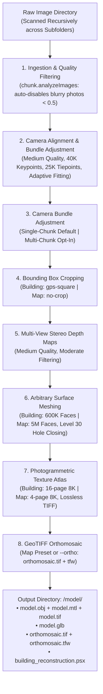

# AutoMetashape

[](LICENSE)
[](https://github.com/ngviettam82/AutoMetashape/releases/tag/v1.2.0)
[](https://www.python.org/)
[](https://developer.nvidia.com/cuda-zone)
[]()
[](https://www.agisoft.com/)

**AutoMetashape** is an autonomous, high-precision photogrammetry and aerial survey pipeline that transforms drone imagery and ground camera captures into millimeter-accurate 3D models (`.obj`, `.mtl`, `.glb`), GeoTIFF orthomosaics (`.tif`, `.tfw`), and native Agisoft Metashape projects (`.psx`) with **NVIDIA CUDA** GPU acceleration.

Available both as an interactive desktop studio application (**AutoMetashape Studio**) and as a scriptable command-line interface.

---

## Download v1.2.0

Download the standalone v1.2.0 release package directly from GitHub Releases:

📦 **[AutoMetashape-v1.2.0.zip](https://github.com/ngviettam82/AutoMetashape/releases/download/v1.2.0/AutoMetashape-v1.2.0.zip)**  
Release details and release notes: [GitHub Release v1.2.0](https://github.com/ngviettam82/AutoMetashape/releases/tag/v1.2.0)

---

## Quickstart

### 1. Launch AutoMetashape Studio (Desktop GUI)

Run the desktop launcher:

```powershell
# Windows:
.\gui.bat

# Linux / macOS:
./gui.sh
```

Or run directly with Python:
```powershell
python scripts/autometashape_gui.py
```

### 2. Autonomous CLI Execution

Run photogrammetry reconstruction directly from PowerShell or terminal:

```powershell
# Building Preset (Default: 600K faces, 16-page 8K textures, GPS crop):
& "C:/Program Files/Agisoft/Metashape Pro/metashape.exe" -r scripts/metashape_reconstruction.py --images "C:/path/to/your/images"

# Aerial Map Preset (5M faces, 4-page 8K textures, uncropped scene, GeoTIFF orthomosaic):
& "C:/Program Files/Agisoft/Metashape Pro/metashape.exe" -r scripts/metashape_reconstruction.py --images "C:/path/to/your/images" --preset map
```

All production deliverables are automatically placed in `C:/path/to/your/images/model/`.

---

## Key Features

### 1. Purpose-Built Workflow Presets
- **🏢 Building Preset (`--preset building`, Default)**:
  - Tailored for architectural structures, towers, facades, and vertical monuments.
  - **600,000 polygon faces (600K)** with Level-30 planar hole closing across window and door voids.
  - **16-Page 8K Texture Atlas** ($16 \times 8192 \times 8192$) uncompressed TIFF mosaic blending with hole filling and ghosting filter.
  - **`gps-square` Bounding Box**: Calculates the enclosing horizontal square of camera GPS poses while leaving vertical bounds uncropped to guarantee rooftops, spires, and foundations are never sliced.
- **🗺️ Aerial Map Preset (`--preset map`)**:
  - Tailored for site surveys, civil engineering, topography, and agricultural mapping.
  - **5,000,000 polygon faces (5M)** capturing micro-topographical terrain details.
  - **4-Page 8K Texture Atlas** for sharp aerial orthophoto texture projection.
  - **Full Uncropped Extent (`--no-crop`)**: Preserves the complete surveyed terrain, boundary roads, and environmental perimeter.
  - **GeoTIFF Orthomosaic**: Surface-mesh projected mosaic orthophoto with BigTIFF LZW compression, ESRI `.tfw` world file, and automatic persistence inside the `.psx` project chunk.
- **⚡ Parameter Override Precedence**:
  - User-specified flags (`--faces`, `--texture-pages`, `--crop-method`, `--ortho`) take absolute precedence over preset defaults (e.g. `--preset map --faces 2500000 --texture-pages 8`).

### 2. Robust Single-Chunk Global Alignment (Default) & Multi-Chunk Isolation
- **Single-Chunk Global Alignment (Default, `--multi-chunk disable`)**: To prevent false alignment artifacts or coordinate shifts caused by chunk merging, AutoMetashape defaults to loading all photos across all subfolders into a single unified chunk, solving bundle adjustment globally.
- **Optional Multi-Chunk Mode (`--multi-chunk auto`)**: When enabled, automatically assigns nested flight subfolders (`flight_1/`, `flight_2/`) to independent chunks and solves sensor calibrations independently.
- **Camera/GPS-Based Registration (`method=2`, Default)**: When multi-chunk mode is active, aligns secondary chunks to the anchor flight using camera reference coordinates to prevent 180-degree rotation flips on symmetric structures.
- **Point-Based RANSAC ICP Fallback (`method=0`)**: If camera reference coordinates are unavailable or degraded, automatically falls back to point-based ICP (`fit_scale=True`).
- Configurable via `--multi-chunk [disable|auto|force]` and `--chunk-align-method [camera|point]`, also selectable in the desktop GUI studio.


### 3. Execution Lifecycle & Resilient Recovery
- **Fresh Restart from Scratch (Default)**: Recreates output directories cleanly to prevent dirty project states or stale geometry accumulation.
- **Safe Checkpoint Resumption (`--resume`)**: Detects existing completed stages (camera bundle adjustment, depth maps, polygonal mesh, texture atlas, orthomosaic) and skips forward to uncompleted tasks.
- **Non-Fatal Orthomosaic Guard**: Wraps orthomosaic export in an exception guard—if coordinate projection issues occur, it logs a warning and successfully completes the 3D mesh and texture deliverables without crashing the pipeline.

### 4. Comprehensive Image & Sensor Format Ingestion
Recursively scans image folders and nested directories for all supported formats:
- **Standard Raster**: `.jpg`, `.jpeg`, `.png`, `.tif`, `.tiff`, `.bmp`, `.webp`, `.jp2`, `.jxl`, `.exr`, `.tga`
- **Drone & Camera RAW**: DJI DNG RAW (Mavic 3 Enterprise, Matrice 300/350 RTK, Phantom 4 RTK, Autel EVO II/MAX), Canon CR2/CR3, Nikon NEF, Sony ARW, Phase One IIQ, Hasselblad 3FR, Fujifilm RAF, Panasonic RW2
- **Radiometric Thermal**: FLIR SEQ, ARA

### 5. Automated Sharpness Quality Filtering & CMOS Rolling Shutter
- Calculates gradient sharpness across all camera frames via `chunk.analyzeImages()`.
- Automatically disables out-of-focus or motion-blurred photos ($<0.50$ quality index) before bundle adjustment.
- Compensates for drone CMOS rolling shutter motion using `Metashape.Shutter.Model.Regularized`, reducing reprojection errors by up to 30%.

---

## Desktop GUI Studio (AutoMetashape Studio)

`gui.bat` launches the desktop studio application built with modern app-screen standards:

- **Dual-Column Responsive Layout**: Parameter configuration and hardware monitor on the left, live execution console and visual stepper on the right.
- **Horizontal 7-Stage Live Stepper**:
  1. `[1/7]` Ingestion & Quality Filtering
  2. `[2/7]` Camera Bundle Adjustment
  3. `[3/7]` Multi-Flight Registration & Merge
  4. `[4/7]` GPU MVS Depth Map Generation
  5. `[5/7]` 3D Surface Meshing & Hole Closing
  6. `[6/7]` 8K Photogrammetric Texture Atlas
  7. `[7/7]` GeoTIFF Orthomosaic & Delivery Packaging
- **Dynamic Preset Switching**: Instant auto-fill of face counts, texture pages, crop modes, and orthomosaic toggles when switching between Building and Aerial Map presets.
- **Export & Texture Re-Baking Tab**: Re-bake UV texture atlases or re-export GLB/OBJ models from existing `.psx` projects without re-running camera alignment or depth maps.
- **Safe Process Management**: Live log streaming, progress bar, instant cancellation without UI freeze, and one-click "Open Output Folder" / "Open in Metashape GUI" buttons.

---

## Pipeline Architecture



---

## CLI Reference & Usage Examples

### Building Preset (Default)
```powershell
& "C:/Program Files/Agisoft/Metashape Pro/metashape.exe" -r scripts/metashape_reconstruction.py \
    --images "D:/Surveys/BuildingSite"
```

### Aerial Map Preset (5M Faces, Full Extent, GeoTIFF Orthomosaic)
```powershell
& "C:/Program Files/Agisoft/Metashape Pro/metashape.exe" -r scripts/metashape_reconstruction.py \
    --images "D:/Surveys/SiteMapping" \
    --preset map
```

### Parameter Overrides
Explicit arguments override preset defaults:
```powershell
& "C:/Program Files/Agisoft/Metashape Pro/metashape.exe" -r scripts/metashape_reconstruction.py \
    --images "D:/Surveys/SiteMapping" \
    --preset map \
    --faces 2000000 \
    --texture-pages 8 \
    --crop-method gps-square
```

### Resume Interrupted Reconstruction
```powershell
& "C:/Program Files/Agisoft/Metashape Pro/metashape.exe" -r scripts/metashape_reconstruction.py \
    --images "D:/Surveys/BuildingSite" \
    --resume
```

### Optical Ray Convergence Crop (No-GPS Walkthrough)
```powershell
& "C:/Program Files/Agisoft/Metashape Pro/metashape.exe" -r scripts/metashape_reconstruction.py \
    --images "D:/Surveys/StatueOrbit" \
    --crop-method structure
```

### Standalone Asset Export & Texture Re-Baking
Export production assets from an existing `.psx` project after manual editing in Metashape GUI:
```powershell
& "C:/Program Files/Agisoft/Metashape Pro/metashape.exe" -r scripts/metashape_export.py \
    --project "D:/Surveys/BuildingSite/model/building_reconstruction.psx" \
    --rebake-texture \
    --texture-pages 16
```

---

## Production Deliverables

All outputs are automatically organized inside the dedicated `<images_dir>/model/` folder:

| File | Format | Description |
|---|---|---|
| `model.obj` + `model.mtl` | Wavefront OBJ | Metric polygonal mesh with vertex normals and material definitions |
| `model.tif` (pages 1..N) | 8K TIFF | Uncompressed $8192\times 8192$ multi-page photogrammetric texture atlas |
| `model.glb` | Binary glTF | Standalone 3D model with embedded PBR textures for instant web and viewer loading |
| `orthomosaic.tif` | GeoTIFF | Geo-referenced orthomosaic raster with LZW BigTIFF compression (Map preset) |
| `orthomosaic.tfw` | ESRI World File | Coordinate positioning transformation matrix for GIS integration |
| `building_reconstruction.psx` | Agisoft PSX | Native editable Metashape Professional project preserving all calibrations and depth maps |

---

## Agent Skills & Architecture

This repository adheres to the **NVIDIA Isaac Lab** multi-asset skill architecture and governance standards:

- [`skills/user/image-to-3d-model`](skills/user/image-to-3d-model/SKILL.md): Autonomous end-to-end photogrammetry pipeline with Building and Map presets, multi-flight registration, and GeoTIFF orthomosaic generation.
- [`skills/user/photogrammetry-export`](skills/user/photogrammetry-export/SKILL.md): Fast production asset export and texture re-baking from existing projects.
- [`skills/developer/coding-style`](skills/developer/coding-style/SKILL.md): Repository coding conventions, SPDX license headers, line limits, and formatting hygiene.
- [`skills/developer/pr-workflow`](skills/developer/pr-workflow/SKILL.md): Conventional commits, DCO sign-offs, and presubmit validation pipelines.
- [`skills/developer/test-audit`](skills/developer/test-audit/SKILL.md): Test suite quality gates and mutation resistance verification.

Validate all repository agent skills:
```powershell
python tools/skills/cli.py check
```

---

## System Requirements

- **Operating System**: Windows 10/11 (64-bit) or Linux (Ubuntu 20.04/22.04 LTS).
- **Engine**: Agisoft Metashape Professional 2.0 or 2.1+.
- **Python**: Python 3.10, 3.11, or 3.12 (or Metashape bundled Python environment).
- **GPU**: NVIDIA GPU with CUDA support (RTX 30-series, RTX 40-series, RTX 50-series, or Quadro/Tesla).
- **RAM**: 32 GB RAM recommended for Building preset; 64 GB+ RAM recommended for large 5M-face Map presets.

---

## Contributing

Contributions are welcome! Please read [`CONTRIBUTING.md`](CONTRIBUTING.md) and [`AGENTS.md`](AGENTS.md) before submitting pull requests:
- Sign all commits with Developer Certificate of Origin (`git commit -s`).
- Follow Conventional Commits format (`feat:`, `fix:`, `docs:`, etc.).
- Validate skills (`python tools/skills/cli.py check`) and license compliance (`python tools/check_licenses.py`).
- Run code formatting via `.\format_code.bat` or `./format_code.sh`.

---

## License

This project is licensed under the Apache 2.0 License - see the [LICENSE](LICENSE) file for details.
