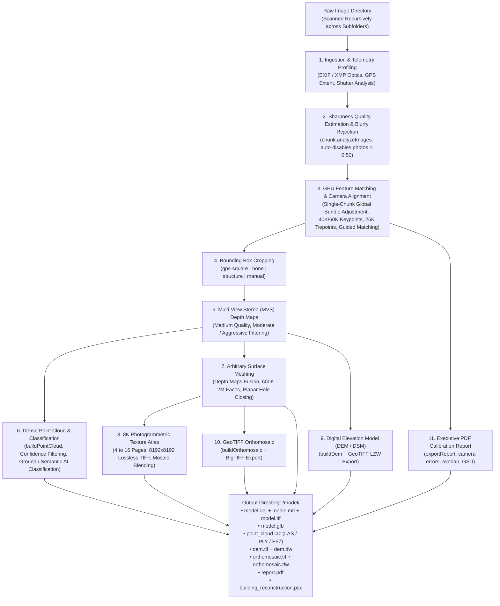

# AutoMetashape

[](LICENSE)
[](https://github.com/ngviettam82/AutoMetashape/releases/tag/v1.3.0)
[](https://www.python.org/)
[](https://developer.nvidia.com/cuda-zone)
[]()
[](https://www.agisoft.com/)

**AutoMetashape** is an autonomous, high-precision photogrammetry and aerial survey pipeline that transforms drone imagery and ground camera captures into millimeter-accurate 3D models (`.obj`, `.mtl`, `.glb`), classified dense point clouds (`.laz`, `.las`, `.ply`, `.e57`), Digital Elevation Models (`dem.tif`), GeoTIFF orthomosaics (`.tif`, `.tfw`), executive calibration reports (`report.pdf`), and native Agisoft Metashape projects (`.psx`) with **NVIDIA CUDA** GPU acceleration.

Available both as an interactive desktop studio application (**AutoMetashape Studio**) and as a scriptable command-line interface.

---

## Download v1.3.0

Download the standalone v1.3.0 release package directly from GitHub Releases:

📦 **[AutoMetashape-v1.3.0.zip](https://github.com/ngviettam82/AutoMetashape/releases/download/v1.3.0/AutoMetashape-v1.3.0.zip)**  
Release details and release notes: [GitHub Release v1.3.0](https://github.com/ngviettam82/AutoMetashape/releases/tag/v1.3.0)

---

## Quickstart

### 1. Launch AutoMetashape Studio (Desktop GUI)

Run the desktop launcher:

```powershell
# Windows:
.\gui.bat

# Linux / macOS:
./gui.sh
```

Or run directly with Python:
```powershell
python scripts/autometashape_gui.py
```

### 2. Autonomous CLI Execution

Run photogrammetry reconstruction directly from PowerShell or terminal:

```powershell
# Autonomous Mode (Profiles dataset and learns optimal parameters dynamically):
& "C:/Program Files/Agisoft/Metashape Pro/metashape.exe" -r scripts/metashape_reconstruction.py --images "C:/path/to/your/images" --preset auto

# Building Preset (Default: 600K faces, 16-page 8K textures, GPS crop):
& "C:/Program Files/Agisoft/Metashape Pro/metashape.exe" -r scripts/metashape_reconstruction.py --images "C:/path/to/your/images"

# Aerial Map Preset (2M faces, 4-page 8K textures, uncropped scene, GeoTIFF orthomosaic):
& "C:/Program Files/Agisoft/Metashape Pro/metashape.exe" -r scripts/metashape_reconstruction.py --images "C:/path/to/your/images" --preset map
```

All production deliverables are automatically placed in `C:/path/to/your/images/model/`.

---

## Key Features

### 1. Autonomous Telemetry Profiling & Learned Parameters
- **🧠 Dataset Profiling Engine (`--profile`, `--preset auto`)**:
  - Automatically samples and extracts EXIF/XMP camera telemetry, focal lengths, megapixels, shutter models, and GPS flight bounds.
  - Dynamically classifies dataset into **Nadir Aerial Survey**, **Oblique Facade Survey**, or **Terrestrial Close-Range Walkthrough**.
  - Dynamically calculates optimal keypoint limits (60K for $\ge 30\text{MP}$, 40K otherwise), tiepoints (25K), bounding box cropping strategy, face budgets ($600\text{K} - 2\text{M}$), texture page counts, and toggles for DEM, point cloud, and orthomosaic generation.
- **🏢 Building Preset (`--preset building`, Default)**:
  - Tailored for architectural structures, towers, facades, and vertical monuments.
  - **600,000 polygon faces (600K)** with Level-30 planar hole closing across window and door voids.
  - **16-Page 8K Texture Atlas** ($16 \times 8192 \times 8192$) uncompressed TIFF mosaic blending with hole filling and ghosting filter.
  - **`gps-square` Bounding Box**: Calculates the enclosing horizontal square of camera GPS poses while leaving vertical bounds uncropped to guarantee rooftops, spires, and foundations are never sliced.
- **🗺️ Aerial Map Preset (`--preset map`)**:
  - Tailored for site surveys, civil engineering, topography, and agricultural mapping.
  - **2,000,000 polygon faces (2M)** capturing micro-topographical terrain details.
  - **4-Page 8K Texture Atlas** for sharp aerial orthophoto texture projection.
  - **Full Uncropped Extent (`--no-crop`)**: Preserves the complete surveyed terrain, boundary roads, and environmental perimeter.
  - **GeoTIFF Orthomosaic**: Surface-mesh projected mosaic orthophoto with BigTIFF LZW compression, ESRI `.tfw` world file, and automatic persistence inside the `.psx` project chunk.
- **⚡ Parameter Override Precedence**:
  - User-specified flags (`--faces`, `--texture-pages`, `--crop-method`, `--ortho`, `--build-point-cloud`, `--build-dem`) take absolute precedence over preset defaults.

### 2. Dense Point Cloud, Ground Classification & Semantic AI
- **Dense Point Cloud Generation (`--build-point-cloud`)**: Computes dense 3D point clouds directly from depth maps (`chunk.buildPointCloud()`) with RGB vertex colors and confidence indices.
- **Point Confidence Filtering (`--filter-point-confidence <N>`)**: Filters low-confidence, noisy points before export.
- **Ground Point Classification (`--classify-ground`)**: Executes automatic bare-earth ground segmentation (`classifyGroundPoints`) isolating ground topography from vegetation and structures.
- **Semantic Point Classification (`--classify-points`)**: Applies multi-class AI point classification into standard ASPRS LiDAR classes (Ground, Low Veg, Medium Veg, High Veg, Building, Road, Car).
- **Multi-Format Export (`--point-cloud-format [laz|las|ply|e57|xyz]`)**: Exports point clouds in compressed LAZ, LAS, PLY, E57, or XYZ formats with colors, normals, and classifications.

### 3. Digital Elevation Models (DEM) & Calibration Quality Reports
- **Digital Elevation Model (DEM / DSM / DTM, `--build-dem`)**: Reconstructs metric elevation rasters from point clouds or depth maps; exports georeferenced GeoTIFFs with BigTIFF LZW compression (`dem.tif` + `dem.tfw`).
- **Executive PDF Quality & Calibration Report (`--export-report`)**: Exports official Agisoft Metashape processing, camera calibration, reprojection error histograms, ground sampling distance (GSD), and flight overlap reports (`report.pdf`).

### 4. Robust Single-Chunk Global Alignment & Multi-Chunk Registration
- **Single-Chunk Global Alignment (Default, `--multi-chunk disable`)**: To prevent false alignment artifacts or coordinate shifts caused by chunk merging, AutoMetashape defaults to loading all photos across all subfolders into a single unified chunk, solving bundle adjustment globally.
- **Optional Multi-Chunk Mode (`--multi-chunk auto`)**: When enabled, automatically assigns nested flight subfolders (`flight_1/`, `flight_2/`) to independent chunks and solves sensor calibrations independently.
- **Camera/GPS-Based Registration (`method=2`, Default)**: Aligns secondary chunks to the anchor flight using camera reference coordinates to prevent 180-degree rotation flips on symmetric structures.
- **Point-Based RANSAC ICP Fallback (`method=0`)**: If camera reference coordinates are unavailable or degraded, automatically falls back to point-based ICP (`fit_scale=True`).

### 5. Execution Lifecycle & Resilient Recovery
- **Fresh Restart from Scratch (Default)**: Recreates output directories cleanly to prevent dirty project states or stale geometry accumulation.
- **Safe Checkpoint Resumption (`--resume`)**: Detects existing completed stages (camera bundle adjustment, depth maps, polygonal mesh, texture atlas, orthomosaic, point cloud, DEM) and skips forward to uncompleted tasks.
- **Non-Fatal Feature Guards**: Wraps DEM, orthomosaic, point cloud, and PDF report exports in non-fatal exception guards so 3D mesh and texture deliverables are preserved even if coordinate projection errors occur.

### 6. Comprehensive Image & Sensor Format Ingestion
Recursively scans image folders and nested directories for all supported formats:
- **Standard Raster**: `.jpg`, `.jpeg`, `.png`, `.tif`, `.tiff`, `.bmp`, `.webp`, `.jp2`, `.jxl`, `.exr`, `.tga`
- **Drone & Camera RAW**: DJI DNG RAW (Mavic 3 Enterprise, Matrice 300/350 RTK, Phantom 4 RTK, Autel EVO II/MAX), Canon CR2/CR3, Nikon NEF, Sony ARW, Phase One IIQ, Hasselblad 3FR, Fujifilm RAF, Panasonic RW2
- **Radiometric Thermal**: FLIR SEQ, ARA

### 7. Automated Sharpness Quality Filtering & CMOS Rolling Shutter
- Calculates gradient sharpness across all camera frames via `chunk.analyzeImages()`.
- Automatically disables out-of-focus or motion-blurred photos ($<0.50$ quality index) before bundle adjustment.
- Compensates for drone CMOS rolling shutter motion using `Metashape.Shutter.Model.Regularized`, reducing reprojection errors by up to 30%.

---

## Desktop GUI Studio (AutoMetashape Studio)

`gui.bat` launches the desktop studio application:

- **Dual-Column Responsive Layout**: Parameter configuration and hardware monitor on the left, live execution console and visual stepper on the right.
- **7 Categorized Process Sections in Parameters**:
  1. `ALIGN`: Camera matching downscale, keypoints (40K/60K), tiepoints (25K), guided matching, adaptive fitting, stationary point rejection, rolling shutter, and multi-chunk registration.
  2. `REGION`: Bounding box cropping strategy (`gps-square`, `none`, `structure`, `manual`).
  3. `MODEL`: Depth map downscale, filtering mode, arbitrary surface meshing, custom face budget ($600\text{K} - 2\text{M}$), and planar hole closing.
  4. `POINT CLOUD`: Dense point cloud generation toggle, confidence filtering threshold, ground point classification, semantic point classification, and format selection (`laz`, `las`, `ply`, `e57`, `xyz`).
  5. `ELEVATION`: Digital Elevation Model (DEM) generation and GeoTIFF orthomosaic toggles.
  6. `TEXTURE`: UV parameterization, 8K texture atlas page budget (4 to 16 pages), hole filling, and ghosting filters.
  7. `REPORT`: Executive PDF calibration report toggle, custom report title, and execution lifecycle (`--resume`).
- **Dynamic Preset Switching**: Instant auto-fill of all parameters when switching between **Autonomous (Learned)**, **Building (600K faces, 16-page 8K)**, and **Map (2M faces, 4-page 8K, DEM & Ortho)** presets.
- **Export & Texture Re-Baking Tab**: Re-bake UV texture atlases, export point clouds, DEMs, orthomosaics, or re-export GLB/OBJ models from existing `.psx` projects without re-running camera alignment or depth maps.
- **Safe Process Management**: Live log streaming, progress bar, instant cancellation without UI freeze, and one-click "Open Output Folder" / "Open in Metashape GUI" buttons.

---

## Pipeline Architecture



---

## CLI Reference & Usage Examples

### Autonomous Survey (Learned Parameters - Recommended)
Profiles telemetry and flight geometry to automatically choose the best parameters:
```powershell
& "C:/Program Files/Agisoft/Metashape Pro/metashape.exe" -r scripts/metashape_reconstruction.py \
    --images "D:/Surveys/SurveySite" \
    --preset auto
```

### Dataset Telemetry Profiling (Inspect Only)
Inspects images and prints camera models, GPS span, and recommended settings without executing:
```powershell
& "C:/Program Files/Agisoft/Metashape Pro/metashape.exe" -r scripts/metashape_reconstruction.py \
    --images "D:/Surveys/SurveySite" \
    --profile
```

### Building Preset (Default: 600K faces, 16-page 8K, GPS crop)
```powershell
& "C:/Program Files/Agisoft/Metashape Pro/metashape.exe" -r scripts/metashape_reconstruction.py \
    --images "D:/Surveys/BuildingSite"
```

### Aerial Map Preset (2M Faces, Full Extent, GeoTIFF Orthomosaic, DEM & Point Cloud)
```powershell
& "C:/Program Files/Agisoft/Metashape Pro/metashape.exe" -r scripts/metashape_reconstruction.py \
    --images "D:/Surveys/SiteMapping" \
    --preset map \
    --build-point-cloud \
    --point-cloud-format laz \
    --classify-ground \
    --build-dem \
    --export-report
```

### Resume Interrupted Reconstruction
```powershell
& "C:/Program Files/Agisoft/Metashape Pro/metashape.exe" -r scripts/metashape_reconstruction.py \
    --images "D:/Surveys/BuildingSite" \
    --resume
```

### Standalone Asset Export & Texture Re-Baking
Export production assets from an existing `.psx` project after manual editing in Metashape GUI:
```powershell
& "C:/Program Files/Agisoft/Metashape Pro/metashape.exe" -r scripts/metashape_export.py \
    --project "D:/Surveys/BuildingSite/model/building_reconstruction.psx" \
    --export-point-cloud \
    --point-cloud-format laz \
    --export-dem \
    --export-report \
    --rebake-texture \
    --texture-pages 16
```

---

## Production Deliverables

All outputs are automatically organized inside the dedicated `<images_dir>/model/` folder:

| File | Format | Description |
|---|---|---|
| `model.obj` + `model.mtl` | Wavefront OBJ | Metric polygonal mesh with vertex normals and material definitions |
| `model.tif` (pages 1..N) | 8K TIFF | Uncompressed $8192\times 8192$ multi-page photogrammetric texture atlas |
| `model.glb` | Binary glTF | Standalone 3D model with embedded PBR textures for instant web and viewer loading |
| `point_cloud.laz` (or `.las`, `.ply`, `.e57`) | Dense Point Cloud | 3D point cloud with RGB colors, normals, confidence, and ASPRS ground/semantic classifications |
| `dem.tif` + `dem.tfw` | GeoTIFF DEM | Digital Elevation Model (DSM/DTM) raster with BigTIFF LZW compression and world file |
| `orthomosaic.tif` + `orthomosaic.tfw` | GeoTIFF Ortho | Geo-referenced orthomosaic raster with LZW BigTIFF compression and world file |
| `report.pdf` | PDF Report | Executive processing, camera calibration, reprojection error, and flight overlap report |
| `building_reconstruction.psx` | Agisoft PSX | Native editable Metashape Professional project preserving all calibrations and depth maps |

---

## Agent Skills & Architecture

This repository adheres to the **NVIDIA Isaac Lab** multi-asset skill architecture and governance standards:

- [`skills/user/image-to-3d-model`](skills/user/image-to-3d-model/SKILL.md): Autonomous end-to-end photogrammetry pipeline with survey telemetry profiling, learned parameters, dense point cloud generation, ground classification, DEM, and PDF reporting.
- [`skills/user/photogrammetry-export`](skills/user/photogrammetry-export/SKILL.md): Fast production asset export, point cloud extraction, DEM export, and texture re-baking from existing projects.
- [`skills/developer/coding-style`](skills/developer/coding-style/SKILL.md): Repository coding conventions, SPDX license headers, line limits, and formatting hygiene.
- [`skills/developer/pr-workflow`](skills/developer/pr-workflow/SKILL.md): Conventional commits, DCO sign-offs, and presubmit validation pipelines.
- [`skills/developer/test-audit`](skills/developer/test-audit/SKILL.md): Test suite quality gates and mutation resistance verification.

Validate all repository agent skills:
```powershell
python tools/skills/cli.py check
```

---

## System Requirements

- **Operating System**: Windows 10/11 (64-bit) or Linux (Ubuntu 20.04/22.04 LTS).
- **Engine**: Agisoft Metashape Professional 2.0 or 2.1+ (verified on 2.2.2 Pro, build 20889).
- **Python**: Python 3.10, 3.11, or 3.12 (or Metashape bundled Python environment).
- **GPU**: NVIDIA GPU with CUDA support (RTX 30-series, RTX 40-series, RTX 50-series, or Quadro/Tesla).
- **RAM**: 32 GB RAM recommended for Building preset; 32-64 GB RAM recommended for 2M-face Map presets and dense point clouds.

---

## Contributing

Contributions are welcome! Please read [`CONTRIBUTING.md`](CONTRIBUTING.md) and [`AGENTS.md`](AGENTS.md) before submitting pull requests:
- Sign all commits with Developer Certificate of Origin (`git commit -s`).
- Follow Conventional Commits format (`feat:`, `fix:`, `docs:`, etc.).
- Validate skills (`python tools/skills/cli.py check`) and license compliance (`python tools/check_licenses.py`).
- Run code formatting via `.\format_code.bat` or `./format_code.sh`.

---

## License

This project is licensed under the Apache 2.0 License - see the [LICENSE](LICENSE) file for details.
