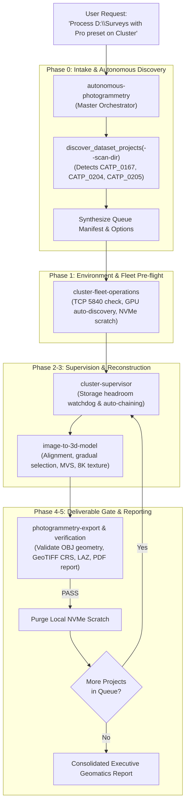

# Autonomous Photogrammetry Master Coordinator

Top-level meta-workflow and master orchestrator for end-to-end autonomous photogrammetry operations. Ingests raw survey photo folders, auto-discovers multi-project dataset topologies, structures unattended execution queues, coordinates distributed cluster workers or local GPUs, enforces storage exhaustion watchdogs, executes high-precision 3D reconstructions, validates deliverable integrity, and generates consolidated engineering summaries.

---

## When To Use

Use this skill as the **primary entry point** when:
- Starting, planning, or executing any photogrammetry request end-to-end from a folder of survey photos.
- Pointing the agent to a directory containing one or multiple survey project folders (e.g. `D:\Surveys` or `\\CLUSTER_SHARE\Captures`) without manually writing JSON queue manifests.
- Running lights-out, unattended overnight batch reconstructions across multiple projects.
- The user provides requirements (folder path, target outputs, mode: cluster vs. standalone, preset: `pro` vs. `building`) and expects complete autonomous execution.

Do not use this skill when:
- Deploying or updating worker nodes without processing datasets (use `skills/user/cluster-fleet-operations/`).
- Running a single-step format conversion from an existing `.psx` archive (use `skills/user/photogrammetry-export/`).
- Modifying or debugging internal unit tests (use `skills/developer/test-audit/`).

---

## Workflow

The Master Coordinator acts as the central brain orchestrating the 4 specialized domain skills:



### Phase 0: Intake & Autonomous Dataset Discovery
You provide the master coordinator with an input root directory. The coordinator automatically inspects the folder topology:

```powershell
# Auto-discover all datasets in a folder and preview queue without executing
python scripts/cluster_supervisor.py --scan-dir "\\CLUSTER_SHARE\Surveys" --output-root "\\CLUSTER_SHARE\Deliverables" --min-headroom-gb 50.0
```

- **Single Dataset Root**: If the root folder directly contains survey photos, it is queued as a single project.
- **Multi-Dataset Directory**: If subdirectories contain photos (e.g., `CATP_0167/`, `CATP_0204/`), each folder is queued as a discrete project named after the folder.
- **Excluded Folders**: Auxiliary folders (`model*`, `output*`, `deliverables*`, `temp*`, `__pycache__`) are automatically excluded.

### Phase 1: Environment & Mode Resolution
Resolve the operational mode based on user constraints:

1. **Distributed Network Cluster Mode** (Recommended for multi-workstation environments):
   - Delegates node health and GPU discovery to [cluster-fleet-operations](../cluster-fleet-operations/SKILL.md).
   - Engages independent worker locking (`--network-independent-workers`) to eliminate intermediate LAN sync pauses.
   - Command pattern:
     ```powershell
     python scripts/cluster_supervisor.py `
       --scan-dir "\\CLUSTER_SHARE\Surveys" `
       --output-root "\\CLUSTER_SHARE\Deliverables" `
       --network-enable `
       --network-host 192.168.1.100 `
       --network-independent-workers `
       --min-headroom-gb 50.0
     ```

2. **Standalone Workstation Mode** (Recommended for single-machine local NVMe execution):
   - Executes reconstruction directly on the local GPU with automatic NVMe scratch staging.
   - Command pattern:
     ```powershell
     python scripts/cluster_supervisor.py `
       --scan-dir "D:\Captures" `
       --output-root "D:\Deliverables" `
       --preset pro `
       --min-headroom-gb 30.0
     ```

### Phase 2: Storage Headroom Watchdog (Win32 Error 112 Defense)
Before dispatching each dataset, the coordinator executes the storage watchdog:
- Samples available free space on the output volume and local scratch volume.
- If free space drops below threshold (default: $50.0\text{ GB}$), pauses execution into `PAUSED_LOW_DISK` state, preventing cascading I/O corruptions.

### Phase 3: Autonomous Photogrammetry Reconstruction
Each project executes using the standardized **Production Geomatics (`pro`)** preset:
- High-accuracy camera alignment with guided matching and CMOS rolling shutter compensation.
- Gentle gradual selection tie-point filtering and camera parameter re-optimization.
- GPU MVS dense depth map stereopsis with moderate outlier filtering.
- 2,000,000 polygon arbitrary 3D surface mesh.
- 16-page 8K ($8192\times 8192$) texture atlas baking with ghosting removal.
- Digital Elevation Model (DEM) and True Orthomosaic generation.

### Phase 4: Automated Deliverable Integrity Gate
Upon pipeline completion, the coordinator verifies generated deliverables before marking success:
```powershell
python scripts/verify_deliverables.py --dir "\\CLUSTER_SHARE\Deliverables\CATP_0167" --expect obj dem ortho point_cloud report
```
- **OBJ & MTL**: Non-zero bytes, valid vertex/face polygons, and valid texture links.
- **GeoTIFF**: Valid TIFF/BigTIFF headers and CRS spatial tags.
- **Point Cloud**: LAZ/LAS/PLY size matches expected point density.
- **PDF Report**: Calibration report exists and exceeds $15\text{ KB}$.

### Phase 5: Scratch Purge & Executive Geomatics Summary
- Upon successful verification, the local NVMe staging folder `{project}_local_stage` is purged cleanly.
- The coordinator outputs a consolidated delivery matrix:

```text
========================================================================================
  AUTOMETASHAPE: CONSOLIDATED ENGINEERING & DELIVERY SUMMARY
========================================================================================
  Datasets Processed  : 3 / 3 Completed & Verified
  Total Duration      : 3.42 hours
  Storage Headroom    : 342.5 GB free on \\CLUSTER_SHARE\Storage

  PROJECT            PHOTOS   VERTICES / FACES     ORTHO RES    STATUS   DELIVERABLES
  --------------------------------------------------------------------------------------
  CATP_0167           1,420   1.02M / 2.00M        1.2 cm/px    PASS     OBJ, DEM, Ortho, PDF
  CATP_0204           2,150   1.04M / 2.00M        1.0 cm/px    PASS     OBJ, DEM, Ortho, PDF
  CATP_0205             890   0.98M / 1.95M        1.5 cm/px    PASS     OBJ, DEM, Ortho, PDF
========================================================================================
```

---

## Validation

Verify that the master orchestrator, discovery, and sub-skill bridges function seamlessly:

```powershell
# 1. Run supervisor and verification unit tests
python -m unittest tests/test_supervisor.py tests/test_verification.py

# 2. Run skills validation across the repository
python tools/skills/cli.py check

# 3. Test multi-project folder discovery CLI dry-run
python scripts/cluster_supervisor.py --help
```

---

## Maintenance

- **Subfolder Heuristics**: Update `SUPPORTED_IMAGE_EXTS` in `source/autometashape/cluster/supervisor.py` when adding new sensor formats (e.g., thermal raw).
- **Sub-Skill Synchronization**: When modifying parameters in `image-to-3d-model` or `cluster-fleet-operations`, ensure passthrough arguments in `discover_dataset_projects` remain synchronized.

---

## References

- Contributing guide: [CONTRIBUTING.md](../../../CONTRIBUTING.md)
- Photogrammetry Pipeline Skill: [skills/user/image-to-3d-model/SKILL.md](../image-to-3d-model/SKILL.md)
- Cluster Fleet Operations Skill: [skills/user/cluster-fleet-operations/SKILL.md](../cluster-fleet-operations/SKILL.md)
- Cluster Supervisor Skill: [skills/user/cluster-supervisor/SKILL.md](../cluster-supervisor/SKILL.md)
- Asset Export Skill: [skills/user/photogrammetry-export/SKILL.md](../photogrammetry-export/SKILL.md)
- Master Supervisor Engine: [source/autometashape/cluster/supervisor.py](../../../source/autometashape/cluster/supervisor.py)
- Evaluation Scenarios: [evaluations.md](evaluations.md)
