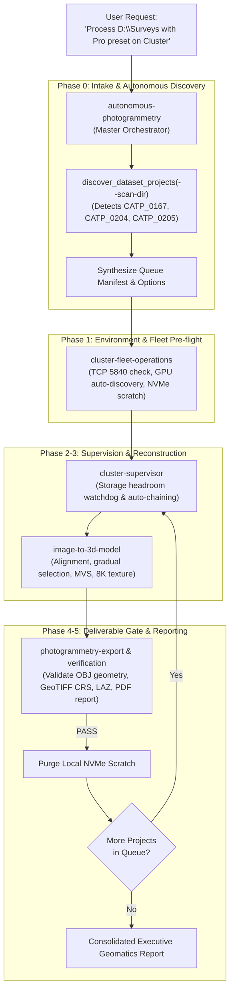

# Autonomous Photogrammetry Master Coordinator

Top-level meta-workflow and master orchestrator for end-to-end autonomous photogrammetry operations. Ingests raw survey photo folders, auto-discovers multi-project dataset topologies, structures unattended execution queues, coordinates distributed cluster workers or local GPUs, enforces storage exhaustion watchdogs, executes high-precision 3D reconstructions, validates deliverable integrity, and generates consolidated engineering summaries.

---

## When To Use

Use this skill as the **primary entry point** when:
- Starting, planning, or executing any photogrammetry request end-to-end from a folder of survey photos.
- Pointing the agent to a directory containing one or multiple survey project folders (e.g. `D:\Surveys` or `\\CLUSTER_SHARE\Captures`) without manually writing JSON queue manifests.
- Running lights-out, unattended overnight batch reconstructions across multiple projects.
- The user provides requirements (folder path, target outputs, mode: cluster vs. standalone, preset: `pro` default, `building` legacy alias, or `custom`) and expects complete autonomous execution.

Do not use this skill when:
- Deploying or updating worker nodes without processing datasets (use `skills/user/cluster-fleet-operations/`).
- Running a single-step format conversion from an existing `.psx` archive (use `skills/user/photogrammetry-export/`).
- Modifying or debugging internal unit tests (use `skills/developer/test-audit/`).

---

## Workflow

The Master Coordinator acts as the central brain orchestrating the 4 specialized domain skills:



### Phase 0: Intake & Autonomous Dataset Discovery
You provide the master coordinator with an input root directory. The coordinator automatically inspects the folder topology:

```powershell
# Auto-discover all datasets in a folder and execute the supervised queue (use --help to inspect options)
python scripts/cluster_supervisor.py --scan-dir "\\CLUSTER_SHARE\Surveys" --output-root "\\CLUSTER_SHARE\Deliverables" --min-headroom-gb 50.0
```

- **Single Dataset Root**: If the root folder directly contains survey photos, it is queued as a single project.
- **Multi-Dataset Directory**: If subdirectories contain photos (e.g., `CATP_0167/`, `CATP_0204/`), each folder is queued as a discrete project named after the folder.
- **Excluded Folders & Ingestion Hygiene**: Auxiliary output directories (`model`, `models`, `output`, `output_*`, `result`, `result_*`, `deliverables`, `temp`, `temp_*`, `tmp`, `tmp_*`, `__pycache__`, and stray `*.files` project directories) are automatically excluded without falsely skipping legitimate site names like `ModelHouse`, and exact duplicate images across nested subfolders are deduplicated automatically. Optional `--exclude-folders` remains available when operators explicitly wish to skip named subfolders, though close-range `Manual` orbits are natively supported by the 4-stage zero-neural alignment hygiene & Open3D ICP bridge.

### Phase 1: Environment & Mode Resolution
Resolve the operational mode based on user constraints:

1. **Distributed Network Cluster Mode** (Recommended for multi-workstation environments):
   - Delegates node health and GPU discovery to [cluster-fleet-operations](../cluster-fleet-operations/SKILL.md).
   - **Independent Project Mode (`--network-independent-workers`, `worker_limit=1`) & Local NVMe Scratch Staging (`--local-scratch-staging`) are ENABLED BY DEFAULT** across `submit_cluster_batch.py`, `cluster_supervisor.py`, and `metashape_reconstruction.py --network-enable` (strictly zero stage-by-stage fallback unless `--no-network-independent-workers` is passed).
   - Supports **Dual Shared Folder (Multi-SSD)** topologies (`--source-share` for read-only SSD #1 raw photos and `--result-share` for writable SSD #2 `.psx` + deliverables acting as Metashape `--root`):
     ```powershell
     python scripts/cluster_supervisor.py `
       --source-share "\\CLUSTER_SHARE\DataSSD_Surveys" `
       --result-share "\\CLUSTER_SHARE\ResultSSD_Deliverables" `
       --preset pro `
       --ortho-resolution 0.05 `
       --network-enable `
       --network-host 192.168.1.100 `
       --min-headroom-gb 50.0
     ```

2. **Standalone Workstation Mode** (Recommended for single-machine local NVMe execution):
   - Executes reconstruction directly on the local GPU with automatic NVMe scratch staging (`scripts/cluster_supervisor.py` auto-delegates via `metashape.exe -r` when run under plain Python and enables `obj`/`ortho` deliverable exports by default).
   - Supports both single-folder (`--scan-dir`) and Dual Shared Folder (`--source-share` / `--result-share --sequential`) topologies:
     ```powershell
     # Single-folder local execution:
     python scripts/cluster_supervisor.py `
       --scan-dir "D:\Captures" `
       --output-root "D:\Deliverables" `
       --preset pro `
       --min-headroom-gb 30.0

     # Dual Shared Folder local sequential execution (read-only SSD #1 -> writable SSD #2):
     python scripts/cluster_supervisor.py `
       --source-share "\\CLUSTER_SHARE\DataSSD_Surveys" `
       --result-share "\\CLUSTER_SHARE\ResultSSD_Deliverables" `
       --preset pro `
       --ortho-resolution 0.05 `
       --sequential `
       --min-headroom-gb 50.0
     ```

### Phase 2: Storage Headroom Watchdog (Win32 Error 112 Defense)
Before dispatching each dataset, the coordinator executes the storage watchdog:
- Samples available free space on the output volume and local scratch volume.
- If free space drops below threshold (default: $50.0\text{ GB}$), pauses execution into `PAUSED_LOW_DISK` state, preventing cascading I/O corruptions.

### Phase 3: Autonomous Photogrammetry Reconstruction
Each project executes using the standardized **Production Geomatics (`pro`)** preset:
- High-accuracy camera alignment (`keypoint_limit=50,000`, `tiepoint_limit=40,000`, `keypoint_limit_per_mpx=2,000`) with guided matching, sensor-aware shutter physics (including DJI Air 3S `FC9113`), and **`k4 = b1 = b2 = 0` / `adaptive_fitting = False` hard-locked** across all passes.
- **4-Stage Zero-Neural Alignment Hygiene & Open3D ICP Bridge** (`--alignment-hygiene`, `--icp-bridge`, enabled by default): neutralizes Null-Island/`> 5 km` GPS outliers, applies folder- and time-agnostic `TakeoffZ0` barometer datum normalization (1D gap clustering + idempotent `Z = ref_z0 + RelativeAltitude`, preserving RTK Fixed flights), audits the `pt.valid`-filtered tie graph (`edge >= 15`) with Tarjan 1-edge weak-hinge cutting and neighbor-continuity GPS-spike protection, isolates coherent sub-islands inside every aligned candidate and `_ICP_Rescue` chunk (`_isolate_coherent_sub_islands()`), and fuses disconnected overlapping orbits via portable offline CPU Open3D Sim(3) Point-to-Plane + gated Colored ICP under a strict Pre-MVS Quality Gate (`fitness_15cm >= 35%`, `MedErr <= 10 cm`, `0.90 <= scale <= 1.10`, `tilt <= 5°`, `|k4| < 0.05`).
- USGS 4-Pass gradual selection tie-point filtering (`RU <= 15.0`, `PA <= 3.0`, `RE <= 0.50`, `Rays >= 2`, `<= 10%/pass`) and camera parameter re-optimization with `k4=b1=b2=0` locked.
- GPU MVS dense depth map stereopsis with moderate outlier filtering (dense point cloud disabled by default in `pro`; opt-in via `--build-point-cloud`).
- 2,000,000 polygon arbitrary 3D surface mesh.
- Deterministic 16-page 8K ($16 \times 8192\times 8192$) texture atlas baking with mosaic blending and ghosting removal (reusing existing Metashape 2.2.2 `BuildUV/page_count` atlases on `--resume`).
- True Orthomosaic built and exported at **5 cm/px (`0.05 m/px`)** by default (customizable via `--ortho-resolution`), plus optional DEM (`--build-dem`).

### Phase 4: Automated Deliverable Integrity Gate
Upon pipeline completion, the coordinator verifies generated deliverables before marking success (default `pro` assets: `obj` and `ortho`; include `dem`, `point_cloud`, or `report` when explicitly enabled):
```powershell
python scripts/verify_deliverables.py --dir "\\CLUSTER_SHARE\ResultSSD\CATP_0167" --expect obj ortho
```
- **OBJ & MTL**: Non-zero bytes, valid vertex/face polygons, and valid texture links.
- **GeoTIFF**: Valid TIFF/BigTIFF headers and CRS spatial tags (5 cm/px default metric orthomosaic).
- **Point Cloud (Opt-In)**: LAZ/LAS/PLY size matches expected point density when `--build-point-cloud --export-point-cloud` is enabled.
- **PDF Report (Opt-In)**: Calibration report exists and exceeds $15\text{ KB}$ when `--export-report` is enabled.
- **Post-Completion 3D Geometric Audit (Recommended for Production Batches)**: Because file-level deliverable verification (`PASS`) can still mask subtle geometric defects (double-shell ghost roofs, detached ICP rescue fragments, mixed multi-site folders, or over-pruned coverage gaps), run the read-only forensic audit protocol in [skills/user/photogrammetry-forensic-audit/SKILL.md](../photogrammetry-forensic-audit/SKILL.md) across finished `.psx` projects before final sign-off.

### Phase 5: Scratch Purge & Executive Geomatics Summary
- Upon successful verification, the PID+hash-isolated local NVMe staging folder `{project}_{hash}_{pid}_local_stage` is synced atomically (`.files` sibling swap, `.psx` published last) and purged cleanly.
- The coordinator outputs a consolidated delivery matrix:

```text
========================================================================================
  AUTOMETASHAPE: CONSOLIDATED ENGINEERING & DELIVERY SUMMARY
========================================================================================
  Datasets Processed  : 3 / 3 Completed & Verified
  Total Duration      : 3.42 hours
  Storage Headroom    : 342.5 GB free on \\CLUSTER_SHARE\ResultSSD

  PROJECT            PHOTOS   VERTICES / FACES     ORTHO RES    STATUS   DELIVERABLES
  --------------------------------------------------------------------------------------
  CATP_0167           1,420   1.02M / 2.00M        5.0 cm/px    PASS     OBJ, Ortho
  CATP_0204           2,150   1.04M / 2.00M        5.0 cm/px    PASS     OBJ, Ortho
  CATP_0205             890   0.98M / 1.95M        5.0 cm/px    PASS     OBJ, Ortho
========================================================================================
```

---

## Validation

Verify that the master orchestrator, discovery, and sub-skill bridges function seamlessly:

```powershell
# 1. Run supervisor, verification, alignment hygiene, and ICP bridge unit tests
python -m unittest tests/test_supervisor.py tests/test_verification.py tests/test_alignment_hygiene.py tests/test_icp_bridge.py tests/test_exclude_folders.py

# 2. Run skills validation across the repository
python tools/skills/cli.py check

# 3. Test multi-project folder discovery CLI dry-run
python scripts/cluster_supervisor.py --help
```

---

## Maintenance

- **Subfolder Heuristics**: Update `SUPPORTED_IMAGE_EXTS` in `source/autometashape/core/telemetry.py` when adding new sensor formats (e.g., thermal raw).
- **Sub-Skill Synchronization**: When modifying parameters in `image-to-3d-model` or `cluster-fleet-operations`, ensure passthrough arguments in `discover_dataset_projects` remain synchronized.

---

## References

- Contributing guide: [CONTRIBUTING.md](../../../CONTRIBUTING.md)
- Photogrammetry Pipeline Skill: [skills/user/image-to-3d-model/SKILL.md](../image-to-3d-model/SKILL.md)
- Cluster Fleet Operations Skill: [skills/user/cluster-fleet-operations/SKILL.md](../cluster-fleet-operations/SKILL.md)
- Cluster Supervisor Skill: [skills/user/cluster-supervisor/SKILL.md](../cluster-supervisor/SKILL.md)
- Asset Export Skill: [skills/user/photogrammetry-export/SKILL.md](../photogrammetry-export/SKILL.md)
- Photogrammetry Forensic Audit Skill: [skills/user/photogrammetry-forensic-audit/SKILL.md](../photogrammetry-forensic-audit/SKILL.md)
- Master Supervisor Engine: [source/autometashape/cluster/supervisor.py](../../../source/autometashape/cluster/supervisor.py)
- Evaluation Scenarios: [evaluations.md](evaluations.md)
