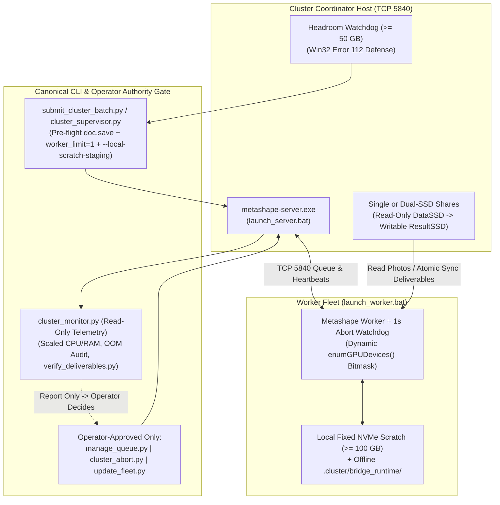
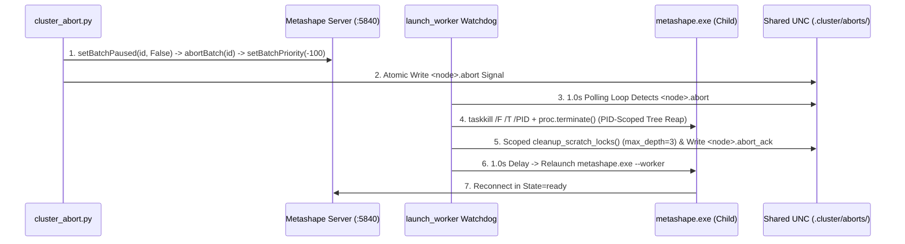

# Distributed Processing Cluster, Fleet Operations & Supervision

Canonical operational runbook for Agisoft Metashape Professional distributed processing clusters. Unifies server/worker provisioning, dynamic discrete GPU bitmask probing, local NVMe scratch staging, portable offline Open3D bridge provisioning, canonical batch dispatch (`submit_cluster_batch.py`, `cluster_supervisor.py`), storage headroom watchdogs (Win32 Error 112 defense), read-only telemetry under the Operator Authority Gate (`cluster_monitor.py`, `manage_queue.py`), deliverable integrity gates (`verify_deliverables.py`), signal-based worker aborts (`cluster_abort.py`), and canary/selective remote fleet updates (`update_fleet.py`).

---

## When To Use

Use this skill when:
- Deploying or starting the central Cluster Coordinator Server (`launch_server.bat`) or remote worker nodes (`launch_worker.bat`, `worker_config.json`) across single-share or Dual-SSD topologies.
- Diagnosing TCP port 5840 reachability, UNC share permissions, dynamic GPU bitmask probing (`enumGPUDevices()`), local NVMe scratch staging, or offline `.cluster/bridge_runtime/` Open3D provisioning.
- Submitting single or multi-dataset cluster batches (`scripts/submit_cluster_batch.py`, `scripts/cluster_supervisor.py`) with pre-flight `.psx` materialization, `--start-paused` staging, or hidden `.cluster/tickets/` failover.
- Monitoring multi-hour cluster telemetry, storage headroom (`>= 50 GB`, Win32 Error 112 defense), passive `std::bad_alloc` / OOM audits, and deliverable integrity (`scripts/verify_deliverables.py`) in strict read-only reporting mode under the **Operator Authority Gate**.
- Executing operator-authorized queue/worker controls (`scripts/manage_queue.py`), signal-based worker aborts (`scripts/cluster_abort.py`), targeted GUI `.files/lock` PID forensics, or canary/selective remote fleet updates (`scripts/update_fleet.py`).

Do not use this skill when:
- Executing standalone local photogrammetry physics/reconstruction without cluster orchestration (use `skills/user/image-to-3d-model/`).
- Performing standalone format conversion or texture re-baking from an existing `.psx` (use `skills/user/photogrammetry-export/`).
- Running deep read-only post-completion 3D geometric/alignment/coverage audits on finished `.psx` archives (use `skills/user/photogrammetry-forensic-audit/`).
- Auto-aborting batches, modifying priorities, or altering cluster queues without explicit, real-time operator permission (strictly prohibited by the Operator Authority Gate).

---

## Workflow



### 1. Cluster Server & Worker Node Provisioning

1. **Coordinator Server**: Verify UNC share read/write access and TCP port 5840 firewall rule, then start the server:
   ```powershell
   .\launch_server.bat --port 5840 --root "\\HOST_PC\ResultSSD"
   Test-NetConnection -ComputerName 127.0.0.1 -Port 5840
   ```
2. **Unattended Worker Provisioning (`worker_config.json`)**: Supports single-share or Dual-SSD topologies (`source_root` = read-only SSD #1 raw photos; `root` = writable SSD #2 Result Share anchored as Metashape `--root`):
   ```json
   {
     "host": "10.5.10.202",
     "port": "5840",
     "root": "\\\\HOST_PC\\ResultSSD",
     "source_root": "\\\\HOST_PC\\DataSSD",
     "cpu_enable": 1
   }
   ```
   ```powershell
   .\launch_worker.bat --non-interactive --result-share "\\HOST_PC\ResultSSD" --source-share "\\HOST_PC\DataSSD"
   ```
3. **Built-In Pre-Flight Diagnostics & Dynamic GPU Bitmask Probing**:
   - Locates `metashape.exe` across `%ProgramFiles%` and drives `C:`–`G:`, verifies TCP 5840 and SMB shares, and auto-reconnects every 10 s on disconnect.
   - **Dynamic Metashape Discrete GPU Bitmask (`probe_metashape_gpu_mask()`)**: When `--gpu-mask` is omitted or `"Auto"`, `scripts/launch_worker.py` queries `Metashape.app.enumGPUDevices()` (`source/autometashape/cluster/hardware.py`) to select discrete GPUs while excluding Intel UHD/HD/Iris/Core Ultra Arc iGPUs, AMD 610M–890M/Vega APUs, and software renderers. For example, `[0] Intel Graphics, [1] NVIDIA RTX` dynamically computes `1 << 1 = 2` (`0b10` -> `GPU=2` in telemetry), single-GPU hosts compute `1`, dual-GPU hosts compute `3` or `6`, and CPU-only hosts compute `0` — never hardcoded. Overrides poisoned `HKCU` Registry `gpu_mask=0` or mixed `4294967295`. Explicit overrides (`--gpu-mask <N>`) persist `"gpu_mask_explicit": true`.

### 2. Local NVMe Scratch Staging, Independent Mode & Offline Open3D Bridge Runtime

1. **Canonical Cluster Defaults (Both Enabled by Default)**:
   - **Independent Project Mode (`--network-independent-workers`, `worker_limit=1`)**: Each project runs atomically on 1 dedicated worker (zero worker hopping or SMB stage syncs; opt out via `--no-network-independent-workers --sequential` only for centralized stage-by-stage distribution on a single mega-survey).
   - **Local NVMe Scratch Staging (`--local-scratch-staging` / `--stage-local`)**: Workers automatically select the fastest internal fixed non-system NVMe/SATA volume with `>= 100 GB` free (`--min-scratch-free-gb`), rejecting mapped network drives (`DRIVE_REMOTE`), removable media, and external USB/FireWire/SD/MMC enclosures (`BusTypeUsb`), and safely falling back to direct network output when local headroom is below threshold. Only pass `--no-local-scratch-staging` for standalone host-pinned runs.
2. **Staged PSX Chunk-ID Reconciliation & Atomic Deliverable Sync**: Before replacing `.files/` on Result Share, `reconcile_staged_psx_chunk_id()` aligns single ICP-merged chunk directories (e.g. `3/` -> `0/`) with the shared `.psx` stub (`project.zip/doc.xml`) so post-`RunScript` commits never trigger `Can't open file: .../0/chunk.zip`. Deliverables sync atomically, `_autometashape_status.json` finalizes `status="completed"` (`progress=100.0`), and PID+hash-isolated local scratch is purged cleanly.
3. **Portable Offline Open3D Bridge Runtime (`.cluster/bridge_runtime/`)**:
   - Supports Stage-4 Zero-Neural CPU Open3D Sim(3) ICP (`source/autometashape/core/icp_bridge.py` + `icp_worker.py`) on bare workers with **no system Python, no PyTorch, no CUDA toolkit, no admin rights, and no internet**.
   - `<root>/.cluster/bridge_runtime/manifest.json` + SHA-256-verified `bridge_runtime_win_amd64_v1.zip` (~107 MB) auto-provisions once into `%LOCALAPPDATA%\AutoMetashape\bridge_runtime_v<version>` on the first project needing ICP (0 s overhead for single-block projects).
   - `_clean_bridge_env()` strips Metashape DLL paths from `PATH` and clears `PYTHONHOME`/`PYTHONPATH`; Stage-0 clouds enforce 4 cm uniform spacing (`points_spacing=0.04` for 32 GB RAM safety) written strictly to `%TEMP%\autometashape_icp_*` (outside `local_staging_dir`, auto-pruned after 24 h).

### 3. Canonical Batch Submission, Multi-Dataset Chaining & Checkpoint Resolution

Never compose ad-hoc dispatch scripts in chat or scratch directories — strictly use canonical scripts under `scripts/`:

1. **Single-Project Canonical Dispatch (`scripts/submit_cluster_batch.py`)**:
   - **Pre-Flight Physical Materialization Invariant**: Validates images, saves `<project>.psx` on Result Share, verifies `os.path.isfile(psx_path)`, releases locks via `doc.clear()`, and dispatches through idempotent `safe_create_cluster_batch()`.
   - Defaults to `pro` preset (`50K` keypoints, `40K` tiepoints, `2K/MPx`, `k4=b1=b2=0`, 16×8K textures, 5 cm/px ortho, dense point cloud opt-in), `worker_limit=1`, `local_scratch=True`, and all folders included (natively bridging `Manual/` via hygiene + Open3D ICP; optional `--exclude-folders` includes a legacy-worker shim).
   - **Staged Pausing**: Pass `--start-paused` to hold newly queued batches behind a pending remote fleet update until all target workers reboot onto the new commit.
   - **Hidden `.cluster/tickets/` Recovery**: Always submits the canonical `<project>.psx` (attaching safely unless `--force` is passed). If Metashape Server 2.2.2 retains an un-evictable hard-killed aborted batch key (`Duplicate batch`), `safe_create_cluster_batch()` automatically dispatches via `<root>/.cluster/tickets/<slug>_<ts>_<pid>.psx` + `.ticket.json` — keeping `Result/<project>/` spotless without `_dispatch_*.psx` stubs while `cluster_monitor.py` resolves the real deliverable folder.
   ```powershell
   python scripts/submit_cluster_batch.py `
       --images "\\HOST_PC\DataSSD\Survey_0167" `
       --output "\\HOST_PC\ResultSSD\Survey_0167" `
       --root "\\HOST_PC\ResultSSD" `
       --preset pro --ortho-resolution 0.05 --priority 50
   ```
2. **Multi-Dataset Auto-Discovery & Queue Chaining (`scripts/cluster_supervisor.py`)**:
   - Auto-discovers projects from `--scan-dir`, Dual-SSD (`--source-share` + `--result-share`), or a JSON manifest (`--manifest queue.json`), automatically skipping auxiliary output folders (`model`, `output`, `result`, `temp`, `*.files`).
   - Supports **Mode 2 (Independent Concurrent, default with `--network-enable`)** and **Mode 1 (Centralized / Local Sequential via `--sequential` / `--no-concurrent`)**.
   - **Metashape 2.2.2 Infinite-Retry Defense**: Respects operator-paused workers passively, rejects zombie `error_count > 0` batches, and aborts errored tasks stuck in `state="inprogress"` with `error_count > 0`.
   ```powershell
   python scripts/cluster_supervisor.py `
       --source-share "\\HOST_PC\DataSSD\Batch_A" `
       --result-share "\\HOST_PC\ResultSSD\Batch_A" `
       --preset pro --ortho-resolution 0.05 --min-headroom-gb 50.0 `
       --network-enable --network-host 10.5.10.202
   ```
3. **Hardened Checkpoint Resolution (`resolve_checkpoint_chunk(doc)`)**: On `--resume`, selects `Production_Reconstruction` first, falls back to the chunk with the highest aligned enabled camera count (`>= 2` skips alignment; `< 2` starts fresh cleanly).

### 4. Read-Only Telemetry, Headroom Watchdog & The Operator Authority Gate

**Core Invariant**: Agents and supervisors operate strictly as **Read-Only Telemetry Reporters**. All queue alterations, aborts, priority shifts, worker pauses, and setting changes **lie exclusively with the human operator**.

1. **Canonical Read-Only Cluster Monitor** *(use `--server`, not `--host`)*:
   ```powershell
   python scripts/cluster_monitor.py --server 10.5.10.202 --result-share "\\HOST_PC\ResultSSD" --source-share "\\HOST_PC\DataSSD"
   ```
   - Reports accurate scaled CPU % and RAM GB from Metashape 2.x `workerList()` (`(memory_usage / 100.0) * memory_size`), with **no artificial RAM warning guard** and passive post-mortem `std::bad_alloc` / OOM auditing.
   - Strictly isolates read-only `--source-share` from deliverable/sidecar checks and skips internal `.cluster/` maintenance batches.
2. **Storage Headroom Watchdog (Win32 Error 112 Defense)**:
   - Minimum safe free space: **50.0 GB** on the writable Result Share (`check_storage_headroom(path, 50.0)`). Below 50 GB, `cluster_supervisor.py` holds new dispatches in `PAUSED_LOW_DISK` and alerts the operator immediately rather than risking `ERROR_DISK_FULL` corruption.
3. **Deliverable Integrity & Checkpoint Gates**:
   ```powershell
   python scripts/verify_deliverables.py --dir "\\HOST_PC\ResultSSD\Survey_0167" --expect obj ortho
   python scripts/inspect_checkpoint.py --project "\\HOST_PC\ResultSSD\Survey_0167\Survey_0167.psx"
   ```
   - `verify_deliverables.py` checks OBJ size/vertices/faces + MTL/`map_Kd` textures, GLB `b'glTF'`, GeoTIFF/BigTIFF headers, LAZ/LAS/PLY headers (`>= 50 KB`), and PDF `%PDF` (`>= 15 KB`).
   - For deep **3D geometric quality audits** (double-shells, detached ICP fragments, mixed multi-site folders, coverage gaps), invoke [skills/user/photogrammetry-forensic-audit/SKILL.md](../photogrammetry-forensic-audit/SKILL.md).
4. **Operator Authority Gate & Canonical Queue Controls (`scripts/manage_queue.py`)**:
   Observe & Report -> Propose Action -> Await Operator Decision -> Execute Canonical CLI:
   ```powershell
   python scripts/manage_queue.py list --server 10.5.10.202
   python scripts/manage_queue.py pause --batch 12
   python scripts/manage_queue.py unpause --batch 12
   python scripts/manage_queue.py set-priority --batch 29 --priority 100
   python scripts/manage_queue.py abort --batch 58 --demote-priority -100
   python scripts/manage_queue.py pause-worker --hostname CTUAV
   python scripts/manage_queue.py unpause-worker --hostname CTUAV
   python scripts/manage_queue.py clear-worker --worker-id 14 --only-aborted
   python scripts/manage_queue.py set-worker-gpu-mask --hostname CTUAV --gpu-mask 2
   ```
   - **Prohibitions**: Zero uncommanded aborts/mutations, zero silent quality degradation, zero script-side node affinity rejection (`if COMPUTERNAME != target: sys.exit(2)` causes priority thrashing), and zero ad-hoc queue mutation scripts.

### 5. Host-Initiated Autonomous Worker Fleet Update Protocol

1. **Governance Rules**:
   - **Zero Blind Fleet Kills**: Never push unverified updates across all nodes simultaneously. Validate **ONE canary worker** first (`inprogress -> offline -> ready` within 30–60 s) before staggered rollout.
   - **Coordinator Exemption & Selective Remote-Only Rollouts**: Exclude the coordinator host from remote updates. When the coordinator runs directly from the local Git working tree or holds a multi-hour mega-project, update remote nodes individually (`--node <host>`) instead of `--node all`, stage new batches with `submit_cluster_batch.py --start-paused`, confirm all remote workers reboot on the new commit, and then unpause via `manage_queue.py unpause`.
   - **Canonical Directory & Zero-OS-Python Invariants**: `%USERPROFILE%\Documents\AutoMetashape` is the only permissible fixed local path on workers; `launch_worker.bat` and `reexec_supervisor` run strictly on Metashape's bundled Python without requiring Git or system Python on remote workers.
2. **Fleet Updater CLI (`scripts/update_fleet.py` / `update_fleet.bat`)**:
   ```powershell
   .\update_fleet.bat --list
   .\update_fleet.bat --root "\\HOST_PC\ResultSSD" --node canary
   .\update_fleet.bat --root "\\HOST_PC\ResultSSD" --node Admin-pc          # default --force
   .\update_fleet.bat --root "\\HOST_PC\ResultSSD" --node Admin-pc --safe   # skip if busy
   .\update_fleet.bat --root "\\HOST_PC\ResultSSD" --node all
   .\update_fleet.bat --root "\\HOST_PC\ResultSSD" --node Admin-pc --no-restart
   ```
3. **Decoupled Handshake, Watchdog-First Force Abort & Stale-ID Recovery**:
   - **Watchdog-First `--force` Abort**: Aborts only the target worker's active `batch_id` and dispatches `dispatch_abort_signal(node_name=..., shared_root=...)` **before** `quitWorker` so C++ `RunScript`-blocked workers cleanly reap while unrelated workers keep running.
   - **Per-Worker Maintenance Isolation**: Uses distinct `.cluster/maintenance_<slug>.psx` archives (real ZIP `project.zip/doc.xml`, `doc.clear()`, `worker_limit=1`), pauses non-target workers during `<50 ms` `.update_pending` signal registration, and restores all workers in a guaranteed `finally` block.
   - **ZIP-Parity Mirror & Clean Re-Exec**: On child exit, `launch_worker.py` pulls `.cluster/update_payload.zip` (verified via `testzip()`, falling back to GitHub `main.zip`), mirrors files while preserving `worker_config.json`, `server_config.json`, `.agents/`, logs, and signal files, then re-execs cleanly (`subprocess.run` + `sys.exit` on Windows; `os.execv` on POSIX) with fresh GPU probing.
   - **Stale Worker-ID `.update_pending` Recovery**: If a worker double-restarts during abort and `update_fleet.py` reports a restart-confirmation timeout (`Can't quit worker` on stale ID), `.update_pending` remains staged on disk. Check the worker's fresh ID and active batch, then run operator-approved `scripts/cluster_abort.py --node <name> --batch <active_bid> --root <share>` so `launch_worker.py` recycles the worker and applies `.update_pending`.

### 6. Signal-Based Worker Abort, GUI Lock Forensics & Self-Healing Watchdog

When a monolithic `RunScript` task hangs in native C++ CUDA/MVS code or a paused batch freezes Metashape Server's scheduler, execute operator-authorized signal-based abort:



1. **Zero Host-Wide Taskkill & Targeted GUI `.files/lock` Forensics**: Never execute `taskkill /IM metashape.exe` (it kills dual-role coordinator/worker processes). When an interactive Metashape GUI holds `.files/lock`, inspect exact window titles via `tasklist /V /FI "IMAGENAME eq metashape.exe" /FO LIST` and terminate ONLY the specific GUI PID (`taskkill /F /T /PID <pid>`). Remote nodes are signaled strictly via atomic UNC `.abort` files.
2. **Scoped Lock Cleanup & Single-Kill Ack**: `cleanup_scratch_locks()` cleans locks strictly inside Metashape/AutoMetashape project and scratch directories (`max_depth=3`); `acknowledge_abort_signal()` removes both `<node>.abort` and the matching `.cluster/abort_signals.json` entry so workers never double-kill.
3. **Operator-Authorized Abort CLI** *(auto-routes through `metashape.exe -r`)*:
   ```powershell
   .\cluster_abort.bat --node DESKTOP-IFA3707 --batch 3 --server 10.5.10.202:5840 --root "\\HOST_PC\ResultSSD"
   ```

---

## Validation

```powershell
# 1. Validate skill architecture and governance rules
python tools/skills/cli.py check

# 2. Audit license compliance
python tools/check_licenses.py

# 3. Execute full cluster, supervisor, verification, dual-share, and hygiene/ICP test suites
python -m unittest tests/test_cluster_utils.py tests/test_cluster_dispatch.py tests/test_cli_args.py tests/test_fleet_updater.py tests/test_worker_abort.py tests/test_supervisor.py tests/test_verification.py tests/test_checkpoint_loader.py tests/test_dual_share.py tests/test_audit_regressions.py tests/test_alignment_hygiene.py tests/test_icp_bridge.py tests/test_exclude_folders.py

# 4. Verify canonical CLI entry points
python scripts/submit_cluster_batch.py --help
python scripts/cluster_monitor.py --help
python scripts/verify_deliverables.py --help
```

---

## Maintenance

- Audit Metashape `NetworkClient` compatibility, `workerList()` scaling, and `enumGPUDevices()` GPU probing on each Metashape Pro release.
- Keep `worker_config.json` backward-compatible across deployed worker fleets and extend `verify_project_deliverables` in `source/autometashape/core/verification.py` when adding new export formats.
- Tune `min_headroom_gb` (default `50.0 GB`) and `--min-scratch-free-gb` (default `100.0 GB`) as dataset sizes scale.

---

## References

- Contributing guide & Operator Authority Gate: [CONTRIBUTING.md](../../../CONTRIBUTING.md)
- Cluster supervisor & dispatch engine: [source/autometashape/cluster/supervisor.py](../../../source/autometashape/cluster/supervisor.py)
- Deliverable verification engine: [source/autometashape/core/verification.py](../../../source/autometashape/core/verification.py)
- Image-to-3D model skill: [skills/user/image-to-3d-model/SKILL.md](../image-to-3d-model/SKILL.md)
- Photogrammetry forensic audit skill: [skills/user/photogrammetry-forensic-audit/SKILL.md](../photogrammetry-forensic-audit/SKILL.md)
- Asset export skill: [skills/user/photogrammetry-export/SKILL.md](../photogrammetry-export/SKILL.md)
- Benchmark evaluation suite: [evaluations.md](evaluations.md)
