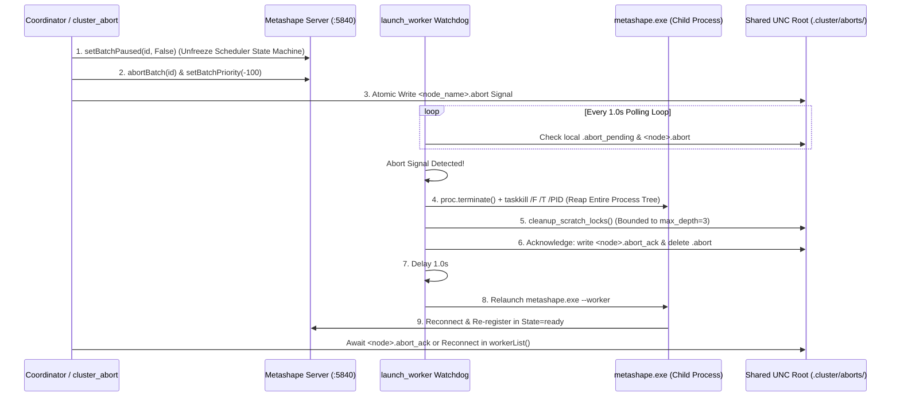

# Distributed Processing Cluster & Autonomous Fleet Operations

Comprehensive operational runbook and architectural standard for provisioning, orchestrating, monitoring, and updating Agisoft Metashape Professional distributed processing clusters. Covers cluster server daemons, worker node provisioning with pre-flight TCP/UNC diagnostics, dynamic native multi-GPU discovery, local NVMe scratch staging, continuous autonomous health audits, and zero-touch canary fleet update protocols.

---

## When To Use

Use this skill when:
- Deploying or starting the central Cluster Coordinator Server (`metashape-server.exe`) on a LAN host.
- Provisioning or starting remote worker nodes (`launch_worker.bat`) across workstation fleets.
- Configuring unattended worker provisioning via `worker_config.json` with zero-touch automation.
- Diagnosing network reachability (TCP port 5840), shared UNC storage path access, or GPU device discovery.
- Managing Local NVMe Scratch Staging (`--stage-local` / `--local-scratch-staging`) to eliminate SMB network congestion and Win32 Error 112 (`ERROR_DISK_FULL`).
- Executing the Autonomous 1-Hour Health & Self-Healing Monitoring Cycle for multi-hour cluster reconstructions.
- Performing rolling fleet updates (`update.bat`) across remote worker nodes using the Single Canary Node Verification Gate.
- Troubleshooting worker state transitions (`inprogress -> offline -> ready`), stalled tasks, or network disconnects.
- Forcibly aborting hung worker processes during monolithic tasks, purging scratch locks, and orchestrating self-healing worker reconnects without server scheduler deadlocks.

Do not use this skill when:
- Performing single-node local photogrammetry reconstructions without network distribution (use `skills/user/image-to-3d-model/`).
- Exporting, format converting, or baking deliverables from an existing project archive (use `skills/user/photogrammetry-export/`).

---

## Workflow

```mermaid
flowchart TD
    subgraph Host_Coordinator["Cluster Coordinator Host (e.g. SERVER / 192.168.1.100)"]
        ServerProc["metashape-server.exe\n(TCP 5840 Control Daemon)"]
        SharedStorage["Shared UNC Root (\\\\HOST\\SharedMetashape)"]
        StatusSidecar["_autometashape_status.json\n(Milestone IPC Telemetry)"]
    end

    subgraph Remote_Worker_Fleet["Remote Worker Fleet (Nodes: tan, RJUQ6L8, etc.)"]
        WorkerProc["Metashape Worker Daemon\n(launch_worker.bat)"]
        LocalScratch["Local Fast Scratch NVMe\n(C:\\AutoMetashape_Scratch or D:\\)"]
        DiscreteGPU["Discrete RTX GPUs\n(Native C++ Discovery)"]
    end

    ServerProc <-->|TCP 5840 Task Queue & Heartbeats| WorkerProc
    SharedStorage -->|Read Photo Assets & Project Files| WorkerProc
    WorkerProc <-->|High-Speed NVMe I/O (75+ GB Temp Leaves)| LocalScratch
    WorkerProc <-->|CUDA Kernels| DiscreteGPU
    WorkerProc -->|Atomic Write on Stage Completion| SharedStorage
    WorkerProc -->|Push Real-Time Sidecar Events| StatusSidecar
```

### 1. Cluster Coordinator Server Provisioning
On the Coordinator workstation hosting the shared network storage:
1. Verify network share accessibility via UNC format (`\\HOST_PC\SharedMetashape`).
2. Launch the cluster coordinator server daemon:
   ```powershell
   .\launch_server.bat --port 5840 --root "\\HOST_PC\SharedMetashape"
   ```
3. Confirm server listening state:
   ```powershell
   Test-NetConnection -ComputerName 127.0.0.1 -Port 5840
   ```

### 2. Worker Node Provisioning & Pre-Flight Diagnostics
On each remote worker node across the local network:
1. Interactive Launch with Guided Wizard (stores `worker_config.json`):
   ```powershell
   .\launch_worker.bat
   ```
2. Unattended / Headless Deployment:
   Place `worker_config.json` in the AutoMetashape root directory:
   ```json
   {
     "host": "10.2.8.43",
     "port": "5840",
     "root": "\\\\HOST_PC\\SharedMetashape",
     "cpu_enable": 1
   }
   ```
   Execute non-interactively:
   ```powershell
   .\launch_worker.bat --non-interactive
   ```
3. Pre-Flight Diagnostics Built-in:
   - Validates Metashape Pro executable across `%ProgramFiles%` and all drives `C:`, `D:`, `E:`, `F:`, `G:`.
   - Tests TCP port reachability to server host.
   - Tests Shared UNC storage directory access and read/write permissions.
   - **Native Multi-GPU Discovery**: When `--gpu-mask` is omitted or `"Auto"` (default), Metashape Pro dynamically discovers, benchmarks, and engages all discrete GPUs natively, bypassing integrated graphics.
   - **Auto-Reconnect Daemon**: Automatically reconnects every 10s if the coordinator restarts or network fluctuates.

### 3. Local NVMe Scratch Staging Management
During large-scale reconstructions (1,000+ to 10,000+ photos), intermediate scratch data (depth maps, point clouds, and octree meshing leaves) reaches 75–150+ GB.
- **Default Staging**: Enabled by default (`--stage-local`).
- **Dynamic NVMe Discovery**: The worker daemon automatically discovers the fastest non-system NVMe SSD with the highest free capacity (e.g., `D:\AutoMetashape_Scratch`).
- **Headroom Fallback**: Requires $\ge 100\text{ GB}$ free space (configurable via `--min-scratch-free-gb`). Safely falls back to direct network storage if local space is insufficient.
- **Atomic Deliverable Sync**: Consolidated deliverables and project files are synchronized atomically to the central network share upon completion, and local scratch is cleanly purged.
- **Opt-Out**: Pass `--no-stage-local` to bypass local staging.

### 4. Autonomous 1-Hour Monitoring & Self-Healing Protocol
For multi-hour cluster runs, execute the continuous monitoring cycle:
1. **Telemetry & Milestone Inspection**:
   ```python
   import Metashape

   client = Metashape.NetworkClient()
   client.connect("127.0.0.1:5840")
   workers = client.workerList()
   batches = client.batchList()
   ```
2. **Sidecar Inspection**: Read `_autometashape_status.json` from the shared output directory.
3. **Structured Hourly Status Reporting**:
   - Active Batches: Current stage, subtask completion %, elapsed time, ETA.
   - Worker Health: Active/idle states, GPU utilization, memory usage.
   - Deliverables: Verified files on disk (`.obj`, `.glb`, `orthomosaic.tif`).
4. **Self-Healing Diagnostics**:
   - *Dropped Worker*: Ping host, alert user, or trigger daemon restart.
   - *Stalled Task (>45m 0% progress)*: Trigger safe checkpoint resume.
   - *Storage Latency / Access Drops*: Audit SMB UNC path connectivity.

> [!IMPORTANT]
> **Strict Non-Destructive Code Governance Boundary**:
> - Permitted: Network reconnection, daemon restarts, batch retry via `--resume`, lockfile cleanup, and structured progress reporting.
> - Strictly Prohibited: Never autonomously rewrite, mutate, refactor, or modify core reconstruction code or pipeline scripts during monitoring runs without explicit user authorization.

### 5. Host-Initiated Autonomous Worker Fleet Update Protocol
When maintaining or upgrading remote cluster worker nodes from the Coordinator host:
1. **Zero Fleet-Wide Blind Kills**: Never kill or push updates across all nodes simultaneously.
2. **Single Canary Node Verification Gate**:
   - Dispatch update probe to exactly **ONE canary worker node** first (e.g. canary or `Admin-pc`).
   - Monitor canary state transition:
     $$\text{inprogress (probe)} \longrightarrow \text{offline (releasing locks)} \longrightarrow \text{ready (online with fresh code)}$$
   - Confirm canary node completes self-update and re-registers as `ready` within **30–60 seconds**.
   - Only proceed across remaining worker nodes in staggered waves after canary passes.
3. **Preserve Host / Coordinator Exemption**: Coordinator host must be explicitly excluded from worker update batches. Never run worker kill/update commands against the server daemon.
4. **Zero-Touch Headless Invariants**: Worker nodes execute non-interactively with automatic UNC path inference and dynamic GPU discovery.
5. **Canonical Local Directory Invariant**: `%USERPROFILE%\Documents\AutoMetashape` is the **only permissible hardcoded directory** across all worker nodes. All other paths (storage root, server IP, GPU devices, scratch folders) MUST be dynamically auto-detected or explicitly configured via CLI/environment variables.

#### Automated Fleet Updater CLI & API
The repository provides an end-to-end autonomous remote updater (`scripts/update_fleet.py` and `update_fleet.bat`):

- **List Connected Fleet Workers**:
  ```powershell
  .\update_fleet.bat --list
  ```
- **Update Single Canary Node** (verifies self-healing before wider rollout):
  ```powershell
  .\update_fleet.bat --root "\\HOST_PC\SharedMetashape" --node canary
  ```
- **Update Specific Worker Node** (default `--force` aborts active process for immediate update):
  ```powershell
  .\update_fleet.bat --root "\\HOST_PC\SharedMetashape" --node Admin-pc
  ```
- **Update Specific Worker in Safe Mode** (skips worker if busy on active reconstruction):
  ```powershell
  .\update_fleet.bat --root "\\HOST_PC\SharedMetashape" --node Admin-pc --safe
  ```
- **Update Entire Fleet in Parallel**:
  ```powershell
  .\update_fleet.bat --root "\\HOST_PC\SharedMetashape" --node all
  ```
- **Update Codebase Without Daemon Restart** (signal registration only):
  ```powershell
  .\update_fleet.bat --root "\\HOST_PC\SharedMetashape" --node Admin-pc --no-restart
  ```

#### Underlying Decoupled Handshake & Process Re-execution Architecture
1. **Target Worker State Gating & Force Abort**: If the targeted worker is currently busy on an active job, `--force` (default) pauses queued batches, sends `client.abortBatch()` to cancel the active task, and ensures the target transitions to `ready`. `--safe` cleanly skips busy workers to protect jobs.
2. **Cluster Isolation Guard**: Coordinator queries all online workers, temporarily pauses all non-target workers (`client.setWorkerPaused(w, True)`), and locks the batch with `client.setBatchWorkerLimit(batch_id, 1)`. In a guaranteed `finally` teardown, all workers and batches are unpaused.
3. **In-Task Signal Handshake (Zero In-Process File Locks)**:
   - The injected Python task runs in `<50ms` inside `metashape.exe`.
   - Verifies target `COMPUTERNAME` and locates target installation directory via `AUTOMETASHAPE_DIR`.
   - Drops `.update_pending` signal file containing repo URL and payload cache path.
   - Writes registration notice to `.cluster/<node>_update_result.txt`.
   - Task completes immediately with zero network heavy downloads inside Metashape.
4. **Graceful Daemon Signal**: Coordinator verifies task completion and calls `client.quitWorker(wid)`. Child `metashape.exe` terminates cleanly with return code 0, releasing all binary file handles.
5. **Supervisor Autonomous Mirror & Git-Parity Prune**:
   - The persistent `launch_worker.py` supervisor intercepts child exit and detects `.update_pending`.
   - Pulls update payload (preferring high-speed LAN `.cluster/update_payload.zip`, falling back to GitHub).
   - Extracts archive and executes Git-parity file mirror with automatic pruning of obsolete repository files.
   - Strictly preserves machine-local files (`worker_config.json`, `server_config.json`), logs, and `.cluster/`.
   - Removes `.update_pending`.
6. **Clean Process Image Re-Execution (`os.execv`)**:
   - Supervisor invokes `os.execv(sys.executable, [sys.executable, launcher_py] + sys.argv[1:])` to replace the Python process image entirely from disk.
   - Dynamic GPU benchmarking, TCP checks, and updated CLI flags execute fresh without stale memory.
7. **Zero OS-Python Invariant**:
   - `launch_worker.bat` and `reexec_supervisor` prioritize Metashape Pro's bundled Python (`python\python.exe`) across all system drives. Worker nodes operate 100% headless without requiring system Python.
8. **Server Re-Registration**: Fresh worker process connects on a new socket port and registers with the server in `State=ready`.


### 6. Signal-Based Worker Abort & Self-Healing Watchdog Protocol
When an Agisoft Metashape batch is paused or aborted on the coordinator while running a monolithic task (`metashape_reconstruction.py`), the worker hangs because native C++ operations (OpenCV, FLANN matching, MVS stereopsis, CUDA depth maps) block the internal network listener. Furthermore, pausing an in-progress batch on the server freezes the scheduler state machine, locking the worker.

AutoMetashape implements an autonomous signal-based abort-and-restart mechanism:



#### Protocol Details
1. **Non-Blocking Supervisor Watchdog**:
   `scripts/launch_worker.py` replaces blocking `wait()` with a 1.0s watchdog polling loop monitoring local `.abort_pending` and network `<root>/.cluster/aborts/<node_name>.abort`.
2. **Defensive Process-Tree Termination**:
   `kill_worker_process()` initiates graceful termination, then enforces `taskkill /F /T /PID {proc.pid}` on Windows to ensure both parent worker daemons and any child processes running native CUDA stereopsis or scripts are reaped without leaving orphaned locks.
3. **Scratch Lock Cleanup**:
   `cleanup_scratch_locks()` removes stale `lock` files in target output, `%TEMP%`, and NVMe scratch folders, strictly bounded to `max_depth = 3` to eliminate SMB latency over deep octree trees.
4. **Self-Healing Relaunch**:
   After clearing signals and locks, the supervisor re-executes `metashape.exe --worker` with a 1.0s delay, seamlessly reconnecting to the coordinator in `State=ready`.
5. **Remote Abort CLI & Native Runner Delegation**:
   - `cluster_abort.bat` and `scripts/cluster_abort.py` unpause the frozen batch, abort it, demote its priority to `-100`, dispatch `<node>.abort`, and await acknowledgment:
     ```powershell
     # Using the batch runner (automatically locates and launches via metashape.exe -r)
     .\cluster_abort.bat --node DESKTOP-IFA3707 --batch 3 --server 192.168.1.100:5840 --root "\\SERVER\SharedMetashape"

     # Or using the Python CLI (auto-delegates through metashape.exe -r if run under plain Python)
     python scripts/cluster_abort.py --node DESKTOP-IFA3707 --batch 3 --server 192.168.1.100:5840 --root "\\SERVER\SharedMetashape"
     ```
   - **Metashape Runner Delegation**: Because `Metashape.NetworkClient` is embedded in `metashape.exe` and not in plain Python, `cluster_abort.bat` and `cluster_abort.py` automatically route through `metashape.exe -r` so server unpausing, batch aborting, and priority demotion execute natively.

---

## Validation

Verify that all procedures and skill contracts execute cleanly:

```bash
# Validate skill architecture and governance rules
python tools/skills/cli.py check

# Audit license compliance
python tools/check_licenses.py

# Execute test suite covering cluster utilities and CLI arguments
python -m unittest tests/test_cluster_utils.py tests/test_cli_args.py tests/test_fleet_updater.py tests/test_worker_abort.py
```

---

## Maintenance

- Review and audit worker connectivity and protocol compatibility with each Agisoft Metashape Pro minor/major update.
- Verify that `worker_config.json` schema remains backward-compatible across existing fleet deployments.
- Periodically validate NVMe scratch purge logic to guarantee zero residual disk leak on remote worker workstations.

---

## References

- Contributing guide: [CONTRIBUTING.md](../../../CONTRIBUTING.md)
- Image to 3D model skill: [skills/user/image-to-3d-model/SKILL.md](../image-to-3d-model/SKILL.md)
- Benchmark evaluation suite: [evaluations.md](evaluations.md)
