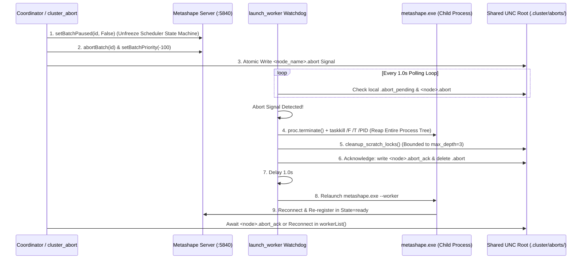

# Distributed Processing Cluster & Autonomous Fleet Operations

Comprehensive operational runbook and architectural standard for provisioning, orchestrating, monitoring, and updating Agisoft Metashape Professional distributed processing clusters. Covers cluster server daemons, worker node provisioning with pre-flight TCP/UNC diagnostics, dynamic native multi-GPU discovery, local NVMe scratch staging, continuous autonomous health audits, and zero-touch canary fleet update protocols.

---

## When To Use

Use this skill when:
- Deploying or starting the central Cluster Coordinator Server (`metashape-server.exe`) on a LAN host.
- Provisioning or starting remote worker nodes (`launch_worker.bat`) across workstation fleets.
- Configuring unattended worker provisioning via `worker_config.json` with zero-touch automation.
- Diagnosing network reachability (TCP port 5840), shared UNC storage path access, or GPU device discovery.
- Managing Local NVMe Scratch Staging (`--stage-local` / `--local-scratch-staging`) to eliminate SMB network congestion and Win32 Error 112 (`ERROR_DISK_FULL`).
- Executing the Autonomous 1-Hour Health & Self-Healing Monitoring Cycle for multi-hour cluster reconstructions.
- Performing rolling fleet updates (`update.bat`) across remote worker nodes using the Single Canary Node Verification Gate.
- Troubleshooting worker state transitions (`inprogress -> offline -> ready`), stalled tasks, or network disconnects.
- Forcibly aborting hung worker processes during monolithic tasks, purging scratch locks, and orchestrating self-healing worker reconnects without server scheduler deadlocks.

Do not use this skill when:
- Performing single-node local photogrammetry reconstructions without network distribution (use `skills/user/image-to-3d-model/`).
- Exporting, format converting, or baking deliverables from an existing project archive (use `skills/user/photogrammetry-export/`).

---

## Workflow

```mermaid
flowchart TD
    subgraph Host_Coordinator["Cluster Coordinator Host (e.g. SERVER / 192.168.1.100)"]
        ServerProc["metashape-server.exe\n(TCP 5840 Control Daemon)"]
        SharedStorage["Shared UNC Root (\\\\HOST\\SharedMetashape)"]
        StatusSidecar["_autometashape_status.json\n(Milestone IPC Telemetry)"]
    end

    subgraph Remote_Worker_Fleet["Remote Worker Fleet (Nodes: tan, RJUQ6L8, etc.)"]
        WorkerProc["Metashape Worker Daemon\n(launch_worker.bat)"]
        LocalScratch["Local Fast Scratch NVMe\n(C:\\AutoMetashape_Scratch or D:\\)"]
        DiscreteGPU["Discrete RTX GPUs\n(Native C++ Discovery)"]
    end

    ServerProc <-->|TCP 5840 Task Queue & Heartbeats| WorkerProc
    SharedStorage -->|Read Photo Assets & Project Files| WorkerProc
    WorkerProc <-->|High-Speed NVMe I/O (75+ GB Temp Leaves)| LocalScratch
    WorkerProc <-->|CUDA Kernels| DiscreteGPU
    WorkerProc -->|Atomic Write on Stage Completion| SharedStorage
    WorkerProc -->|Push Real-Time Sidecar Events| StatusSidecar
```

### 1. Cluster Coordinator Server Provisioning
On the Coordinator workstation hosting the shared network storage:
1. Verify network share accessibility via UNC format (`\\HOST_PC\SharedMetashape`).
2. Launch the cluster coordinator server daemon:
   ```powershell
   .\launch_server.bat --port 5840 --root "\\HOST_PC\SharedMetashape"
   ```
3. Confirm server listening state:
   ```powershell
   Test-NetConnection -ComputerName 127.0.0.1 -Port 5840
   ```

### 2. Worker Node Provisioning & Pre-Flight Diagnostics
On each remote worker node across the local network:
1. Interactive Launch with Guided Wizard (stores `worker_config.json`):
   ```powershell
   .\launch_worker.bat
   ```
2. Unattended / Headless Deployment (Single-Share or Dual-SSD):
   Place `worker_config.json` in the AutoMetashape root directory (optionally setting `source_root` for Dual Shared Folder SSD #1 read-only photo shares while `root` anchors Metashape `--root` to SSD #2 Result Share):
   ```json
   {
     "host": "10.2.8.43",
     "port": "5840",
     "root": "\\\\HOST_PC\\ResultSSD",
     "source_root": "\\\\HOST_PC\\DataSSD",
     "cpu_enable": 1
   }
   ```
   Execute non-interactively (or override shares via `--result-share` and `--source-share`):
   ```powershell
   .\launch_worker.bat --non-interactive --result-share "\\HOST_PC\ResultSSD" --source-share "\\HOST_PC\DataSSD"
   ```
3. Pre-Flight Diagnostics Built-in:
   - Validates Metashape Pro executable across `%ProgramFiles%` and all drives `C:`, `D:`, `E:`, `F:`, `G:`.
   - Tests TCP port reachability to server host.
   - Tests Result Share (`--root`) and optional Data Source Share (`--source-root`) SMB/UNC accessibility.
   - **Dynamic Metashape Discrete GPU Bitmask Probing**: When `--gpu-mask` is omitted or `"Auto"` (default), `launch_worker.py` probes `Metashape.app.enumGPUDevices()` directly via `probe_metashape_gpu_mask()` (`source/autometashape/cluster/hardware.py`) to compute the exact Metashape-indexed discrete GPU bitmask (excluding Intel UHD/HD/Iris/Core Ultra Arc iGPUs, AMD 610M–890M/Vega APUs, and software renderers) and passes `--gpu-mask <N>` explicitly. For example, on a workstation with `[0] Intel Graphics` and `[1] NVIDIA GeForce RTX`, the computed bitmask is dynamically `1 << 1 = 2` (`0b10` -> `GPU=2` in telemetry), whereas single-discrete-GPU hosts automatically compute `1` (`0b01`), dual-GPU hosts compute `3` (`0b11`) or `6` (`0b110`), and CPU-only hosts compute `0` — never hardcoded. This overrides poisoned `HKCU` Registry `gpu_mask=0` or mixed `4294967295` values cleanly. Explicit overrides (`--gpu-mask <N>`) persist `"gpu_mask_explicit": true` and set `AUTOMETASHAPE_EXPLICIT_GPU_MASK`.
   - **Auto-Reconnect Daemon**: Automatically reconnects every 10s if the coordinator restarts or network fluctuates, re-probing GPU bitmask if an initial boot probe transiently failed.

### 3. Local NVMe Scratch Staging & Independent Project Defaults
During large-scale reconstructions (1,000+ to 10,000+ photos), intermediate scratch data (depth maps and octree meshing leaves) reaches 75–150+ GB.
- **Canonical Cluster Defaults (Both Enabled by Default)**:
  - **Independent Project Mode (`--network-independent-workers`, `worker_limit=1`)**: Enabled by default across `submit_cluster_batch.py`, `cluster_supervisor.py`, and `metashape_reconstruction.py --network-enable` (opt out via `--no-network-independent-workers`). Each project runs atomically on 1 dedicated worker with zero worker hopping.
  - **Local NVMe Scratch Staging (`--local-scratch-staging` / `--stage-local`)**: Enabled by default so every worker computes locally on internal NVMe instead of saturating SMB shares (opt out via `--no-local-scratch-staging` only for standalone host-local runs).
- **Dynamic Local NVMe Discovery**: The worker daemon automatically discovers the fastest internal fixed non-system NVMe/SATA drive with the highest free capacity (e.g., `D:\AutoMetashape_Scratch`), explicitly rejecting mapped SMB network drives (`DRIVE_REMOTE`), removable/optical media (`GetDriveTypeW`), and external USB/FireWire/SD/MMC SSD enclosures (`BusTypeUsb` via `IOCTL_STORAGE_QUERY_PROPERTY`).
- **Headroom Fallback**: Requires $\ge 100\text{ GB}$ free space (configurable via `--min-scratch-free-gb`). Safely falls back to direct network storage if local space is insufficient.
- **Staged PSX Chunk-ID Reconciliation & Atomic Deliverable Sync**: Before replacing `.files/` on the shared Result Share, `reconcile_staged_psx_chunk_id()` aligns single ICP-merged chunk folders (e.g. `3/` or `1/`) to the shared stub's chunk ID (`0/`) inside `project.zip/doc.xml` so Metashape Worker's post-`RunScript` commit never triggers `Can't open file: .../0/chunk.zip`. Deliverables and project files then sync atomically to the Result Share, `_autometashape_status.json` is finalized to `status="completed"` (`progress=100.0`), and local scratch is purged cleanly.
- **Opt-Out**: Pass `--no-stage-local` / `--no-local-scratch-staging` to bypass local staging on standalone host-local jobs.

### 3b. Portable Offline Open3D Bridge Runtime Provisioning (`.cluster/bridge_runtime/`)
To support the Zero-Neural CPU Open3D Sim(3) ICP Bridge (`source/autometashape/core/icp_bridge.py` + `icp_worker.py`) on bare worker nodes that have **no system Python, no PyTorch, no CUDA toolkit, no admin rights, and no internet access**:
- **Shared Bundle Hosting**: The shared cluster root hosts `<root>/.cluster/bridge_runtime/manifest.json` alongside the SHA-256-verified `bridge_runtime_win_amd64_v1.zip` (~107 MB portable CPython 3.11 + Open3D + NumPy + SciPy + MSVC runtime DLLs).
- **Zero-Touch One-Time Auto-Provisioning**: On the first project requiring ICP bridging, `icp_bridge.py` verifies the bundle SHA-256 against `manifest.json` and extracts it atomically into `%LOCALAPPDATA%\AutoMetashape\bridge_runtime_v<version>` (~2.5 s via built-in `zipfile`). Single-block projects never invoke the bridge runtime (0 s overhead).
- **DLL & Environment Isolation**: `_clean_bridge_env()` strips Metashape binary directories from `PATH` and clears `PYTHONHOME` / `PYTHONPATH` before spawning the worker subprocess so Metashape's bundled Qt/OpenMP/VC++ DLLs cannot conflict with Open3D.
- **32 GB RAM Safety & Isolated Temp Lifecycle**: Stage-0 dense cloud generation enforces `uniform_sampling=True, points_spacing=0.04` (4 cm spacing) to cap memory footprint, writes temporary PLY point clouds strictly to `%TEMP%\autometashape_icp_*` (outside `local_staging_dir` so they are never synced to the Result Share), and automatically purges stale `autometashape_icp_*` directories older than 24 hours.

### 4. Autonomous 1-Hour Monitoring & Self-Healing Protocol
For multi-hour cluster runs, run the canonical read-only monitor CLI:
```powershell
python scripts/cluster_monitor.py --server 127.0.0.1:5840 --result-share "\\HOST_PC\ResultSSD" --source-share "\\HOST_PC\DataSSD"
```
1. **Telemetry & Resource Scaling**: Reports accurate CPU % and RAM GB from Metashape 2.x `workerList()` `0–100%` resource usage metrics (`(memory_usage / 100.0) * memory_size`), with **no artificial RAM warning guard** and passive post-mortem `std::bad_alloc` / OOM reporting.
2. **Dual-Share Isolation & Maintenance Filtering**: Strictly isolates read-only `--source-share` from deliverable/sidecar lookups (inspecting deliverables only under `--result-share`) and ignores internal `.cluster/` maintenance batches during deliverable verification.
3. **Sidecar Inspection**: Read `_autometashape_status.json` from the shared output directory on Result Share.
3. **Structured Hourly Status Reporting**:
   - Active Batches: Current stage, subtask completion %, elapsed time, ETA.
   - Worker Health: Active/idle states, GPU utilization, CPU %, RAM GB.
   - Storage Headroom & Deliverables: Free space across Result & Data Source SSD shares and verified files on disk (`.obj`, `.mtl`, textures, `*_orthomosaic.tif`, `.tfw`, `.prj`).
4. **Self-Healing Diagnostics**:
   - *Dropped Worker*: Ping host, alert user, or trigger daemon restart.
   - *Stalled Task (>45m 0% progress)*: Report to operator for authorized checkpoint resume.
   - *Storage Latency / Access Drops*: Audit SMB UNC path connectivity.

> [!IMPORTANT]
> **Strict Non-Destructive Code Governance Boundary**:
> - Permitted: Network reconnection, daemon restarts, batch retry via `--resume`, lockfile cleanup, and structured progress reporting.
> - Strictly Prohibited: Never autonomously rewrite, mutate, refactor, or modify core reconstruction code or pipeline scripts during monitoring runs without explicit user authorization.

### 5. Host-Initiated Autonomous Worker Fleet Update Protocol
When maintaining or upgrading remote cluster worker nodes from the Coordinator host:
1. **Zero Fleet-Wide Blind Kills**: Never kill or push updates across all nodes simultaneously.
2. **Single Canary Node Verification Gate**:
   - Dispatch update probe to exactly **ONE canary worker node** first (e.g. canary or `Admin-pc`).
   - Monitor canary state transition:
     $$\text{inprogress (probe)} \longrightarrow \text{offline (releasing locks)} \longrightarrow \text{ready (online with fresh code)}$$
   - Confirm canary node completes self-update and re-registers as `ready` within **30–60 seconds**.
   - Only proceed across remaining worker nodes in staggered waves after canary passes.
3. **Preserve Host / Coordinator Exemption & Selective Remote-Only Rollouts**: Coordinator host must be explicitly excluded from worker update batches, and never run worker kill/update commands against the server daemon. When the coordinator node runs directly out of the local Git working tree (or holds a long-running mega-project), target remote workers individually via `--node <host>` rather than `--node all`, stage any new batches requiring the update with `scripts/submit_cluster_batch.py --start-paused`, verify every remote worker reconnects cleanly on the new commit, and then unpause queued batches via `scripts/manage_queue.py unpause --batch <id>`.
4. **Zero-Touch Headless Invariants**: Worker nodes execute non-interactively with automatic UNC path inference and dynamic GPU discovery.
5. **Canonical Local Directory Invariant**: `%USERPROFILE%\Documents\AutoMetashape` is the **only permissible hardcoded directory** across all worker nodes. All other paths (storage root, server IP, GPU devices, scratch folders) MUST be dynamically auto-detected or explicitly configured via CLI/environment variables.

#### Automated Fleet Updater CLI & API
The repository provides an end-to-end autonomous remote updater (`scripts/update_fleet.py` and `update_fleet.bat`):

- **List Connected Fleet Workers**:
  ```powershell
  .\update_fleet.bat --list
  ```
- **Update Single Canary Node** (verifies self-healing before wider rollout):
  ```powershell
  .\update_fleet.bat --root "\\HOST_PC\SharedMetashape" --node canary
  ```
- **Update Specific Worker Node** (default `--force` aborts active process for immediate update):
  ```powershell
  .\update_fleet.bat --root "\\HOST_PC\SharedMetashape" --node Admin-pc
  ```
- **Update Specific Worker in Safe Mode** (skips worker if busy on active reconstruction):
  ```powershell
  .\update_fleet.bat --root "\\HOST_PC\SharedMetashape" --node Admin-pc --safe
  ```
- **Update Entire Fleet in Parallel**:
  ```powershell
  .\update_fleet.bat --root "\\HOST_PC\SharedMetashape" --node all
  ```
- **Update Codebase Without Daemon Restart** (signal registration only):
  ```powershell
  .\update_fleet.bat --root "\\HOST_PC\SharedMetashape" --node Admin-pc --no-restart
  ```

#### Underlying Decoupled Handshake & Process Re-execution Architecture
1. **Target Worker State Gating & Watchdog-First Force Abort**: If the targeted worker is currently busy on an active job, `--force` (default) aborts only the target worker's active `batch_id` (plus any stale maintenance batch) and dispatches the watchdog abort signal (`dispatch_abort_signal(node_name=..., shared_root=...)`) **before** `quitWorker` so C++ `RunScript`-blocked workers cleanly reap and recycle while unrelated workers keep running. `--safe` cleanly skips busy workers to protect jobs.
   - **Stale Worker-ID `.update_pending` Recovery**: If a worker double-restarts during abort and `update_fleet.py` reports a restart-confirmation timeout (server log shows `Can't quit worker` on the stale ID), `.update_pending` remains staged on the remote host's disk. Inspect the worker's fresh ID and active batch in server logs or `cluster_monitor.py`, then issue `scripts/cluster_abort.py --node <name> --batch <active_bid> --root <share>` (with operator approval) so `launch_worker.py` cleanly recycles the child process and applies `.update_pending` immediately.
2. **Per-Worker Maintenance Project & Cluster Isolation Guard**: Both single-node (`update_remote_worker`) and parallel (`update_all_workers_parallel`) rollouts assign each target worker a distinct `.cluster/maintenance_<slug>.psx` archive (with a real ZIP `project.zip` containing `doc.xml` on fallback, releasing locks via `doc.clear()`) so updates never collide on `safe_create_cluster_batch()`. Coordinator pauses non-target workers during signal dispatch, locks `worker_limit=1`, aborts any batch reporting `error_count > 0` (preventing Metashape 2.2.2 infinite retries), and restores all workers in a guaranteed `finally` teardown.
3. **In-Task Signal Handshake (Zero In-Process File Locks)**:
   - The injected Python task runs in `<50ms` inside `metashape.exe`.
   - Verifies target `COMPUTERNAME` and locates target installation directory via `AUTOMETASHAPE_DIR`.
   - Drops `.update_pending` signal file containing repo URL and payload cache path.
   - Writes registration notice to `.cluster/<node>_update_result.txt`.
   - Task completes immediately with zero network heavy downloads inside Metashape.
4. **Graceful Daemon Signal**: Coordinator verifies task completion and calls `client.quitWorker(wid)`. Child `metashape.exe` terminates cleanly with return code 0, releasing all binary file handles.
5. **Supervisor Autonomous Mirror & ZIP-Parity Prune (Zero Git on Workers)**:
   - The persistent `launch_worker.py` supervisor intercepts child exit and detects `.update_pending`.
   - Pulls the freshly staged ZIP archive (preferring high-speed LAN `.cluster/update_payload.zip` verified via `testzip()`, falling back to GitHub `main.zip`, matching `update.bat` without requiring Git on workers).
   - Extracts archive, verifies repository structure, and executes case-safe Git-parity mirroring with automatic pruning of obsolete repository files.
   - Strictly preserves machine-local files (`worker_config.json`, `server_config.json`), `.agents/`, logs, signal files (`.update_pending`, `.abort_pending`), and `.cluster/`.
   - Removes `.update_pending`.
6. **Clean Process Re-Execution**:
   - Supervisor clears its PID file and relaunches `launch_worker.py` cleanly from disk (`subprocess.run` + `sys.exit` on Windows to preserve parent `.bat`/Task Scheduler handles and backslash escaping; `os.execv` on POSIX).
   - Dynamic Metashape GPU probing (`probe_metashape_gpu_mask()`), TCP/UNC checks, and updated CLI flags execute fresh without stale memory.
7. **Zero OS-Python Invariant**:
   - `launch_worker.bat` and `reexec_supervisor` prioritize Metashape Pro's bundled Python (`python\python.exe`) across all system drives. Worker nodes operate 100% headless without requiring system Python.
8. **Server Re-Registration**: Fresh worker process connects on a new socket port and registers with the server in `State=ready`.


### 6. Signal-Based Worker Abort & Self-Healing Watchdog Protocol
When an Agisoft Metashape batch is paused or aborted on the coordinator while running a monolithic task (`metashape_reconstruction.py`), the worker hangs because native C++ operations (OpenCV, FLANN matching, MVS stereopsis, CUDA depth maps) block the internal network listener. Furthermore, pausing an in-progress batch on the server freezes the scheduler state machine, locking the worker.

AutoMetashape implements an autonomous signal-based abort-and-restart mechanism:



#### Protocol Details
1. **Non-Blocking Supervisor Watchdog**:
   `scripts/launch_worker.py` replaces blocking `wait()` with a 1.0s watchdog polling loop monitoring local `.abort_pending` and network `<root>/.cluster/aborts/<node_name>.abort`.
2. **Defensive Process-Tree Termination & Dual-Role Safety**:
   `kill_worker_process()` initiates graceful termination, then enforces `taskkill /F /T /PID {proc.pid}` on Windows to ensure both parent worker daemons and any child processes running native CUDA stereopsis or scripts are reaped without leaving orphaned locks.
   - **Zero Host-Wide Taskkill & Targeted GUI Lock Forensics**: In environments where a machine hosts both coordinator services and a compute worker (or an interactive Metashape Pro GUI session holding `.files/lock`), never execute `taskkill /IM metashape.exe`. Inspect exact window titles first via `tasklist /V /FI "IMAGENAME eq metashape.exe" /FO LIST` to identify and isolate ONLY the specific GUI PID holding the locked project archive (all termination strictly scoped via `taskkill /F /T /PID <pid>`). Remote nodes are signaled exclusively via atomic UNC files without local process interference.
3. **Scoped Scratch Lock Cleanup & Single-Kill Acknowledgment**:
   `cleanup_scratch_locks()` removes stale `lock` files strictly inside AutoMetashape/Metashape project and scratch directories (never sweeping unrelated `%TEMP%` files), bounded to `max_depth = 3`. `acknowledge_abort_signal()` purges both `<node>.abort` and the matching `.cluster/abort_signals.json` entry so workers never double-kill on reconnect.
4. **Self-Healing Relaunch**:
   After clearing signals and locks, the supervisor re-executes `metashape.exe --worker` with a 1.0s delay, seamlessly reconnecting to the coordinator in `State=ready`.
5. **Remote Abort CLI & Native Runner Delegation**:
   - `cluster_abort.bat` and `scripts/cluster_abort.py` unpause the frozen batch, abort it, demote its priority to `-100`, dispatch `<node>.abort`, and await acknowledgment:
     ```powershell
     # Using the batch runner (automatically locates and launches via metashape.exe -r)
     .\cluster_abort.bat --node DESKTOP-IFA3707 --batch 3 --server 192.168.1.100:5840 --root "\\SERVER\SharedMetashape"

     # Or using the Python CLI (auto-delegates through metashape.exe -r if run under plain Python)
     python scripts/cluster_abort.py --node DESKTOP-IFA3707 --batch 3 --server 192.168.1.100:5840 --root "\\SERVER\SharedMetashape"
     ```
   - **Metashape Runner Delegation**: Because `Metashape.NetworkClient` is embedded in `metashape.exe` and not in plain Python, `cluster_abort.bat` and `cluster_abort.py` automatically route through `metashape.exe -r` so server unpausing, batch aborting, and priority demotion execute natively.

---

## Validation

Verify that all procedures and skill contracts execute cleanly:

```bash
# Validate skill architecture and governance rules
python tools/skills/cli.py check

# Audit license compliance
python tools/check_licenses.py

# Execute test suite covering cluster utilities, dual-share topology, alignment hygiene, ICP bridge, and regression guards
python -m unittest tests/test_cluster_utils.py tests/test_cli_args.py tests/test_fleet_updater.py tests/test_worker_abort.py tests/test_dual_share.py tests/test_audit_regressions.py tests/test_alignment_hygiene.py tests/test_icp_bridge.py tests/test_exclude_folders.py
```

---

## Maintenance

- Review and audit worker connectivity and protocol compatibility with each Agisoft Metashape Pro minor/major update.
- Verify that `worker_config.json` schema remains backward-compatible across existing fleet deployments.
- Periodically validate NVMe scratch purge logic to guarantee zero residual disk leak on remote worker workstations.

---

## References

- Contributing guide: [CONTRIBUTING.md](../../../CONTRIBUTING.md)
- Image to 3D model skill: [skills/user/image-to-3d-model/SKILL.md](../image-to-3d-model/SKILL.md)
- Photogrammetry forensic audit skill: [skills/user/photogrammetry-forensic-audit/SKILL.md](../photogrammetry-forensic-audit/SKILL.md)
- Benchmark evaluation suite: [evaluations.md](evaluations.md)
