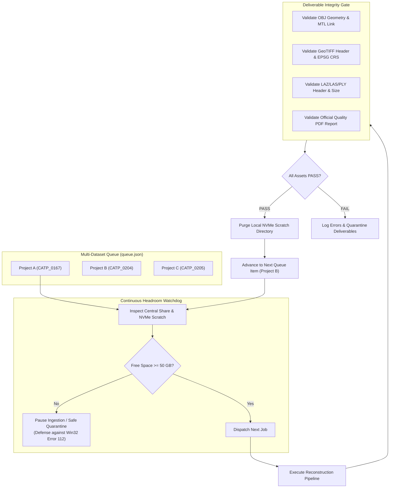

# Autonomous Cluster Supervisor & Deliverable Verification Gate

Comprehensive operational runbook for lights-out, unattended photogrammetry cluster supervision, storage headroom watchdogs (Win32 Error 112 defense), automated deliverable quality verification gates, and sequential multi-dataset queue chaining.

---

## When To Use

Use this skill when:
- Running multi-hour, overnight, or multi-dataset photogrammetry cluster jobs without human supervision.
- Preventing catastrophic cluster stalls caused by storage exhaustion (`Win32 Error 112: ERROR_DISK_FULL`).
- Verifying deliverable integrity (OBJ vertices/faces, linked MTL textures, GeoTIFF CRS projection tags, dense point cloud byte density, and PDF calibration reports) before declaring a job complete.
- Chaining sequential dataset reconstructions (e.g., `CATP_0167` -> `CATP_0204` -> `CATP_0205`) into an automated queue that clears scratch space between jobs and advances unattended.
- Quarantining corrupted outputs and resuming or auto-retrying failed stages without crashing the rest of the queue.

Do not use this skill when:
- Deploying or updating worker nodes and server daemons (use `skills/user/cluster-fleet-operations/`).
- Executing an interactive, single-project photogrammetry reconstruction (use `skills/user/image-to-3d-model/`).
- Running standalone asset format conversions from an existing `.psx` archive (use `skills/user/photogrammetry-export/`).

---

## Workflow



### 1. Storage Headroom Watchdog (Win32 Error 112 Defense)
Metashape MVS depth maps and octree leave partitions peak heavily during dense reconstruction. If the host volume runs out of free space, Metashape crashes with `Win32 Error 112`.

1. **Pre-Flight Disk Sampling**:
   Before launching any queued reconstruction, inspect disk space on both target network output and local NVMe scratch:
   ```powershell
   python -c "from autometashape.cluster.supervisor import check_storage_headroom; ok, free = check_storage_headroom('\\\\CLUSTER_SHARE\\storage', 50.0); print(f'Headroom OK: {ok} ({free} GB free)')"
   ```
2. **Watchdog Protocol**:
   - Minimum safe threshold: **50.0 GB** free space.
   - If free space $< 50.0\text{ GB}$, the supervisor automatically halts the job in `PAUSED_LOW_DISK` state, preventing corruption of preceding deliverables.

### 2. Automated Deliverable Quality & Integrity Gate
Never mark a reconstruction finished simply because `metashape.exe` exited code `0`. Run the deterministic deliverable verification gate:

```powershell
python scripts/verify_deliverables.py --dir "\\CLUSTER_SHARE\Khảo sát Địa hình Đà Nẵng" --expect obj dem ortho point_cloud report
```

The verification gate executes 5 structural integrity checks:
1. **Wavefront OBJ**:
   - File size $\ge 1,000$ bytes.
   - Verified vertex definitions (`v x y z`) and polygon faces (`f v1 v2 v3`).
   - `mtllib` link points to an existing `.mtl` material file.
   - All `map_Kd` texture images referenced inside `.mtl` exist, are readable, and $> 1,000$ bytes.
2. **Binary glTF (GLB)**:
   - File size $\ge 1,000$ bytes; binary magic matches `b'glTF'`.
3. **GeoTIFF (Elevation DEM & True Orthomosaic)**:
   - File size $\ge 1,000$ bytes.
   - Header matches valid TIFF/BigTIFF magics (`II*\0`, `MM\0*`, `II+\0`, `MM\0+`).
4. **Dense Point Cloud (LAZ, LAS, PLY)**:
   - File size $\ge 50,000$ bytes.
   - LAS/LAZ magic matches `b'LASF'`; PLY starts with `b'ply'`.
5. **Quality PDF Report**:
   - File size $\ge 15,000$ bytes; starts with PDF magic `b'%PDF'`.

Machine-readable JSON output can be requested using `--json`:
```json
{
  "status": "PASS",
  "deliverables_dir": "C:\\Outputs\\Project_A",
  "assets_checked": {
    "obj": { "status": "PASS", "size_bytes": 145023940 },
    "dem": { "status": "PASS", "size_bytes": 84201944 },
    "ortho": { "status": "PASS", "size_bytes": 312049102 },
    "point_cloud": { "status": "PASS", "size_bytes": 204918204 },
    "report": { "status": "PASS", "size_bytes": 142095 }
  },
  "errors": [],
  "warnings": []
}
```

### 3. Multi-Dataset Queue Chaining
To process a sequence of survey datasets without human intervention:

1. **Construct a Queue Manifest (`queue.json`)**:
   ```json
   [
     {
       "images_dir": "\\\\CLUSTER_SHARE\\storage\\Survey_0167",
       "output_dir": "\\\\CLUSTER_SHARE\\storage\\Deliverables_0167",
       "project_name": "Survey_0167",
       "preset": "pro",
       "expected_assets": ["obj", "dem", "ortho", "report"]
     },
     {
       "images_dir": "\\\\CLUSTER_SHARE\\storage\\Survey_0204",
       "output_dir": "\\\\CLUSTER_SHARE\\storage\\Deliverables_0204",
       "project_name": "Survey_0204",
       "preset": "pro",
       "expected_assets": ["obj", "dem", "ortho", "report"]
     }
   ]
   ```

2. **Execute the Queue Supervisor**:
   ```powershell
   python scripts/cluster_supervisor.py --manifest queue.json --min-headroom-gb 50.0
   ```

3. **Supervision Lifecycle per Queue Item**:
   - **Pre-flight**: Checks storage headroom.
   - **Execute**: Dispatches reconstruction with local NVMe scratch staging.
   - **Verify**: Evaluates deliverable integrity gate.
   - **Cleanup**: If verified, purges `{project_name}_local_stage` on local NVMe SSD to free space for the next item.
   - **Advance**: Chains immediately into the subsequent queue item.

---

## Validation

Verify that supervisor components and deliverable validators pass all quality checks:

```powershell
# 1. Run unit test suite
python -m unittest tests/test_verification.py tests/test_supervisor.py

# 2. Run skills validation
python tools/skills/cli.py check

# 3. Test standalone deliverable verification CLI
python scripts/verify_deliverables.py --help
```

---

## Maintenance

- **Threshold Tuning**: Adjust `min_headroom_gb` (default: 50 GB) based on network share capacity and multi-thousand photo project demands.
- **Format Extension**: When introducing new export formats (e.g., Cesium 3D Tiles), extend `verify_project_deliverables` in `source/autometashape/core/verification.py`.

---

## References

- Contributing guide: [CONTRIBUTING.md](../../../CONTRIBUTING.md)
- Deliverable Verification Engine: [source/autometashape/core/verification.py](../../../source/autometashape/core/verification.py)
- Cluster Supervisor Engine: [source/autometashape/cluster/supervisor.py](../../../source/autometashape/cluster/supervisor.py)
- Distributed Cluster Fleet Operations: [skills/user/cluster-fleet-operations/SKILL.md](../cluster-fleet-operations/SKILL.md)
- Supervisor Evaluation Suite: [evaluations.md](evaluations.md)
