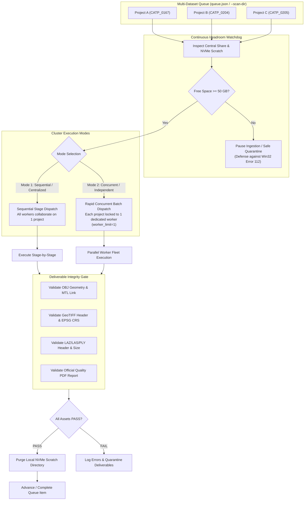

# Autonomous Cluster Supervisor & Deliverable Verification Gate

Comprehensive operational runbook for lights-out, unattended photogrammetry cluster supervision, storage headroom watchdogs (Win32 Error 112 defense), automated deliverable quality verification gates, and sequential multi-dataset queue chaining.

---

## When To Use

Use this skill when:
- Running multi-hour, overnight, or multi-dataset photogrammetry cluster jobs without human supervision.
- Preventing catastrophic cluster stalls caused by storage exhaustion (`Win32 Error 112: ERROR_DISK_FULL`).
- Verifying deliverable integrity (OBJ vertices/faces, linked MTL textures, GeoTIFF CRS projection tags, dense point cloud byte density, and PDF calibration reports) before declaring a job complete.
- Chaining sequential dataset reconstructions (e.g., `CATP_0167` -> `CATP_0204` -> `CATP_0205`) into an automated queue that clears scratch space between jobs and advances unattended.
- Quarantining corrupted outputs and resuming or auto-retrying failed stages without crashing the rest of the queue.

Do not use this skill when:
- Deploying or updating worker nodes and server daemons (use `skills/user/cluster-fleet-operations/`).
- Executing an interactive, single-project photogrammetry reconstruction (use `skills/user/image-to-3d-model/`).
- Running standalone asset format conversions from an existing `.psx` archive (use `skills/user/photogrammetry-export/`).

---

## Workflow



### 1. Storage Headroom Watchdog (Win32 Error 112 Defense)
Metashape MVS depth maps and octree leave partitions peak heavily during dense reconstruction. If the host volume runs out of free space, Metashape crashes with `Win32 Error 112`.

1. **Pre-Flight Disk Sampling**:
   Before launching any queued reconstruction, inspect disk space on both target network output and local NVMe scratch:
   ```powershell
   python -c "from autometashape.cluster.supervisor import check_storage_headroom; ok, free = check_storage_headroom('\\\\CLUSTER_SHARE\\storage', 50.0); print(f'Headroom OK: {ok} ({free} GB free)')"
   ```
2. **Watchdog Protocol**:
   - Minimum safe threshold: **50.0 GB** free space.
   - If free space $< 50.0\text{ GB}$, the supervisor automatically halts the job in `PAUSED_LOW_DISK` state, preventing corruption of preceding deliverables.

### 2. Automated Deliverable Quality & Integrity Gate
Never mark a reconstruction finished simply because `metashape.exe` exited code `0`. Run the deterministic deliverable verification gate:

```powershell
python scripts/verify_deliverables.py --dir "\\CLUSTER_SHARE\Khảo sát Địa hình Đà Nẵng" --expect obj dem ortho point_cloud report
```

The verification gate executes 5 structural integrity checks:
1. **Wavefront OBJ**:
   - File size $\ge 1,000$ bytes.
   - Verified vertex definitions (`v x y z`) and polygon faces (`f v1 v2 v3`).
   - `mtllib` link points to an existing `.mtl` material file.
   - All `map_Kd` texture images referenced inside `.mtl` exist, are readable, and $> 1,000$ bytes.
2. **Binary glTF (GLB)**:
   - File size $\ge 1,000$ bytes; binary magic matches `b'glTF'`.
3. **GeoTIFF (Elevation DEM & True Orthomosaic)**:
   - File size $\ge 1,000$ bytes.
   - Header matches valid TIFF/BigTIFF magics (`II*\0`, `MM\0*`, `II+\0`, `MM\0+`).
4. **Dense Point Cloud (LAZ, LAS, PLY)**:
   - File size $\ge 50,000$ bytes.
   - LAS/LAZ magic matches `b'LASF'`; PLY starts with `b'ply'`.
5. **Quality PDF Report**:
   - File size $\ge 15,000$ bytes; starts with PDF magic `b'%PDF'`.

Machine-readable JSON output can be requested using `--json`:
```json
{
  "status": "PASS",
  "deliverables_dir": "C:\\Outputs\\Project_A",
  "assets_checked": {
    "obj": { "status": "PASS", "size_bytes": 145023940 },
    "dem": { "status": "PASS", "size_bytes": 84201944 },
    "ortho": { "status": "PASS", "size_bytes": 312049102 },
    "point_cloud": { "status": "PASS", "size_bytes": 204918204 },
    "report": { "status": "PASS", "size_bytes": 142095 }
  },
  "errors": [],
  "warnings": []
}
```

### 3. Execution Modes: Centralized vs Independent Dispatch

The supervisor supports two distinct cluster operational architectures:

#### Mode 1: Centralized Task Mode (`--sequential` / `--no-concurrent`)
- **Behavior**: Datasets in the queue are processed one project at a time. For each project, the supervisor breaks the reconstruction down into granular network tasks (MatchPhotos, BuildDepthMaps) where **all available cluster workers collaborate concurrently on the same project**.
- **Best For**: Single massive surveys (e.g., 5,000+ images) requiring the aggregate compute and VRAM of the entire GPU fleet.
- **Invocation**:
  ```powershell
  python scripts/cluster_supervisor.py --manifest queue.json --network-enable --network-host 10.5.10.202 --sequential
  ```

#### Mode 2: Independent Project Mode (`--concurrent` / `--parallel-dispatch`)
- **Behavior**: All queued dataset projects are submitted to the Metashape Server scheduler simultaneously as atomic monolithic batches locked to 1 dedicated worker node (`worker_limit=1`). Each assigned worker stages project data into its local NVMe scratch volume and executes the complete pipeline independently with zero inter-worker network synchronization overhead.
- **Default Behavior**: When `--network-independent-workers` is enabled, concurrent dispatch is active by default.
- **Best For**: Daily drone batches consisting of multiple small-to-medium datasets (e.g., 500-1,500 photos each) where running $N$ projects simultaneously on $N$ GPUs yields maximum total throughput.
- **Invocation**:
  ```powershell
  python scripts/cluster_supervisor.py --scan-dir "\\ctuav\catp\101126" --output-root "\\ctuav\catp\101126" `
      --network-enable --network-host 10.5.10.202 --network-independent-workers --concurrent
  ```

### 4. Multi-Dataset Queue Chaining & Discovery
To process a sequence of survey datasets without human intervention:

1. **Auto-Discovery from Date/Survey Root Folder**:
   ```powershell
   python scripts/cluster_supervisor.py --scan-dir "\\CLUSTER_SHARE\storage\101126" --output-root "\\CLUSTER_SHARE\storage\101126" `
       --preset pro --min-headroom-gb 50.0 --concurrent
   ```

2. **Construct a Queue Manifest (`queue.json`)**:
   ```json
   [
     {
       "images_dir": "\\\\CLUSTER_SHARE\\storage\\Survey_0167",
       "output_dir": "\\\\CLUSTER_SHARE\\storage\\Deliverables_0167",
       "project_name": "Survey_0167",
       "preset": "pro",
       "expected_assets": ["obj", "dem", "ortho", "report"]
     },
     {
       "images_dir": "\\\\CLUSTER_SHARE\\storage\\Survey_0204",
       "output_dir": "\\\\CLUSTER_SHARE\\storage\\Deliverables_0204",
       "project_name": "Survey_0204",
       "preset": "pro",
       "expected_assets": ["obj", "dem", "ortho", "report"]
     }
   ]
   ```

3. **Supervision Lifecycle**:
   - **Pre-flight Headroom Watchdog**: Inspects free storage capacity across target output share before queue dispatch.
   - **Dispatch**: Submits batches to Metashape scheduler (sequentially for Mode 1 or concurrently with `worker_limit=1` for Mode 2).
   - **Telemetry Monitoring**: Non-blocking polling loop checks `batchInfo()` and worker sidecar `_autometashape_status.json` every 2.0s.
   - **Quality Gate**: Upon batch completion, runs structural verification on Wavefront OBJ, textures, GeoTIFFs, point clouds, and PDF reports.
   - **Scratch Purge**: Clears temporary local NVMe staging caches upon verified deliverable pass.


### 5. Signal-Based Worker Abort & Server Deadlock Recovery
During unattended overnight supervision, an independent monolithic batch or worker may freeze or become unresponsive during native stereopsis or matching. The supervisor or operator triggers deterministic recovery via the signal-based abort mechanism:

1. **Deadlock Defense via Server Unpause**:
   When Metashape Server freezes due to a paused batch (`batch.paused == True`), the scheduler cannot re-evaluate worker queues. The abort orchestrator calls `client.setBatchPaused(batch_id, False)` before invoking `client.abortBatch(batch_id)`.
2. **Priority Demotion**:
   The batch priority is demoted to `-100` (`client.setBatchPriority(batch_id, -100)`) to prevent the scheduler from immediately re-dispatching the cancelled task when the worker reconnects.
3. **Signal Dispatch & Process Tree Kill**:
   Writes `<unc_root>/.cluster/aborts/<node_name>.abort`. The worker supervisor's non-blocking watchdog detects the signal, executes `taskkill /F /T /PID` to terminate both the parent daemon and any child processes, purges locks, and auto-reconnects to the cluster in 1.0s.
4. **Execution**:
   ```powershell
   .\cluster_abort.bat --node DESKTOP-IFA3707 --batch 3 --server 192.168.1.100:5840 --root "\\SERVER\SharedMetashape"
   ```

### 6. Hardened Checkpoint Chunk Resolution & Recovery
When resuming a project checkpoint via `--resume`, older or GUI-modified projects often lack canonical `Production_Reconstruction` chunk labels, contain single default chunks (`Chunk 1`), or have empty chunk lists.

The unified chunk resolver (`resolve_checkpoint_chunk(doc)`) protects against `AttributeError: 'NoneType' object has no attribute 'cameras'` with deterministic fallback:
1. **Canonical Label Priority**: Checks if any chunk matches `Production_Reconstruction`.
2. **Highest Aligned Camera Fallback**: If canonical label is absent, counts aligned cameras across all chunks in a single $O(N)$ pass (`cam.transform and cam.enabled`) and selects the chunk with the highest count.
3. **Alignment Threshold**: If aligned cameras $\ge 2$, safely resumes downstream MVS depth maps and meshing, skipping camera alignment. If $< 2$, initializes a clean production chunk and restarts alignment from Step 1.

### 7. Canonical Batch Submission & Pre-Flight Physical Materialization
When submitting a standalone or queued batch to the cluster, agents and operators must invoke `scripts/submit_cluster_batch.py` rather than composing ad-hoc Python scripts in chat or scratch directories.

1. **Mandatory Physical Materialization Invariant**:
   - `scripts/submit_cluster_batch.py` initializes the Metashape document, configures the canonical chunk, adds raw photos, and enforces `doc.save(psx_path)`:
     ```python
     doc.save(psx_path)
     assert os.path.isfile(psx_path), "Project file must exist on disk before dispatch"
     ```
   - This prevents worker failure modes where remote nodes claim a task whose project file has not yet been flushed or materialized to shared network storage.
2. **Direct Storage Standard**:
   - For datasets physically hosted on the current machine's storage, pass `--no-local-scratch-staging` to eliminate redundant local NVMe staging and disk exhaustion.
3. **Execution**:
   ```powershell
   python scripts/submit_cluster_batch.py --images "\\CLUSTER_SHARE\storage\Survey_0167" `
       --output "\\CLUSTER_SHARE\storage\Survey_0167\Result" --priority 50
   ```

### 8. Cluster Telemetry & Operator-Gated Queue Operations
To monitor and manage the cluster safely without race conditions or uncommanded interventions:

1. **Autonomous Read-Only Telemetry Auditing**:
   Execute non-intrusive fleet audits inspecting worker health, batch stage progress, and storage headroom ($\ge 50\text{ GB}$):
   ```powershell
   python scripts/cluster_monitor.py
   ```
2. **Operator-Gated Queue Management**:
   Under the **Operator Authority Gate**, queue modifications must be explicitly authorized by the operator before execution:
   ```powershell
   # List active and queued batches
   python scripts/manage_queue.py list

   # Pause / Unpause a batch
   python scripts/manage_queue.py pause --batch 12
   python scripts/manage_queue.py unpause --batch 12

   # Adjust priority safely
   python scripts/manage_queue.py set-priority --batch 12 --priority 60
   ```
3. **Anti-Pattern: Ban on Script-Side Node Affinity Rejection**:
   - Never inject `if COMPUTERNAME != target_node: sys.exit(2)` into task execution scripts.
   - In Metashape Server's priority queue, an unauthorized worker that claims and yields a top-priority task will immediately be re-served the exact same task, triggering an infinite claim-and-yield loop that starves the entire worker fleet.

### 9. Checkpoint Forensics & Diagnostics
To inspect an existing `.psx` archive non-destructively without risking accidental chunk wipeout:
```powershell
python scripts/inspect_checkpoint.py --project "\\CLUSTER_SHARE\storage\Survey_0167\Result\Survey_0167.psx"
```

---

## Validation

Verify that supervisor components, canonical scripts, and deliverable validators pass all quality checks:

```powershell
# 1. Run unit test suite
python -m unittest tests/test_verification.py tests/test_supervisor.py tests/test_checkpoint_loader.py tests/test_worker_abort.py tests/test_cluster_dispatch.py

# 2. Run skills validation
python tools/skills/cli.py check

# 3. Test standalone deliverable verification CLI
python scripts/verify_deliverables.py --help

# 4. Test canonical batch submission CLI
python scripts/submit_cluster_batch.py --help
```

---

## Maintenance

- **Threshold Tuning**: Adjust `min_headroom_gb` (default: 50 GB) based on network share capacity and multi-thousand photo project demands.
- **Format Extension**: When introducing new export formats (e.g., Cesium 3D Tiles), extend `verify_project_deliverables` in `source/autometashape/core/verification.py`.

---

## References

- Contributing guide: [CONTRIBUTING.md](../../../CONTRIBUTING.md)
- Deliverable Verification Engine: [source/autometashape/core/verification.py](../../../source/autometashape/core/verification.py)
- Cluster Supervisor Engine: [source/autometashape/cluster/supervisor.py](../../../source/autometashape/cluster/supervisor.py)
- Distributed Cluster Fleet Operations: [skills/user/cluster-fleet-operations/SKILL.md](../cluster-fleet-operations/SKILL.md)
- Supervisor Evaluation Suite: [evaluations.md](evaluations.md)
