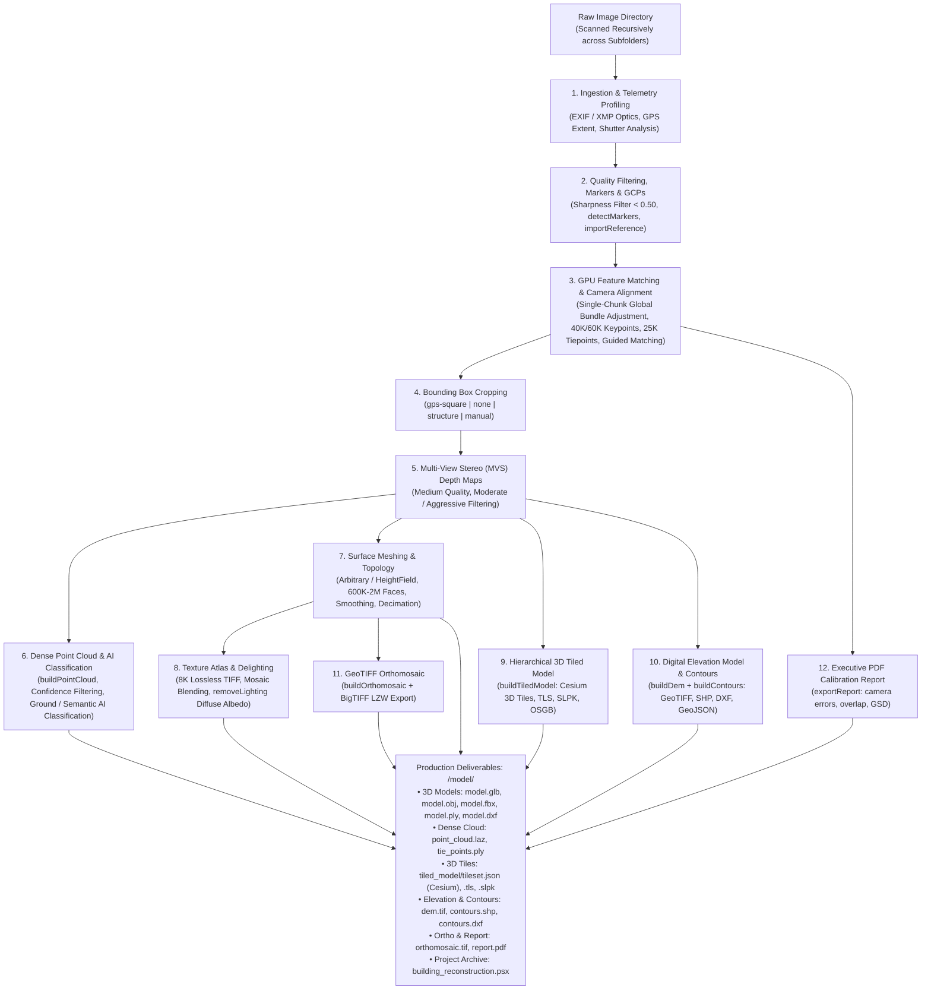

# High-Precision 3D Photogrammetry, Survey Telemetry Analysis & Complete Metashape Processing

Autonomous end-to-end photogrammetry and aerial survey pipeline transforming raw image folders (drone surveys, architectural captures, ground inspections) into high-density textured 3D models (`.obj`, `.mtl`, `.glb`, `.fbx`, `.ply`), classified dense point clouds (`.laz`, `.las`, `.ply`, `.e57`), hierarchical 3D Tiled Models (Cesium 3D Tiles, TLS, SLPK, OSGB), Digital Elevation Models (`dem.tif`), topographic contour vector maps (`.shp`, `.dxf`, `.geojson`, `.kml`), GeoTIFF orthomosaic maps (`orthomosaic.tif`), executive calibration quality reports (`report.pdf`), and native Agisoft Metashape Professional projects (`.psx`).

---

## When To Use

Use this skill when:
- The user provides an image folder (drone survey, building inspection, or ground photogrammetry) and requests 3D models, classified point clouds, digital elevation models, topographic contours, or orthomosaic maps.
- The user asks the agent to **learn and determine the best parameters** rather than forcing a rigid preset: the pipeline automatically inspects image telemetry, sensor resolution, camera models, and GPS flight geometry to dynamically configure the optimal reconstruction settings (`--preset auto` or `--profile`).
- Dense 3D Point Clouds are required: generates point clouds directly from depth maps (`chunk.buildPointCloud()`), filters low-confidence points, performs automatic ground classification (`classifyGroundPoints`), or applies AI semantic classification (`classifyPoints`) with export to compressed LAZ, LAS, PLY, E57, or XYZ.
- Hierarchical 3D Tiled Models (LOD) are required: generates streaming LOD tilesets in Cesium 3D Tiles (`tileset.json` + `b3dm`), Agisoft TLS (`.tls`), Esri Scene Layer Package (`.slpk`), or OpenSceneGraph (`.osgb`) for massive web GIS applications.
- Topographic Digital Elevation Models (DEM/DSM/DTM) or vector contour lines (ESRI Shapefile, AutoCAD DXF, GeoJSON, KML) are needed at custom elevation intervals (e.g., 0.5m, 1m, 2m, 5m).
- Texture Delighting / Shadow Removal is needed: removes harsh direct sunlight shadows and ambient occlusion using `chunk.removeLighting()` to recover true photographic diffuse albedo textures for game engines and VFX.
- Survey Ground Control Points (GCP) or RTK antenna coordinates CSV/TXT need to be imported (`chunk.importReference()`) to establish millimeter-accurate georeferencing.
- Coded target markers or AprilTags need to be automatically detected across photos (`chunk.detectMarkers()`).
- Radiometric color calibration and white balance equalization across cameras is required (`chunk.calibrateColors()`).
- Reconstructing architectural structures, buildings, urban environments, or complex terrain requiring metric accuracy, flat walls, and crisp 90-degree corners.
- Calibrating rolling shutter distortion on consumer drone CMOS sensors and closing localized window openings.
- Exporting into multiple CAD/DCC formats: Autodesk FBX, Stanford PLY, AutoCAD DXF, alongside binary glTF and Wavefront OBJ.

Do not use this skill when:
- Synthesizing 3D models from single images, sketches, or text prompts without multi-view photographic overlap.
- Running pure 2D image enhancement without 3D geometric triangulation.

---

## Workflow



### 1. Autonomous Survey Telemetry Profiling & Parameter Inference

Rather than requiring manual trial-and-error or rigid presets, AutoMetashape features an autonomous telemetry profiling engine (`--profile` and `--preset auto` / `--auto`). An agent or automated pipeline inspects the dataset's EXIF/XMP metadata and mathematically derives the optimal photogrammetric configuration:

#### Telemetry Inference Heuristics

1. **Optical Resolution & Keypoint Budget**:
   - $\text{Megapixels} \ge 30\text{ MP}$ (e.g. 45MP Nikon Z9, 61MP Sony A7R IV, 100MP Phase One): Ingests richer fine details; allocates **60,000 keypoints** and **25,000 tiepoints** with `guided_matching=True` to resolve micro-textures.
   - $\text{Megapixels} < 30\text{ MP}$ (e.g. 12MP / 20MP drone sensors): Allocates **40,000 keypoints** and **25,000 tiepoints** to balance memory and matching speed.

2. **Flight Profile & Survey Geometry**:
   - **Nadir Terrain Survey**: Detected when GPS availability $\ge 70\%$, horizontal geographic span $\ge 140\text{ meters}$, and altitude variance $\le 65\text{ meters}$.
     - *Inferred settings*: `crop_method="none"` (preserves uncropped site boundaries), `build_dem=True` (Digital Elevation Model), `build_orthomosaic=True` (orthophoto mosaic), `build_point_cloud=True`, `classify_ground=True` (ASPRS ground segmentation), `build_contours=True` (1m topographic contour vectors), `build_tiled_model=True` (Cesium 3D Tiles), `faces=2,000,000`, `texture_pages=4`, `depth_filtering="aggressive"`.
   - **Oblique Architecture / Building Survey**: Detected when GPS availability $\ge 70\%$, but horizontal span $< 140\text{ meters}$ or altitude variance $> 40\text{ meters}$ (indicating multi-tier facade orbits or vertical inspections).
     - *Inferred settings*: `crop_method="gps-square"` (tight horizontal bounding box with uncropped vertical elevation), `faces=600,000`, `texture_pages=16` (multi-page UV atlas for crisp wall details), `close_holes=True` (planar hole closing across window apertures), `depth_filtering="moderate"`.
   - **Terrestrial Close-Range / Handheld Walkthrough**: Detected when GPS availability $< 70\%$ or spatial bounding footprint $< 25\text{ meters}$.
     - *Inferred settings*: `crop_method="structure"` (computes camera optical ray convergence via Iteratively Reweighted Least Squares), `faces=600,000`, `texture_pages=16`, `close_holes=True`.

3. **Sensor Shutter Mechanics**:
   - **Rolling Shutter CMOS**: Automatically identified for consumer drone camera tags (e.g. `FC3582`, `FC3411`, `FC220`, `Mavic`, `Air`, `Mini`). Enables `sensor.rolling_shutter = Metashape.Shutter.Model.Regularized` to eliminate flight-induced wall stepping and reduce reprojection errors by up to 30%.
   - **Global Shutter / Professional Photogrammetry Payloads**: Disabled to prevent over-parameterization.

### 2. Complete Metashape Processing Functions

1. **Ingestion, Quality Filtering & Georeferencing**:
   - Recursively traverses `<images_dir>` across all subdirectories, ingesting standard rasters (`.jpg`, `.png`, `.tif`, `.webp`, `.exr`), drone RAW formats (`.dng`, `.cr3`, `.nef`, `.arw`), and radiometric sequences (`.seq`, `.ara`).
   - Executes `chunk.analyzeImages()` to calculate edge gradient sharpness ($<0.50$ disabled).
   - Target Marker Detection (`--detect-markers`, `--target-type`): detects circular coded targets (12-20 bit), cross targets, and AprilTags via `chunk.detectMarkers()`.
   - GCP Reference Import (`--import-reference <path>`): loads ground survey reference CSV/TXT coordinates via `chunk.importReference()` and executes `chunk.updateTransform()`.

2. **Camera Alignment & Radiometric Calibration**:
   - Matching Quality: Medium (`downscale=2`) for optimal memory scaling.
   - Keypoint Limit: 40,000 (or 60,000 for $>30\text{MP}$); Tiepoint Limit: 25,000 tiepoints; Guided Matching enabled by default.
   - Single-Chunk Default (`--multi-chunk disable`): Solves all images globally in one bundle adjustment to prevent false alignment or chunk-merging offsets.
   - Gradual Tie-Point Selection: Prunes tiepoints with reprojection error $>0.4\text{ px}$ and reconstruction uncertainty $>15$ before final bundle adjustment re-optimization.
   - Radiometric Calibration (`--calibrate-colors`): Performs camera color and white balance equalization across frames via `chunk.calibrateColors()`.

3. **Bounding Box Cropping Strategies**:
   - `gps-square` (Default for Building): Horizontal square enclosing all camera GPS coordinates while leaving vertical altitude $Z$ uncropped.
   - `none` (Default for Map & Aerial Surveys): Retains the entire surveyed spatial footprint without clipping perimeter terrain.
   - `structure` (Iteratively Reweighted Least Squares): Computes the 3D line-of-sight intersection of all camera optical viewing axes.
   - `manual`: Saves project and pauses for manual region box positioning in Metashape Pro GUI.

4. **GPU Depth Maps & Dense Point Cloud**:
   - Computes dense per-pixel depth estimation using CUDA on NVIDIA GPUs.
   - Dense Point Cloud (`buildPointCloud`): Fuses depth maps into a 3D point cloud with RGB vertex colors and confidence indices.
   - Ground Point Classification (`--classify-ground`): Separates bare-earth topography from vegetation and structures using `chunk.point_cloud.classifyGroundPoints()`.
   - AI Semantic Classification (`--classify-points`): Applies multi-class deep learning classification assigning points to ASPRS standard classes (Ground, Low Veg, High Veg, Building, Road, Car).
   - Point Cloud Export: Exports dense point clouds in `.laz`, `.las`, `.ply`, `.e57`, or `.xyz` and sparse tie points via `--export-tie-points`.

5. **Surface Meshing, Smoothing & Decimation**:
   - Surface Type: Arbitrary (`--surface-type arbitrary`) for 3D structures or Height Field (`--surface-type heightfield`) for flat planar terrain.
   - Planar Hole Closing: Seals window apertures and planar voids via `chunk.model.closeHoles(level=30)`.
   - Laplacian Smoothing (`--smooth-mesh`, `--smooth-strength 3.0`): Applies Laplacian smoothing preserving sharp feature edges.
   - Decimation (`--decimate-mesh <N>`): Decimates mesh geometry to target polygon face budget.
   - Multi-Format Mesh Export: Binary GLB, Wavefront OBJ + TIFF, Autodesk FBX (`--export-fbx`), Stanford PLY (`--export-ply`), and AutoCAD DXF (`--export-dxf`).

6. **Hierarchical 3D Tiled Model (LOD / Web GIS)**:
   - 3D Tiled Model Generation (`--build-tiled-model`): Builds multiresolution hierarchical LOD mesh tiles directly from depth maps (`chunk.buildTiledModel()`).
   - Format Support (`--tiled-model-format [cesium|tls|slpk|osgb]`): Exports Cesium 3D Tiles (`tileset.json` + `b3dm`) for web GIS (CesiumJS, Unreal Engine), Agisoft TLS (`.tls`), Esri Scene Layer Package (`.slpk`), or OpenSceneGraph (`.osgb`).

7. **Texture Atlas & Delighting (Shadow Removal)**:
   - Generates non-overlapping UV coordinates with `GenericMapping` across 4 to 16 pages at 8K ($8192\times 8192$) resolution.
   - Projects photographic pixels with `MosaicBlending`, hole filling, and ghosting suppression.
   - Texture Delighting (`--remove-lighting`): Removes direct sunlight shadows and ambient occlusion using `chunk.removeLighting()` to output true diffuse albedo textures.

8. **Elevation Models, Contours & Orthomosaics**:
   - Digital Elevation Model (DEM / DSM / DTM, `--build-dem`): Generated via `chunk.buildDem()`; exported as GeoTIFF with BigTIFF LZW compression (`dem.tif` + `dem.tfw`).
   - Topographic Contour Vectors (`--build-contours`, `--contour-interval 1.0`): Generates vector contour lines at user-specified elevation intervals (`chunk.buildContours()`); exported as ESRI Shapefile (`.shp`), AutoCAD (`.dxf`), GeoJSON (`.geojson`), or Google Earth (`.kml`).
   - GeoTIFF Orthomosaic (`--ortho`): Generated via `chunk.buildOrthomosaic()` projected onto the surface mesh; exported as GeoTIFF with BigTIFF LZW compression and ESRI world file (`orthomosaic.tif` + `orthomosaic.tfw`).
   - Executive PDF Quality & Calibration Report (`--export-report`): Generated via `chunk.exportReport()` documenting camera calibrations, tie-point statistics, reprojection error histograms, ground sampling distance (GSD), and survey overlap.

### 3. Multi-Project Sequential Batch Processing Protocol

When a parent directory contains multiple independent survey projects (e.g. `Surveys/Project_A/`, `Surveys/Project_B/`):

1. **Inspection**: Enumerate all immediate subdirectories in the parent folder. Verify photo counts and telemetry profiles.
2. **Sequential Execution**:
   - Execute each project independently:
     ```powershell
     & "C:/Program Files/Agisoft/Metashape Pro/metashape.exe" -r scripts/metashape_reconstruction.py --images "<parent>/<project>" --preset auto
     ```
   - Nested subfolders within a project (e.g. `Project_A/Flight_1`, `Project_A/Flight_2`) are solved in a single global bundle adjustment by default, ensuring zero chunk-merging false alignment.
3. **Verification Gate**:
   - Check `<project>/model/` contains deliverables (`model.obj`, `model.glb`, `building_reconstruction.psx`).
   - Confirm camera alignment registration rate $\ge 90\%$.
   - Confirm exit code 0 and zero unhandled exceptions.
4. **Progressive Advancement**: Advance to Project $N+1$ only after Project $N$ passes verification.
5. **Batch Summary**: Present a consolidated Markdown table reporting photo counts, aligned cameras, face counts, and deliverable paths.

### 4. CLI Recipes & Usage

```powershell
# Autonomous Survey with Learned Parameters (Recommended):
& "C:/Program Files/Agisoft/Metashape Pro/metashape.exe" -r scripts/metashape_reconstruction.py --images "D:/Surveys/Site_A" --preset auto

# Drone Topographic Survey with Point Cloud, DEM, Contours & Cesium 3D Tiles:
& "C:/Program Files/Agisoft/Metashape Pro/metashape.exe" -r scripts/metashape_reconstruction.py \
    --images "D:/Surveys/Topography" \
    --preset map \
    --build-point-cloud --point-cloud-format laz --classify-ground \
    --build-dem --build-contours --contour-interval 1.0 --contours-format shp \
    --build-tiled-model --tiled-model-format cesium \
    --export-report

# Heritage Facade Survey with Coded Target Detection, GCP Import, Delighting & FBX:
& "C:/Program Files/Agisoft/Metashape Pro/metashape.exe" -r scripts/metashape_reconstruction.py \
    --images "D:/Surveys/HeritageSite" \
    --detect-markers --target-type circular12 \
    --import-reference "D:/Surveys/HeritageSite/gcps.csv" \
    --calibrate-colors --remove-lighting \
    --export-fbx --export-ply \
    --export-report

# Standalone Dataset Profiling (Inspect Only):
& "C:/Program Files/Agisoft/Metashape Pro/metashape.exe" -r scripts/metashape_reconstruction.py --images "D:/Surveys/Site_A" --profile

# Checkpoint Resume:
& "C:/Program Files/Agisoft/Metashape Pro/metashape.exe" -r scripts/metashape_reconstruction.py --images "D:/Surveys/Site_A" --resume
```

---

## Validation

Reconstruction outputs must satisfy the following quality criteria:
1. **Camera Quality Filtering**: All active cameras must have sharpness quality $\ge 0.50$ (blurry frames disabled).
2. **Camera Registration**: At least $90\%$ of active input images must be successfully registered in space.
3. **Point Cloud Integrity**: When point cloud generation is requested, `point_cloud.laz` (or `.las`, `.ply`, `.e57`) must be generated and non-empty.
4. **Surface Topology**: Arbitrary or HeightField surface mesh targeting specified face count ($600\text{K} - 2\text{M}$), free from degenerate zero-area faces.
5. **Texture Atlas & Delighting**: Resolution $\ge 8192\times 8192$ with valid UV mapping, hole filling, and zero unmapped black voids.
6. **Elevation Models & Contours**: GeoTIFF files (`dem.tif`, `orthomosaic.tif`) and vector shapefiles (`contours.shp`) exported with accompanying world/projection files.
7. **Tiled Model**: Cesium 3D Tiles (`tileset.json`) or TLS archive exported with valid LOD bounding hierarchy.
8. **Quality Report**: `report.pdf` generated containing camera calibration parameters and error estimates.
9. **Native Project**: Native `.psx` file must be successfully saved and loadable in Agisoft Metashape Professional GUI.

---

## Maintenance

- Ensure `metashape.exe` is installed at `C:/Program Files/Agisoft/Metashape Pro/metashape.exe` or configured on the system PATH.
- Verify NVIDIA GPU CUDA runtime with `nvidia-smi` to ensure Metashape GPU acceleration is active.
- Keep `scripts/metashape_reconstruction.py` updated to match Agisoft Metashape Python API versions.
- Maintain synchronization between `scripts/metashape_reconstruction.py`, `scripts/metashape_export.py`, and `scripts/autometashape_gui.py`.

---

## References

- [evaluations.md](evaluations.md)
- [scripts/metashape_reconstruction.py](../../../scripts/metashape_reconstruction.py)
- [scripts/metashape_export.py](../../../scripts/metashape_export.py)
- [Agisoft Metashape Professional User Manual (v2.x)](https://www.agisoft.com/downloads/user-manuals/)
- [Open Geospatial Consortium (OGC) 3D Tiles Specification](https://www.ogc.org/standards/3DTiles)
- [USGS National Geospatial Program Photogrammetry Standards](https://www.usgs.gov/core-science-systems/ngp)
- [ASPRS LAS 1.4 Specification & Point Classification Standards](https://www.asprs.org/divisions-committees/lidar-division/laser-las-file-format-exchange-activities)
