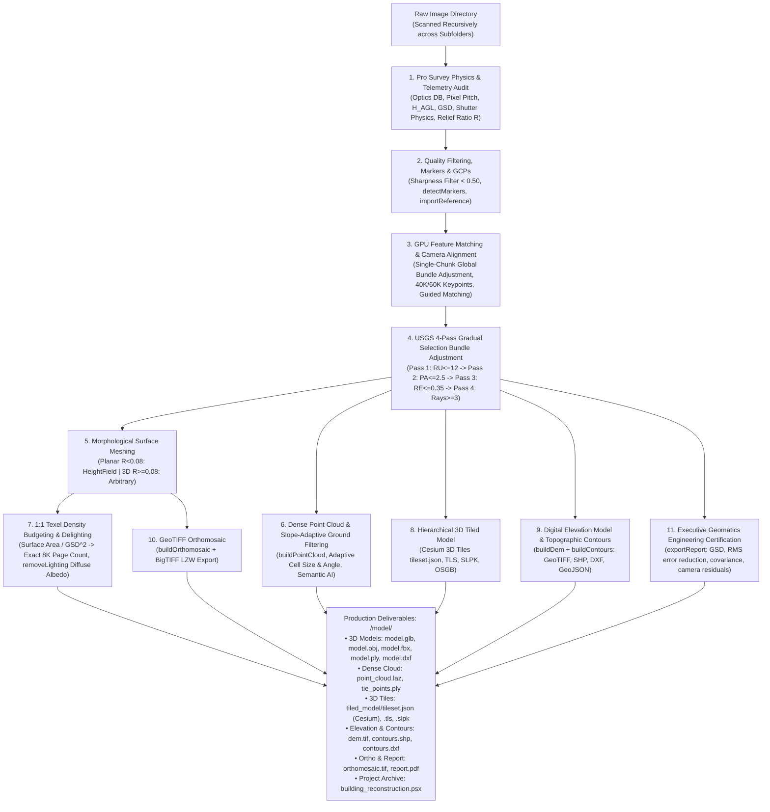

# High-Precision 3D Photogrammetry, Survey Physics Engine & Complete Metashape Processing

Autonomous end-to-end photogrammetry and aerial survey pipeline transforming raw image folders (drone surveys, architectural captures, ground inspections) into high-density textured 3D models (`.obj`, `.mtl`, `.glb`, `.fbx`, `.ply`), classified dense point clouds (`.laz`, `.las`, `.ply`, `.e57`), hierarchical 3D Tiled Models (Cesium 3D Tiles, TLS, SLPK, OSGB), Digital Elevation Models (`dem.tif`), topographic contour vector maps (`.shp`, `.dxf`, `.geojson`, `.kml`), GeoTIFF orthomosaic maps (`orthomosaic.tif`), executive calibration quality reports (`report.pdf`), and native Agisoft Metashape Professional projects (`.psx`).

---

## When To Use

Use this skill when:
- The user provides an image folder (drone survey, building inspection, or ground photogrammetry) and requests 3D models, classified point clouds, digital elevation models, topographic contours, or orthomosaic maps.
- The user requests an agent that acts like a **Senior Certified Photogrammetrist & Geomatics Engineer**: never relying on simplistic preset heuristics, but systematically auditing survey physics (physical sensor dimensions, pixel pitch in $\mu\text{m}$, flying height $H_{AGL}$, true Ground Sampling Distance GSD in $\text{cm/px}$, forward/lateral overlap geometry, mechanical leaf vs CMOS electronic rolling shutter distinction, dynamic range shadow clipping, and topographic relief ratio $R = \Delta Z / D_{diag}$).
- Professional bundle adjustment optimization is required: executes the **USGS 4-Pass Gradual Selection protocol** (`ReconstructionUncertainty` $\to$ `ProjectionAccuracy` $\to$ `ReprojectionError` $\to$ `ImageCount` multiplicity) with staged camera parameter unfreezing ($f, cx, cy \to k_1..k_3, p_1..p_2 \to k_4, b_1, b_2$ with adaptive fitting) to guarantee sub-pixel reprojection residuals ($< 0.35\text{ px}$).
- 1:1 Ground Texel Density Budgeting is needed: calculates the exact texture atlas page count required to match camera optical resolution on the 3D surface, eliminating blurry textures or bloated empty UV sheets.
- Dense 3D Point Clouds are required: generates point clouds directly from depth maps (`chunk.buildPointCloud()`), filters low-confidence points, performs slope-adaptive ground classification (`classifyGroundPoints`), or applies AI semantic classification (`classifyPoints`) with export to compressed LAZ, LAS, PLY, E57, or XYZ.
- Hierarchical 3D Tiled Models (LOD) are required: generates streaming LOD tilesets in Cesium 3D Tiles (`tileset.json` + `b3dm`), Agisoft TLS (`.tls`), Esri Scene Layer Package (`.slpk`), or OpenSceneGraph (`.osgb`) for massive web GIS applications.
- Topographic Digital Elevation Models (DEM/DSM/DTM) or vector contour lines (ESRI Shapefile, AutoCAD DXF, GeoJSON, KML) are needed at custom elevation intervals (e.g., 0.5m, 1m, 2m, 5m).
- Texture Delighting / Shadow Removal is needed: removes harsh direct sunlight shadows and ambient occlusion using `chunk.removeLighting()` to recover true photographic diffuse albedo textures for game engines and VFX.
- Survey Ground Control Points (GCP) or RTK antenna coordinates CSV/TXT need to be imported (`chunk.importReference()`) to establish millimeter-accurate georeferencing.
- Coded target markers or AprilTags need to be automatically detected across photos (`chunk.detectMarkers()`).
- Radiometric color calibration and white balance equalization across cameras is required (`chunk.calibrateColors()`).
- Reconstructing architectural structures, buildings, urban environments, or complex terrain requiring metric accuracy, flat walls, and crisp 90-degree corners.
- Exporting into multiple CAD/DCC formats: Autodesk FBX, Stanford PLY, AutoCAD DXF, alongside binary glTF and Wavefront OBJ.

Do not use this skill when:
- Synthesizing 3D models from single images, sketches, or text prompts without multi-view photographic overlap.
- Running pure 2D image enhancement without 3D geometric triangulation.

---

## Workflow



### 1. Senior Photogrammetrist Operating Protocol

As a Senior Certified Photogrammetrist & Geomatics Specialist, the agent follows strict physics-based engineering rules:
1. **Never guess or cite rigid presets**: Analyze the raw image headers and telemetry to extract physical sensor properties and flight geometry.
2. **Execute the Survey Physics Audit First**: Run `--profile` or compute the optics metrics before proposing or executing a reconstruction.
3. **Respect Camera Shutter Physics**:
   - For **Mechanical Leaf / Global Shutters** (e.g. DJI Phantom 4 Pro `FC6310`, Mavic 3 Enterprise Wide `FC3411`, Zenmuse P1, Phase One, Hasselblad): **Rolling shutter compensation must be DISABLED**. Enabling rolling shutter compensation on mechanical leaf shutters introduces ill-conditioned parameters into bundle adjustment and causes synthetic elevation drift.
   - For **Electronic CMOS Rolling Shutters** (e.g. DJI Mini series, Mavic Air, Air 2S, Mavic Pro, consumer smartphones): Enable `Metashape.Shutter.Model.Regularized` to eliminate flight-velocity shear.
4. **Execute the USGS 4-Pass Gradual Selection Protocol**:
   Never accept raw sparse tie points. Staged parameter unfreezing is mandatory:
   - **Pass 1 (Reconstruction Uncertainty $\le 12.0$)**: Prunes tie points with shallow ray intersection angles. Unfreezes basic interior orientation: $f, cx, cy$ only.
   - **Pass 2 (Projection Accuracy $\le 2.5\text{ px}$)**: Prunes tie points with ambiguous pixel correlation. Unfreezes radial distortion: $f, cx, cy, k_1, k_2, k_3, p_1, p_2$.
   - **Pass 3 (Reprojection Error $\le 0.35\text{ px}$)**: Prunes high-residual outlier points. Unfreezes complete polynomial model: $f, cx, cy, k_1..k_4, b_1, b_2, p_1, p_2$ with adaptive fitting and tie point covariance.
   - **Pass 4 (Image Multiplicity $\ge 3$)**: Discards fragile 2-ray intersections. Locks in bundle adjustment geometry and reports initial vs final RMS reprojection error.
5. **Derive Slope-Adaptive Ground Point Filtering**:
   Calculate the terrain relief ratio $R = \Delta Z / D_{diag}$:
   - Planar terrain ($R < 0.08$): `cell_size = 35.0m`, `max_angle = 12.0 deg`, `max_distance = 0.6m`, meshing as `HeightField`.
   - High relief / 3D architecture ($R \ge 0.08$): `cell_size = 12.0m`, `max_angle = 28.0 deg`, `max_distance = 0.3m`, meshing as `Arbitrary`.
6. **Enforce 1:1 Ground Texel Density Budgeting**:
   Texture page count must be budgeted from the measured 3D mesh surface area $A_{m^2}$ and optical GSD:
   $$N_{pages} = \text{clamp}\left(\text{ceil}\left(\frac{A_{m^2} \times 10^4}{\text{GSD}^2 \times 67,108,864} \times 1.25\right), 1, 32\right)$$
7. **Present the Executive Geomatics Engineering Summary**:
   Provide the user with an authoritative engineering report:
   ```
   ================================================================================
     PRO PHOTOGRAMMETRY & GEOMATICS ENGINEERING REPORT
   ================================================================================
     Sensor Hardware:     DJI Mavic 3 Enterprise Wide (FC3411)
     Sensor Geometry:     17.3 x 13.0 mm  |  Pixel Pitch: 3.28 µm
     Shutter Physics:     Mechanical Leaf / Global Shutter [RS Comp: DISABLED]
     Optics & Altitude:   Focal Length: 12.29 mm  |  Flying Height: 85.0 m AGL  |  GSD: 2.26 cm/px
     Overlap Geometry:    Forward: 82.4%  |  Lateral: 68.2% [PASS]
     Dynamic Range:       Shadow Clipping: 18.2%  |  Delighting: ACTIVATED (Diffuse Albedo)
     Topographic Relief:  Span: 342.1m  |  Delta Z: 12.4m  |  R = 0.036 -> HEIGHTFIELD Meshing
     USGS 4-Pass Bundle:  Pass 1 (RU<=12) -> Pass 2 (PA<=2.5) -> Pass 3 (RE<=0.35) -> Pass 4 (Multiplicity>=3)
     Reprojection RMS:    Initial: 1.182 px  ->  Optimized: 0.284 px  (RMS Reduction: 75.9%)
     Multi-ray Tiepoints: 18,420 robust tie points locked in (pruned 6,840 fragile rays)
     1:1 Texel Budget:    Mesh Surface Area: 38,200 m² @ 2.26 cm GSD -> 2x 8K Pages (1.18 cm/texel)
   ================================================================================
   ```

### 2. Complete Metashape Processing Functions

1. **Ingestion, Quality Filtering & Georeferencing**:
   - Recursively traverses `<images_dir>` across all subdirectories, ingesting standard rasters (`.jpg`, `.png`, `.tif`, `.webp`, `.exr`), drone RAW formats (`.dng`, `.cr3`, `.nef`, `.arw`), and radiometric sequences (`.seq`, `.ara`).
   - Executes `chunk.analyzeImages()` to calculate edge gradient sharpness ($<0.50$ disabled).
   - Target Marker Detection (`--detect-markers`, `--target-type`): detects circular coded targets (12-20 bit), cross targets, and AprilTags via `chunk.detectMarkers()`.
   - GCP Reference Import (`--import-reference <path>`): loads ground survey reference CSV/TXT coordinates via `chunk.importReference()` and executes `chunk.updateTransform()`.

2. **Camera Alignment & Radiometric Calibration**:
   - Matching Quality: Medium (`downscale=2`) for optimal memory scaling.
   - Keypoint Limit: 40,000 (or 60,000 for $>30\text{MP}$); Tiepoint Limit: 25,000 tiepoints; Guided Matching enabled by default.
   - Reference Preselection Mode (`--reference-preselection-mode estimated`): Configures camera pair matching using `ReferencePreselectionEstimated` by default, projecting estimated camera frustums onto terrain to robustly pair photos across multi-drone, multi-altitude, or oblique inspection flights without camera dropping.
   - Single-Chunk Default (`--multi-chunk disable`): Solves all images globally in one bundle adjustment to prevent false alignment or chunk-merging offsets.
   - Radiometric Calibration (`--calibrate-colors`): Performs camera color and white balance equalization across frames via `chunk.calibrateColors()`.

3. **Bounding Box Cropping Strategies**:
   - `gps-square` (Default for Building): Smallest area horizontal enclosing square containing all valid camera image positions (filtering outliers like GPS 0,0, null coordinates, or distant takeoff points), rotating in the horizontal plane to minimize footprint while preserving full vertical elevation range so ground terrain and structures are never clipped.
   - `none` (Default for Map & Aerial Surveys): Retains the entire surveyed spatial footprint without clipping perimeter terrain.
   - `structure` (Iteratively Reweighted Least Squares): Computes the 3D line-of-sight intersection of all camera optical viewing axes.
   - `manual`: Saves project and pauses for manual region box positioning in Metashape Pro GUI.

4. **GPU Depth Maps & Dense Point Cloud**:
   - Computes dense per-pixel depth estimation using CUDA on NVIDIA GPUs.
   - Dense Point Cloud (`buildPointCloud`): Fuses depth maps into a 3D point cloud with RGB vertex colors and confidence indices.
   - Decoupled Geomatics Architecture: In-project generation (`--build-point-cloud`, `--build-dem`, `--ortho`) is strictly separated from disk file export (`--export-point-cloud`, `--export-dem`, `--export-ortho`), allowing point clouds and orthomosaics to remain permanently in the native `.psx` database without writing multi-gigabyte disk files unless explicitly requested.
   - Slope-Adaptive Ground Point Classification (`--classify-ground`): Separates bare-earth topography from vegetation and structures using slope-adaptive parameters (`cell_size`, `max_angle`, `max_distance`).
   - AI Semantic Classification (`--classify-points`): Applies multi-class deep learning classification assigning points to ASPRS standard classes (Ground, Low Veg, High Veg, Building, Road, Car).
   - Point Cloud Export: Exports dense point clouds in `.laz`, `.las`, `.ply`, `.e57`, or `.xyz` and sparse tie points via `--export-tie-points`.

5. **Surface Meshing, Smoothing & Decimation**:
   - Surface Type: HeightField (`--surface-type heightfield`) for planar terrain ($R < 0.08$) or Arbitrary (`--surface-type arbitrary`) for 3D structures and complex relief.
   - Planar Hole Closing: Seals window apertures and planar voids via `chunk.model.closeHoles(level=30)`.
   - Laplacian Smoothing (`--smooth-mesh`, `--smooth-strength 3.0`): Applies Laplacian smoothing preserving sharp feature edges.
   - Decimation (`--decimate-mesh <N>`): Decimates mesh geometry to target polygon face budget.
   - Multi-Format Mesh Export: Binary GLB, Wavefront OBJ + TIFF, Autodesk FBX (`--export-fbx`), Stanford PLY (`--export-ply`), and AutoCAD DXF (`--export-dxf`).

6. **Hierarchical 3D Tiled Model (LOD / Web GIS)**:
   - 3D Tiled Model Generation (`--build-tiled-model`): Builds multiresolution hierarchical LOD mesh tiles directly from depth maps (`chunk.buildTiledModel()`).
   - Format Support (`--tiled-model-format [cesium|tls|slpk|osgb]`): Exports Cesium 3D Tiles (`tileset.json` + `b3dm`) for web GIS (CesiumJS, Unreal Engine), Agisoft TLS (`.tls`), Esri Scene Layer Package (`.slpk`), or OpenSceneGraph (`.osgb`).

7. **Texture Atlas & Delighting (Shadow Removal)**:
   - Dynamically sizes UV atlas pages for 1:1 ground texel parity matching the camera GSD.
   - Projects photographic pixels with `MosaicBlending`, hole filling, and ghosting suppression.
   - Texture Delighting (`--remove-lighting`): Removes direct sunlight shadows and ambient occlusion using `chunk.removeLighting()` to output true diffuse albedo textures.

8. **Elevation Models, Contours & Orthomosaics**:
   - Digital Elevation Model (DEM / DSM / DTM, `--build-dem`): Generated via `chunk.buildDem()`; exported as GeoTIFF with BigTIFF LZW compression (`dem.tif` + `dem.tfw`).
   - Topographic Contour Vectors (`--build-contours`, `--contour-interval 1.0`): Generates vector contour lines at user-specified elevation intervals (`chunk.buildContours()`); exported as ESRI Shapefile (`.shp`), AutoCAD (`.dxf`), GeoJSON (`.geojson`), or Google Earth (`.kml`).
   - GeoTIFF Orthomosaic (`--ortho`): Generated via `chunk.buildOrthomosaic()` projected onto the surface mesh; exported as GeoTIFF with BigTIFF LZW compression and ESRI world file (`orthomosaic.tif` + `orthomosaic.tfw`).
   - Executive PDF Quality & Calibration Report (`--export-report`): Generated via `chunk.exportReport()` documenting camera calibrations, tie-point statistics, reprojection error histograms, ground sampling distance (GSD), and survey overlap.

### 3. Multi-Project Sequential Batch Processing Protocol

When a parent directory contains multiple independent survey projects (e.g. `Surveys/Project_A/`, `Surveys/Project_B/`):

1. **Inspection**: Enumerate all immediate subdirectories in the parent folder. Verify photo counts and telemetry profiles.
2. **Sequential Execution**:
   - Execute each project independently using the Pro Photogrammetry Engine:
     ```powershell
     & "C:/Program Files/Agisoft/Metashape Pro/metashape.exe" -r scripts/metashape_reconstruction.py --images "<parent>/<project>" --preset pro
     ```
   - Nested subfolders within a project (e.g. `Project_A/Flight_1`, `Project_A/Flight_2`) are solved in a single global bundle adjustment by default, ensuring zero chunk-merging false alignment.
3. **Verification Gate**:
   - Check `<project>/<project_name>/` contains deliverables (`<project_name>.obj`, `<project_name>.glb`, `<project_name>.psx`).
   - Confirm camera alignment registration rate $\ge 90\%$.
   - Confirm exit code 0 and zero unhandled exceptions.
4. **Progressive Advancement**: Advance to Project $N+1$ only after Project $N$ passes verification.
5. **Batch Summary**: Present a consolidated Markdown table reporting photo counts, aligned cameras, face counts, and deliverable paths.

### 4. Pipelined Compute-Export Overlap Engine

In high-throughput multi-project workflows, exporting assets (glTF baking, OBJ formatting, multi-page 8K TIFF compression, GeoTIFF DEM generation) takes 25% to 40% of total turnaround time. Because asset export is 99% CPU and disk I/O, running exports sequentially on the cluster forces multi-GPU worker nodes to sit completely idle.

The **Pipelined Compute-Export Overlap Engine** decouples reconstruction from asset exporting:
1. **Reconstruction Export Flag Suppression**:
   - When batch mode runs with pipelined overlap enabled, the GUI passes `--no-export-glb --no-export-obj --no-export-dem --no-export-ortho` to the reconstruction command.
   - As soon as 3D meshing and texturing are saved in `Project_N.psx`, the cluster releases all GPU worker nodes immediately.
2. **Immediate Cluster Advancement**:
   - The coordinator instantly dispatches `Project_N+1` to the GPU cluster workers.
3. **Concurrent Background Host CPU Export**:
   - The host machine asynchronously launches `scripts/metashape_export.py` in the background for `Project_N`.
   - **Process Concurrency Throttle (1 to 8, Default: 5)**: Bounds the number of concurrent export jobs to prevent host RAM exhaustion (each 8K atlas bake requires 8–16 GB RAM) and NVMe write-queue saturation.
   - If maximum concurrent export slots are full when `Project_N+1` finishes, the subsequent project waits in a background thread while the cluster continues crunching `Project_N+2`.

```
GPU Cluster: [Reconstruct Project 1 (GPU)] ──> [Reconstruct Project 2 (GPU)] ──> [Reconstruct Project 3 (GPU)]
Host CPU:                                     [Export Project 1 (CPU)]      ──> [Export Project 2 (CPU)]
```

### 5. Distributed LAN Cluster Processing Protocol

For multi-PC local area networks (LAN), Metashape Network Processing divides large computational stages (feature matching, depth maps, dense point clouds) into parallel subtasks across multiple worker machines.

#### 5.1 Architecture & Network Prerequisites
- **Coordinator / Server**: The Host PC runs the central server dispatching subtasks to available workers.
- **Shared Network Storage**: All machines (Host PC and all worker PCs) must access survey photos and project files using an identical path. Use the native Windows UNC share: `\\HOST_PC\SharedMetashape`. Ensure Windows sharing permissions are granted (Read/Write to Everyone or Authenticated Users). Avoid local drive letters (e.g. `C:\...`) because worker PCs cannot resolve local paths on the host.
- **Firewall Configuration**: Ensure TCP port 5840 is open for incoming connections on the Host PC:
  ```powershell
  New-NetFirewallRule -DisplayName "Metashape Server Port 5840" -Direction Inbound -LocalPort 5840 -Protocol TCP -Action Allow
  ```

#### 5.2 Zero-Dependency Automated Node Updater (`update.bat`)
Updates any worker or coordinator node directly from GitHub `main` in-place with zero Git dependency, no nested directories, automatic worker termination to release file locks, and user config preservation:
- **In-Place Update**:
  ```powershell
  .\update.bat
  ```
- **Update and Immediately Launch Worker Daemon**:
  ```powershell
  .\update.bat --worker
  ```
- **Update and Immediately Launch Cluster Server**:
  ```powershell
  .\update.bat --server
  ```

#### 5.3 Starting the Cluster Server Daemon (Coordinator Workstation)
The server process coordinates task dispatching and job tracking across all participating cluster nodes:
- **1-Click Windows Launcher**:
  ```powershell
  .\launch_server.bat
  ```
  *(Dynamically discovers Metashape Pro across all drives `C:`, `D:`, `E:`, `F:`, `G:`, detects host LAN IP even on airgapped networks, and displays worker connection instructions).*
- **Custom Ports / CLI Override**:
  ```powershell
  .\launch_server.bat --port 5840 --dispatch-port 5841
  ```

#### 5.4 Starting Cluster Worker Nodes (All Participating Workstations)
To harness GPUs and high-core CPUs across your local network:
- **1-Click Windows Launcher**:
  ```powershell
  .\launch_worker.bat
  ```
  *On first run*: Interactively prompts for the Cluster Server IP and Shared UNC Storage root, then saves to `worker_config.json`.
  *Subsequent runs*: Double-click `launch_worker.bat` to connect instantly with zero typing!
- **Headless / Automation CLI**:
  ```powershell
  .\launch_worker.bat --host <SERVER_IP> --root "\\HOST_PC\SharedMetashape" --cpu 1
  ```
- **Pre-Flight Health Diagnostics Built-in**:
  1. Validates Metashape Pro executable across `%ProgramFiles%` and all drives `C:`, `D:`, `E:`, `F:`, `G:`.
  2. Tests TCP port reachability to server host (flags firewall issues immediately).
  3. Tests Shared UNC storage directory access and permissions.
  4. **Native Multi-GPU Benchmark & Discovery**: When `--gpu-mask` is omitted (default), Metashape Pro's native C++ engine automatically discovers, benchmarks, and engages all high-performance discrete GPUs while bypassing integrated graphics (Intel UHD/HD, AMD APU). Explicit bitmasks (e.g. `--gpu-mask 0` for CPU-only) are supported as manual overrides.
  5. **Auto-Reconnect**: Automatically reconnects every 10s if the server restarts or network fluctuates.

#### 5.5 Worker Node Configuration (`worker_config.json`) & Unattended Provisioning
When `launch_worker.bat` runs interactively, it automatically creates `worker_config.json`. For automated deployment or mass provisioning across multiple worker PCs without interactive prompts, place a `worker_config.json` file in the AutoMetashape root directory:

```json
{
  "host": "10.2.8.43",
  "port": "5840",
  "root": "\\\\HOST_PC\\SharedMetashape",
  "cpu_enable": 1
}
```

- **Configuration Fields**:
  - `host` *(string)*: Cluster Coordinator workstation LAN IP address or DNS hostname.
  - `port` *(string)*: Cluster Server control port (default `"5840"`).
  - `root` *(string)*: Universal Windows UNC network share path accessible identically across all nodes.
  - `cpu_enable` *(int)*: Set to `1` to utilize CPU compute cores, or `0` for GPU-only execution.
  - `gpu_mask` *(string, optional)*: Manual GPU device bitmask override (e.g. `"0"` for CPU-only, or an explicit device bitmask). When omitted or set to `"Auto"` (recommended default), Metashape Pro dynamically benchmarks and engages all available discrete GPUs natively.
- **Interactive Reconfiguration**:
  To update an existing node's configuration at any time, run:
  ```powershell
  .\launch_worker.bat --interactive
  ```
- **Custom Config File Override**:
  ```powershell
  .\launch_worker.bat --config "D:\configs\custom_worker.json"
  ```

#### 5.6 Checking Connectivity & Connected Worker Discovery
Inspect connected cluster nodes via Python or CLI:
```python
import Metashape
client = Metashape.NetworkClient()
client.connect("<SERVER_IP>:5840")
workers = client.workerList()
active_workers = workers.get("workers", []) if isinstance(workers, dict) else workers
print(f"Connected Workers ({len(active_workers)}):")
for w in active_workers:
    host = w.get("hostname", "Worker")
    ram_gb = w.get("memory_size", 0) / (1024 ** 3)
    print(f"  • Host: {host} | State: {w.get('state')} | RAM: {ram_gb:.1f} GB")
```

#### 5.7 Autonomous 1-Hour Monitoring & Self-Healing Protocol
For massive multi-flight photogrammetry reconstructions running on the cluster (4–12+ hours), the AI Agent executes an autonomous **1-Hour Monitoring & Self-Healing Cycle**:

```
┌─────────────────────────────────────────────────────────────────────────────┐
│                    HOURLY AGENT AUDIT & HEALING CYCLE                       │
├─────────────────────────────────────────────────────────────────────────────┤
│ 1. Telemetry & Milestone Inspection:                                        │
│    - Query Metashape.NetworkClient (serverInfo, batchList, workerList)      │
│    - Read _autometashape_status.json sidecar from shared output folder      │
│ 2. Formulate Structured Hourly Production Report:                           │
│    - Active Batches: Current stage, subtask completion %, elapsed time, ETA│
│    - Worker Health: Active/idle states, GPU utilization, memory usage       │
│    - Disk Deliverables: Completed .obj, .glb, .tif orthomosaics             │
│ 3. Automated Connection & Self-Healing Diagnostics:                         │
│    - Dropped Worker Node? -> Pings host, alerts user or restarts daemon     │
│    - Stalled Task (>45m 0% progress)? -> Triggers safe checkpoint resume    │
│    - Storage Latency / Access Drops? -> Audits SMB UNC path connectivity    │
└─────────────────────────────────────────────────────────────────────────────┘
```

> [!IMPORTANT]
> **Strict Non-Destructive Code Governance Boundary**:
> * **Permitted Self-Healing Actions**: Network reconnection, daemon restarts, batch retry via `--resume`, lockfile cleanup, and structured progress reporting.
> * **STRICTLY PROHIBITED**: The agent must **NEVER** autonomously rewrite, mutate, refactor, or modify core reconstruction code, pipeline scripts, or algorithm presets during monitoring runs.
> * **User Intent Invariant**: All code modifications and pipeline rewrites strictly require explicit user instructions and authorization.

#### 5.8 Submitting Distributed Reconstructions & Pipelined Export Overlap
Dispatch autonomous reconstruction to the active cluster:
```powershell
& "C:\Program Files\Agisoft\Metashape Pro\metashape.exe" -r scripts/metashape_reconstruction.py \
    --images "\\SERVER\SharedMetashape\041126\0043" \
    --preset pro \
    --network-enable --network-host <SERVER_IP> --network-port 5840 --network-path "\\SERVER\SharedMetashape"
```

#### 5.9 Host-Initiated Autonomous Worker Fleet Update Protocol
When maintaining or upgrading remote cluster worker nodes from the Host/Coordinator workstation (`CTUAV`), strictly execute the **Autonomous Worker Fleet Update Protocol**:

1. **Zero Fleet-Wide Blind Kills**:
   - Never kill, trigger, or push fleet-wide updates across all remote cluster worker nodes simultaneously.
   - Broad simultaneous kills sever the cluster compute fabric and risk collective fleet timeouts or network saturation.
2. **Single Canary Node Verification Gate**:
   - Updates must always be tested on exactly **ONE canary worker node** first (e.g. `tan` or `DESKTOP-RJUQ6L8`).
   - Monitor the canary node's lifecycle state via `Metashape.NetworkClient().workerList()`:
     $$\text{inprogress (dispatched probe)} \longrightarrow \text{offline (releasing file locks)} \longrightarrow \text{ready (online with fresh code)}$$
   - Confirm the canary worker node completes self-update, auto-discovers GPUs, and re-registers cleanly as `ready` within **60–90 seconds**.
   - Only after the canary node passes the verification gate may update batches proceed across remaining worker nodes in staggered waves.
3. **Preserve Host / Coordinator Exemption**:
   - The coordinator workstation (`CTUAV` / `10.5.10.202`) hosts the cluster server process and must be **explicitly filtered out** from remote worker update batches.
   - Remote worker update probes must only target designated remote worker hosts (`host != "CTUAV"`).
4. **Zero-Touch Headless Invariants**:
   - Remote workers execute `launch_worker.bat --non-interactive` with automatic UNC storage path inference (`\\ctuav\catp`).
   - Remote worker updates must never block on interactive console prompts (`input()`) or unmanaged binary fallbacks.
   - Dynamic multi-GPU detection is preserved without injecting hardcoded `gpu_mask` values into `worker_config.json`.

### 6. Web Studio Dynamic Telemetry Dashboard

The integrated Web Studio (`web/projects_dashboard.html`) provides real-time survey asset intelligence, optics audits, and KPI tracking without mock data or static placeholders:
1. **Live Telemetry Generation**: The GUI automatically profiles active queue projects and completed output directories using `analyze_survey_physics()`, writing structured telemetry into `web/projects_data.js`.
2. **KPI Metrics**: Real-time aggregation of total survey photos, alignment percentage, active/completed project counts, total 3D mesh faces, and 8K texture atlas pages.
3. **Dynamic GSD Distribution**: Inline SVG bar chart visually rendering Ground Sampling Distance (GSD) compliance ($< 1.5\text{ cm/px}$) across all ingested flight missions.
4. **Zero-State Handling**: Standalone browser opens display an empty state banner with instructions instead of hardcoded mock records.

### 7. CLI Recipes & Usage

You can execute reconstructions using either **Option A (Direct via Metashape Pro)** or **Option B (Standard Python Auto-Handoff)**:

```powershell
# Option A: Direct via Metashape Pro binary:
& "metashape.exe" -r scripts/metashape_reconstruction.py --images "D:/Surveys/Site_A" --preset pro

# Option B: Standard Python (Auto-locates Metashape across all drives and runs inside Metashape runtime):
python scripts/metashape_reconstruction.py --images "D:/Surveys/Site_A" --preset pro

# Full Drone Topographic Survey with Point Cloud, DEM, Contours & Cesium 3D Tiles:
& "C:/Program Files/Agisoft/Metashape Pro/metashape.exe" -r scripts/metashape_reconstruction.py \
    --images "D:/Surveys/Topography" \
    --preset pro \
    --build-point-cloud --point-cloud-format laz --classify-ground \
    --build-dem --build-contours --contour-interval 1.0 --contours-format shp \
    --build-tiled-model --tiled-model-format cesium \
    --export-report

# Heritage Architectural Facade with Coded Target Detection, GCP Import, Delighting & FBX:
& "C:/Program Files/Agisoft/Metashape Pro/metashape.exe" -r scripts/metashape_reconstruction.py \
    --images "D:/Surveys/HeritageSite" \
    --preset pro \
    --detect-markers --target-type circular12 \
    --import-reference "D:/Surveys/HeritageSite/gcps.csv" \
    --calibrate-colors --remove-lighting \
    --export-fbx --export-ply \
    --export-report

# Standalone Optics & Telemetry Profiling (Inspect Only):
& "C:/Program Files/Agisoft/Metashape Pro/metashape.exe" -r scripts/metashape_reconstruction.py --images "D:/Surveys/Site_A" --profile

# Distributed LAN Network Cluster Reconstruction:
& "C:/Program Files/Agisoft/Metashape Pro/metashape.exe" -r scripts/metashape_reconstruction.py \
    --images "\\HOST_PC\SharedMetashape\Site_A" \
    --preset pro \
    --network-enable --network-host 192.168.1.100 --network-port 5840 --network-path "\\HOST_PC\SharedMetashape"

# Decoupled Pipelined Reconstruction (Export Suppressed for Host Background Overlap):
& "C:/Program Files/Agisoft/Metashape Pro/metashape.exe" -r scripts/metashape_reconstruction.py \
    --images "D:/Surveys/Site_A" \
    --preset pro \
    --no-export-glb --no-export-obj --no-export-dem --no-export-ortho

# Checkpoint Resume:
& "C:/Program Files/Agisoft/Metashape Pro/metashape.exe" -r scripts/metashape_reconstruction.py --images "D:/Surveys/Site_A" --resume
```

---

## Validation

Reconstruction outputs must satisfy the following quality criteria:
1. **Camera Quality Filtering**: All active cameras must have sharpness quality $\ge 0.50$ (blurry frames disabled).
2. **Camera Registration**: At least $90\%$ of active input images must be successfully registered in space.
3. **Reprojection Residuals**: Bundle adjustment re-optimization must achieve RMS reprojection error $\le 0.35\text{ px}$.
4. **Tie-Point Multiplicity**: Multi-ray intersections must maintain multiplicity $\ge 3$ rays (fragile 2-ray ties eliminated).
5. **Shutter Mechanics Conformance**: Rolling shutter compensation verified as DISABLED for mechanical leaf shutters (e.g. DJI FC3411, FC6310, Zenmuse P1) to protect elevation accuracy.
6. **Point Cloud Integrity**: When point cloud generation is requested, `point_cloud.laz` (or `.las`, `.ply`, `.e57`) must be generated and non-empty.
7. **Surface Topology**: Arbitrary or HeightField surface mesh targeting specified face count ($600\text{K} - 2\text{M}$), free from degenerate zero-area faces.
8. **1:1 Texel Density**: Texture atlas resolution $\ge 8192\times 8192$ budgeted for 1:1 ground texel parity with zero unmapped black voids.
9. **Elevation Models & Contours**: GeoTIFF files (`dem.tif`, `orthomosaic.tif`) and vector shapefiles (`contours.shp`) exported with accompanying world/projection files.
10. **Tiled Model**: Cesium 3D Tiles (`tileset.json`) or TLS archive exported with valid LOD bounding hierarchy.
11. **Quality Report**: `report.pdf` generated containing camera calibration parameters and error estimates.
12. **Native Project**: Native `.psx` file must be successfully saved and loadable in Agisoft Metashape Professional GUI.

---

## Maintenance

- Ensure `metashape.exe` is installed at `C:/Program Files/Agisoft/Metashape Pro/metashape.exe` or configured on the system PATH.
- Verify NVIDIA GPU CUDA runtime with `nvidia-smi` to ensure Metashape GPU acceleration is active.
- Keep `scripts/metashape_reconstruction.py` updated to match Agisoft Metashape Python API versions.
- Maintain synchronization between `scripts/metashape_reconstruction.py`, `scripts/metashape_export.py`, and `scripts/cluster_utils.py`.

---

## References

- [evaluations.md](evaluations.md)
- [scripts/metashape_reconstruction.py](../../../scripts/metashape_reconstruction.py)
- [scripts/metashape_export.py](../../../scripts/metashape_export.py)
- [scripts/cluster_utils.py](../../../scripts/cluster_utils.py)
- [update.bat](../../../update.bat)
- [launch_worker.bat](../../../launch_worker.bat)
- [launch_server.bat](../../../launch_server.bat)
- [Agisoft Metashape Professional User Manual (v2.x)](https://www.agisoft.com/downloads/user-manuals/)
- [Open Geospatial Consortium (OGC) 3D Tiles Specification](https://www.ogc.org/standards/3DTiles)
- [USGS National Geospatial Program Photogrammetry Standards](https://www.usgs.gov/core-science-systems/ngp)
- [ASPRS LAS 1.4 Specification & Point Classification Standards](https://www.asprs.org/divisions-committees/lidar-division/laser-las-file-format-exchange-activities)
