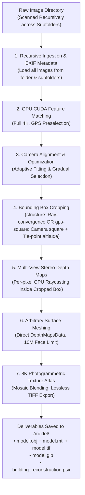

# High-Precision 3D Photogrammetry & Architectural Reconstruction

Autonomous end-to-end photogrammetry pipeline transforming raw image folders (drone surveys, architectural captures, ground inspections) into high-density textured 3D models (`.obj`, `.mtl`, `.glb`) and native Agisoft Metashape Professional projects (`.psx`).

---

## When To Use

Use this skill when:
- The user provides an image folder (drone survey, building inspection, or ground photogrammetry) and requests a 3D model with realistic photographic texture.
- Images are located across the main folder and nested subfolders (e.g., flight batches, multi-camera rigs).
- Reconstructing architectural structures, buildings, urban environments, or complex terrain requiring metric accuracy, flat walls, and crisp 90-degree corners.
- Automatic cropping to the main structure or flight envelope is desired:
  - `structure`: Pinpoints the target structure via camera optical ray convergence and sets the bounding box tightly around building walls.
  - `gps-square`: Computes the smallest enclosing horizontal square of all camera poses with altitude bounded by $[\min, \max]$ tie points inside the square.
- Inspecting or editing 3D models inside **Agisoft Metashape Professional**, Blender, Unreal Engine, 3ds Max, CAD, or GIS software.
- Requiring high polygon counts (10M faces limit) and lossless uncompressed texture atlases (8K 8192×8192 TIFF mosaic photographic blending).

Do not use this skill when:
- Synthesizing 3D models from single images, sketches, or text prompts without multi-view photographic overlap.
- Running pure 2D image enhancement without 3D geometric triangulation.

---

## Workflow



### 1. Ingestion & Directory Convention
When given an image directory, recursively load all images across the target folder and all subfolders. Run the autonomous pipeline without needing manual output or grade flags (Ultra Grade, auto-cropping, and `<images_dir>/model/` destination are default):
```powershell
& "C:/Program Files/Agisoft/Metashape Pro/metashape.exe" -r scripts/metashape_reconstruction.py --images "<path_to_images>"
```

> [!NOTE]
> The pipeline strictly defaults to:
> - **Recursive Discovery**: Scans all subdirectories of `<path_to_images>` for `.jpg`, `.jpeg`, `.png`, `.tif`, and `.tiff`.
> - **Output Subfolder**: Automatically creates `<path_to_images>/model/` and places all outputs there.
> - **Auto-Cropping**: Isolates target volume to focus 100% of reconstruction geometry on the surveyed structure.
> - **Ultra Grade Standard**: 10,000,000 face limit, full 4K MVS depth maps (`downscale=1`), tie-point Gradual Selection optimization, and uncompressed 8K TIFF textures.

### 2. High-Accuracy GPU Matching & Alignment
- **Matching**: `downscale=1` (1:1 full resolution), `keypoint_limit=40000`, `tiepoint_limit=4000`. Uses GPS Reference Preselection so images match against spatial neighbors.
- **Alignment**: Solves camera positions $(X, Y, Z)$, orientations, and non-linear lens distortion ($f, c_x, c_y, k_1, k_2, k_3, k_4, p_1, p_2$).
- **Camera Optimization (Gradual Selection)**: Enabled by default. Prunes high reprojection error ($>0.4\text{ px}$) and high reconstruction uncertainty ($>15$) tie points before re-optimizing lens parameters.

### 3. Automated Bounding Box Cropping Strategies
Metashape's default bounding box (`chunk.region`) encompasses all tie points, including distant horizon, background trees, and surrounding streets. The pipeline provides two automated cropping strategies (`--crop-method`):

#### Method 1: `structure` (Optical Ray Convergence - Default)
- **Principle**: Computes the least-squares 3D line-of-sight intersection of all camera optical viewing axes using Iteratively Reweighted Least Squares (IRLS).
- **Outlier Immunity**: Prunes outlier viewing angles (e.g. when 10–20% of cameras focus on secondary points or takeoff paths), locking firmly onto the main structure.
- **Best For**: Orbit flights, building facade scans, inspection surveys.
- **Bounds**: Tightly hugs the building exterior walls.

#### Method 2: `gps-square` (Camera GPS Square + Tie-Point Altitude)
- **Principle**: Calculates the smallest enclosing horizontal square $(X, Y)$ containing all camera GPS positions. Then, queries all tie points falling strictly inside that horizontal footprint to find the true lowest altitude ($Z_{\min}$, ground level) and highest altitude ($Z_{\max}$, roof/spire).
- **Outlier Immunity**: Applies robust Median Absolute Deviation (MAD) to camera positions so distant takeoff/landing spots do not inflate the square.
- **Best For**: Lawn-mower grid flights, roof surveys, property compounds, and mapping flights.
- **Bounds**: Guaranteed not to clip any architectural elements because the drone flew outside or above them.

```powershell
# Run with Camera GPS Square + Tie-Point Altitude bounds:
& "C:/Program Files/Agisoft/Metashape Pro/metashape.exe" -r scripts/metashape_reconstruction.py --images "<path_to_images>" --crop-method gps-square
```

> [!TIP]
> **Millimeter Human Intent Control**: If you need exact control over whether adjacent sidewalks, exterior fences, or driveways are included or trimmed, run with `--pause-after-crop`. The script saves `building_reconstruction.psx` right after alignment and auto-cropping, allowing you to open the project in Metashape GUI, visually tweak the box in 5 seconds, save, and press Enter in the terminal to resume!

### 4. GPU Multi-View Stereo (MVS) Depth Maps
- Computes dense per-pixel depth estimation using CUDA on NVIDIA GPUs strictly within the cropped bounding box.
- **Default (Ultra)**: `downscale=1` (full 4K depth maps per camera).
- Uses `MildFiltering` to retain fine architectural structures (antennas, window mullions, roof trim, columns).

### 5. Arbitrary Surface Polygonal Meshing
- Fuses visibility-consistent depth maps into a continuous polygonal mesh using `DataSource.DepthMapsData` (avoiding the intermediate dense point cloud and melted wax Poisson artifacts).
- Targets **10,000,000 faces limit** by default (Ultra Grade) to prevent unwieldy file bloat while maintaining extreme architectural precision.

### 6. Multi-Page 8K Photographic Texture Baking & Lossless TIFF Export
- Computes optimized UV parameterization (`GenericMapping`).
- Projects photographic pixels from all original 4K frames using `MosaicBlending` with `ghosting_filter=True` and `fill_holes=True`.
- Exports texture maps in **lossless uncompressed TIFF (`.tif`) format** (no JPEG compression artifacts) at **8192×8192 (8K)** resolution across 4 pages.

### 7. Production Deliverables
All deliverables are automatically placed into `<path_to_images>/model/`:
- `model.obj` + `model.mtl` + `model.tif`: Industry-standard mesh format with uncompressed 8K TIFF texture atlas compatible with all DCC/CAD tools.
- `model.glb`: Binary glTF format with embedded PBR textures for instant web and 3D viewer rendering.
- `building_reconstruction.psx` + `building_reconstruction.files/`: Native Metashape Professional project retaining all camera alignments, depth maps, and UV textures for direct inspection and further editing.

---

## Validation

Reconstruction must satisfy the following quality criteria:
1. **Camera Registration**: At least $90\%$ of input images must be successfully registered in space.
2. **Target Bounding Box**: `chunk.region` must be tightly centered on the surveyed area, discarding $\ge 70\%$ of horizon background volume.
3. **Surface Topology**: Arbitrary surface mesh with $\ge 1,500,000$ polygon faces, free from degenerate zero-area faces.
4. **Texture Atlas**: Resolution $\ge 8192\times 8192$ with valid UV mapping and zero unmapped black voids.
5. **Project File**: Native `.psx` file must be successfully saved and loadable in Agisoft Metashape Professional GUI.

---

## Maintenance

- Ensure `metashape.exe` is installed at `C:/Program Files/Agisoft/Metashape Pro/metashape.exe` or configured on the system PATH.
- Verify NVIDIA GPU CUDA runtime with `nvidia-smi` to ensure Metashape GPU acceleration is active.
- Keep `scripts/metashape_reconstruction.py` updated to match Agisoft Metashape Python API versions.

---

## References

- [Agisoft Metashape Professional User Manual](https://www.agisoft.com/downloads/user-manuals/)
- [USGS National Geospatial Program Photogrammetry Standards](https://www.usgs.gov/core-science-systems/ngp)
