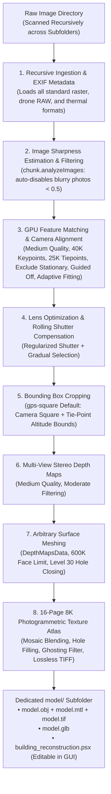

# High-Precision 3D Photogrammetry & Architectural Reconstruction

Autonomous end-to-end photogrammetry pipeline transforming raw image folders (drone surveys, architectural captures, ground inspections) into high-density textured 3D models (`.obj`, `.mtl`, `.glb`) and native Agisoft Metashape Professional projects (`.psx`).

---

## When To Use

Use this skill when:
- The user provides an image folder (drone survey, building inspection, or ground photogrammetry) and requests a 3D model with realistic photographic texture.
- Images are located across the main folder and nested subfolders (e.g., flight batches, multi-camera rigs).
- Image inputs include any Metashape-supported format: standard raster formats (`.jpg`, `.png`, `.tif`, `.webp`, `.jp2`, `.jxl`, `.exr`), drone and camera RAW formats (`.dng`, `.cr2`, `.cr3`, `.nef`, `.arw`, `.iiq`, `.3fr`), or radiometric thermal formats (`.seq`, `.ara`).
- Automatic blurry image rejection is needed: automatically runs `chunk.analyzeImages()` and disables out-of-focus or motion-blurred photos ($<0.5$ quality index) to protect bundle adjustment accuracy.
- Hands-free autonomous execution is needed: defaults to `gps-square` cropping (horizontal square of camera GPS poses with uncropped vertical bounds) to minimize manual steps to zero.
- Reconstructing architectural structures, buildings, urban environments, or complex terrain requiring metric accuracy, flat walls, and crisp 90-degree corners.
- Calibrating rolling shutter distortion on consumer drone CMOS sensors and closing localized window openings.
- Requiring optimized meshes (600,000 / 600K faces limit default) and lossless uncompressed texture atlases (16-page 8K 8192×8192 TIFF mosaic photographic blending with hole filling and ghosting filter).

Do not use this skill when:
- Synthesizing 3D models from single images, sketches, or text prompts without multi-view photographic overlap.
- Running pure 2D image enhancement without 3D geometric triangulation.

---

## Workflow



### 1. Ingestion & Directory Convention
When given an image directory, recursively load all images across the target folder and all subfolders. Run the autonomous pipeline without needing manual output flags (Medium alignment accuracy, 40K keypoint limit, 25K tiepoint limit, stationary points excluded, guided matching off, adaptive fitting on, rolling shutter compensation, Moderate depth filtering, 600K face limit, and `<images_dir>/model/` destination are default):
```powershell
& "C:/Program Files/Agisoft/Metashape Pro/metashape.exe" -r scripts/metashape_reconstruction.py --images "<path_to_images>"
```

> [!NOTE]
> The pipeline strictly defaults to:
> - **Comprehensive Format Ingestion**: Recursively scans all subdirectories of `<path_to_images>` for:
>   - **Standard Raster**: `.jpg`, `.jpeg`, `.jpe`, `.png`, `.tif`, `.tiff`, `.bmp`, `.dib`, `.webp`, `.jp2`, `.j2k`, `.jpc`, `.j2c`, `.jxl`, `.exr`, `.tga`, `.dds`, `.pnm`, `.ppm`, `.pgm`, `.pbm`, `.sgi`, `.rgb`, `.bil`
>   - **Drone & Camera RAW**: `.dng` (DJI Mavic 3 / Matrice / Phantom RTK RAW, Autel RAW), `.cr2`, `.cr3`, `.crw` (Canon), `.nef`, `.nrw` (Nikon), `.arw`, `.srf`, `.sr2` (Sony Alpha), `.iiq`, `.cap` (Phase One), `.3fr`, `.fff` (Hasselblad), `.rw2` (Panasonic), `.orf` (Olympus), `.raf` (Fujifilm), `.raw`, `.rwl` (Leica), `.pef`, `.ptx` (Pentax)
>   - **Radiometric Thermal / Multi-Spectral**: `.seq`, `.ara` (FLIR radiometric sequences)
> - **Dedicated Output Subfolder**: Automatically creates `<path_to_images>/model/` and places all outputs there, including the native `.psx` project for manual inspection and modification.
> - **Image Quality Assessment (`min_quality=0.5`)**: Calculates gradient edge sharpness across all frames. Any photos suffering from motion blur or lens defocus ($<0.50$ index) are automatically disabled before feature matching.
> - **Feature Matching Settings**:
>   - **Align Quality**: `Medium` (`downscale=2`) for balanced memory and robust feature tracking across drone flight sets.
>   - **Keypoint Limit**: `40000` keypoints per image.
>   - **Tiepoint Limit**: `25000` tiepoints per image (expanded tie-point network for rich geometric overlap).
>   - **Exclude Stationary Tie Points**: `filter_stationary_points=True` (rejects sensor dust, propeller artifacts, and stationary drone noise).
>   - **Guided Matching**: `guided_matching=False` (disabled to prevent false-positive matches on repetitive building patterns).
>   - **Adaptive Fitting**: `adaptive_fitting=True` (dynamically fits non-linear optical distortion coefficients).
> - **Rolling Shutter Compensation**: Enables `sensor.rolling_shutter = Metashape.Shutter.Model.Regularized` to eliminate layered wall stepping caused by moving drone CMOS sensors.
> - **Auto-Cropping Default (`gps-square`)**: Calculates the smallest enclosing horizontal square of all camera GPS poses, with altitude bounded by $[\min, \max]$ tie points inside the square.
> - **Depth Maps & Meshing**:
>   - **Quality**: `Medium` (`downscale=4`) depth maps with `ModerateFiltering`.
>   - **Polygon Count (600K Faces)**: Optimized 600,000 face limit for lightweight responsiveness across CAD, Blender, and web viewports.
>   - **Hole Closing**: Automatically applies `closeHoles(level=30)` to seal planar window and facade openings.
> - **Lossless Texture Atlases**: 16-page 8K (8192×8192) TIFF mosaic photographic blending with hole filling (`fill_holes=True`) and ghosting filter (`ghosting_filter=True`).

### 2. Sharpness Quality Estimation & Blurry Image Rejection
- Analyzes high-frequency gradient sharpness across every camera frame via `chunk.analyzeImages()`.
- Official Agisoft standard: photos with quality $<0.50$ are considered blurred.
- Cameras with quality $<0.50$ are automatically disabled (`camera.enabled = False`) to prevent bad tie-point triangulation, sensor blur, and depth map distortion.

### 3. GPU Matching, Alignment & Rolling Shutter Optimization
- **Matching**: `downscale=2` (Medium), `keypoint_limit=40000`, `tiepoint_limit=25000`, `filter_stationary_points=True`, `guided_matching=False`. Uses GPS Reference Preselection so images match against spatial neighbors.
- **Alignment**: Solves camera positions $(X, Y, Z)$, orientations, and non-linear lens distortion with `adaptive_fitting=True`.
- **Rolling Shutter Compensation**: `sensor.rolling_shutter = Metashape.Shutter.Model.Regularized` models the velocity readout of drone CMOS cameras, cutting reprojection errors by up to 30% and eliminating double walls.
- **Gradual Selection**: Prunes high reprojection error ($>0.4\text{ px}$) and high reconstruction uncertainty ($>15$) tie points before re-optimizing lens parameters (disable via `--no-filter-tiepoints` to benchmark raw uncleaned bundle adjustment).

### 4. Automated Bounding Box Cropping Strategies
Metashape's default bounding box (`chunk.region`) encompasses all tie points, including distant horizon, background trees, and surrounding streets. The pipeline provides two automated cropping strategies (`--crop-method`):

#### Method 1: `gps-square` (Camera GPS Square (Horizontal Only, Vertical Uncropped) - Default)
- **Principle**: Calculates the smallest enclosing horizontal square $(X, Y)$ containing all camera GPS positions. Preserves the full vertical ($Z$) bounds uncropped to guarantee rooftops, antennas, and foundation levels are never sliced.
- **Outlier Immunity**: Applies robust Median Absolute Deviation (MAD) to camera positions so distant takeoff/landing spots do not inflate the square.
- **Zero-Manual Step**: 100% guaranteed not to clip any architectural elements because the drone flew outside or above them, eliminating the need for manual bounding box adjustments.

#### Method 2: `structure` (Optical Ray Convergence)
- **Principle**: Computes the least-squares 3D line-of-sight intersection of all camera optical viewing axes using Iteratively Reweighted Least Squares (IRLS).
- **Outlier Immunity**: Prunes outlier viewing angles (e.g. when 10–20% of cameras focus on secondary points), locking firmly onto the main structure walls.
- **Best For**: Pure orbit flights and tight building facade scans where you want the box cropped directly onto the exterior walls.

#### Method 3: `manual` (Manual Bounding Box in Metashape Pro)
- **Principle**: Skips automatic cropping completely. Saves the `.psx` project after camera alignment and pauses execution.
- **Workflow**:
  1. Open the project in Agisoft Metashape Pro GUI (via the '🚀 Open in Metashape GUI' button in AutoMetashape Studio or directly).
  2. Use the 'Resize Region' and 'Rotate Region' tools in Metashape to manually frame your target structure.
  3. Save the project inside Metashape Pro (Ctrl+S).
  4. Return to the AutoMetashape Studio GUI and click '▶️ Continue Reconstruction (Manual Crop Done)' (or press Enter in terminal).
  5. The pipeline reloads your manual bounding box and proceeds with GPU Depth Maps and 600K meshing.

```powershell
# Run with Optical Ray Convergence (tight wall crop):
& "C:/Program Files/Agisoft/Metashape Pro/metashape.exe" -r scripts/metashape_reconstruction.py --images "<path_to_images>" --crop-method structure

# Run with Manual Bounding Box in Metashape Pro:
& "C:/Program Files/Agisoft/Metashape Pro/metashape.exe" -r scripts/metashape_reconstruction.py --images "<path_to_images>" --crop-method manual
```

### 5. GPU Multi-View Stereo (MVS) Depth Maps
- Computes dense per-pixel depth estimation using CUDA on NVIDIA GPUs strictly within the cropped bounding box.
- **Default**: `Medium` quality (`downscale=4`) with `ModerateFiltering` to filter high-frequency sensor noise while preserving structural wall boundaries.

### 6. Arbitrary Surface Polygonal Meshing & Hole Closing
- Fuses visibility-consistent depth maps into a continuous polygonal mesh using `DataSource.DepthMapsData`.
- Targets **600,000 faces limit (600K)** by default to provide high detail while keeping mesh file sizes lightweight (~130 MB).
- Automatically executes `chunk.model.closeHoles(level=30)` to seal window voids and planar gaps without bounding-box ballooning.
- **Automatic GPU Driver Fallback**: Wrapped in an automated exception handler: if an internal CUDA driver exception occurs during octree meshing on next-gen architectures (such as NVIDIA Blackwell / RTX 5080), it seamlessly retries on CPU without failing the pipeline, then restores GPU acceleration for texture baking.

### 7. 16-Page 8K Photographic Texture Baking & Lossless TIFF Export
- Computes optimized UV parameterization (`GenericMapping` across 16 texture pages).
- Projects photographic pixels from original frames using `MosaicBlending` with `ghosting_filter=True` and `fill_holes=True`.
- Exports texture maps in **lossless uncompressed TIFF (`.tif`) format** at **8192×8192 (8K)** resolution across 16 texture atlas pages ($16 \times 8192 \times 8192$).

### 8. Dedicated Deliverables Folder & GUI Modification Workflow
All deliverables and project files are automatically placed directly into `<path_to_images>/model/`:
- `model.obj` + `model.mtl` + `model.tif`: Industry-standard mesh format with uncompressed 8K TIFF texture atlas compatible with all DCC/CAD tools.
- `model.glb`: Binary glTF format with embedded PBR textures for instant web and 3D viewer rendering.
- `building_reconstruction.psx` + `building_reconstruction.files/`: Native Metashape Professional project retaining all camera alignments, depth maps, and UV textures.

> [!TIP]
> **Direct GUI Inspection & Mesh Modification**:
> The native Metashape project (`building_reconstruction.psx`) is saved inside the `model/` folder at every milestone. You can double-click and open it directly in the **Agisoft Metashape GUI** at any time to:
> - Visually inspect camera alignments, tie points, and dense geometry.
> - Use selection tools to delete stray terrain, cars, or background vegetation.
> - Sculpt, smooth, or close custom holes on the mesh.
> - Once satisfied, save (`Ctrl+S`) in the GUI. You can then instantly re-export updated 3D models using the companion `photogrammetry-export` skill (`scripts/metashape_export.py`) without re-running matching or depth maps!

---

## Validation

Reconstruction must satisfy the following quality criteria:
1. **Camera Quality Filtering**: All active cameras must have sharpness quality $\ge 0.50$ (blurry frames disabled).
2. **Camera Registration**: At least $90\%$ of active input images must be successfully registered in space.
3. **Target Bounding Box**: `chunk.region` must be tightly centered on the surveyed area, discarding $\ge 70\%$ of horizon background volume.
4. **Surface Topology**: Arbitrary surface mesh targeting 600,000 polygon faces, free from degenerate zero-area faces.
5. **Texture Atlas**: Resolution $\ge 8192\times 8192$ across 16 pages with valid UV mapping, hole filling, and zero unmapped black voids.
6. **Project File**: Native `.psx` file must be successfully saved and loadable in Agisoft Metashape Professional GUI.

---

## Maintenance

- Ensure `metashape.exe` is installed at `C:/Program Files/Agisoft/Metashape Pro/metashape.exe` or configured on the system PATH.
- Verify NVIDIA GPU CUDA runtime with `nvidia-smi` to ensure Metashape GPU acceleration is active.
- Keep `scripts/metashape_reconstruction.py` updated to match Agisoft Metashape Python API versions.

---

## References

- [Agisoft Metashape Professional User Manual](https://www.agisoft.com/downloads/user-manuals/)
- [USGS National Geospatial Program Photogrammetry Standards](https://www.usgs.gov/core-science-systems/ngp)
