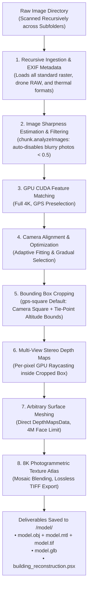

# High-Precision 3D Photogrammetry & Architectural Reconstruction

Autonomous end-to-end photogrammetry pipeline transforming raw image folders (drone surveys, architectural captures, ground inspections) into high-density textured 3D models (`.obj`, `.mtl`, `.glb`) and native Agisoft Metashape Professional projects (`.psx`).

---

## When To Use

Use this skill when:
- The user provides an image folder (drone survey, building inspection, or ground photogrammetry) and requests a 3D model with realistic photographic texture.
- Images are located across the main folder and nested subfolders (e.g., flight batches, multi-camera rigs).
- Image inputs include any Metashape-supported format: standard raster formats (`.jpg`, `.png`, `.tif`, `.webp`, `.jp2`, `.jxl`, `.exr`), drone and camera RAW formats (`.dng`, `.cr2`, `.cr3`, `.nef`, `.arw`, `.iiq`, `.3fr`), or radiometric thermal formats (`.seq`, `.ara`).
- Automatic blurry image rejection is needed: automatically runs `chunk.analyzeImages()` and disables out-of-focus or motion-blurred photos ($<0.5$ quality index) to protect bundle adjustment accuracy.
- Hands-free autonomous execution is needed: defaults to `gps-square` cropping (smallest enclosing square of camera GPS poses with tie-point altitude bounds) to minimize manual steps to zero.
- Reconstructing architectural structures, buildings, urban environments, or complex terrain requiring metric accuracy, flat walls, and crisp 90-degree corners.
- Requiring high-density meshes (optimized 4,000,000 / 4M faces limit default) and lossless uncompressed texture atlases (8K 8192×8192 TIFF mosaic photographic blending).

Do not use this skill when:
- Synthesizing 3D models from single images, sketches, or text prompts without multi-view photographic overlap.
- Running pure 2D image enhancement without 3D geometric triangulation.

---

## Workflow



### 1. Ingestion & Directory Convention
When given an image directory, recursively load all images across the target folder and all subfolders. Run the autonomous pipeline without needing manual output or grade flags (Ultra Grade, sharpness quality filtering, `gps-square` auto-cropping, 4M face limit, and `<images_dir>/model/` destination are default):
```powershell
& "C:/Program Files/Agisoft/Metashape Pro/metashape.exe" -r scripts/metashape_reconstruction.py --images "<path_to_images>"
```

> [!NOTE]
> The pipeline strictly defaults to:
> - **Comprehensive Format Ingestion**: Recursively scans all subdirectories of `<path_to_images>` for:
>   - **Standard Raster**: `.jpg`, `.jpeg`, `.jpe`, `.png`, `.tif`, `.tiff`, `.bmp`, `.dib`, `.webp`, `.jp2`, `.j2k`, `.jpc`, `.j2c`, `.jxl`, `.exr`, `.tga`, `.dds`, `.pnm`, `.ppm`, `.pgm`, `.pbm`, `.sgi`, `.rgb`, `.bil`
>   - **Drone & Camera RAW**: `.dng` (DJI Mavic 3 / Matrice / Phantom RTK RAW, Autel RAW), `.cr2`, `.cr3`, `.crw` (Canon), `.nef`, `.nrw` (Nikon), `.arw`, `.srf`, `.sr2` (Sony Alpha), `.iiq`, `.cap` (Phase One), `.3fr`, `.fff` (Hasselblad), `.rw2` (Panasonic), `.orf` (Olympus), `.raf` (Fujifilm), `.raw`, `.rwl` (Leica), `.pef`, `.ptx` (Pentax)
>   - **Radiometric Thermal / Multi-Spectral**: `.seq`, `.ara` (FLIR radiometric sequences)
> - **Output Subfolder**: Automatically creates `<path_to_images>/model/` and places all outputs there.
> - **Image Quality Assessment (`min_quality=0.5`)**: Calculates gradient edge sharpness across all frames. Any photos suffering from motion blur or lens defocus ($<0.50$ index) are automatically disabled before feature matching.
> - **Auto-Cropping Default (`gps-square`)**: Calculates the smallest enclosing horizontal square of all camera GPS poses, with altitude bounded by $[\min, \max]$ tie points inside the square. This guarantees the entire building and its eaves are captured while eliminating 80% of outer background clutter.
> - **Polygon Count (4M Faces)**: Since the reconstruction bounding box is tightly cropped to the survey area, 4,000,000 faces provide architectural fidelity equivalent to 10M–15M faces on an uncropped scene, while cutting mesh generation and texturing time in half.
> - **Ultra Grade Standard**: Full 4K MVS depth maps (`downscale=1`), tie-point Gradual Selection optimization, and uncompressed 8K TIFF textures.

### 2. Sharpness Quality Estimation & Blurry Image Rejection
- Analyzes high-frequency gradient sharpness across every camera frame via `chunk.analyzeImages()`.
- Official Agisoft standard: photos with quality $<0.50$ are considered blurred.
- Cameras with quality $<0.50$ are automatically disabled (`camera.enabled = False`) to prevent bad tie-point triangulation, sensor blur, and depth map distortion.

### 3. High-Accuracy GPU Matching & Alignment
- **Matching**: `downscale=1` (1:1 full resolution), `keypoint_limit=40000`, `tiepoint_limit=4000`. Uses GPS Reference Preselection so images match against spatial neighbors.
- **Alignment**: Solves camera positions $(X, Y, Z)$, orientations, and non-linear lens distortion ($f, c_x, c_y, k_1, k_2, k_3, k_4, p_1, p_2$).
- **Camera Optimization (Gradual Selection)**: Enabled by default. Prunes high reprojection error ($>0.4\text{ px}$) and high reconstruction uncertainty ($>15$) tie points before re-optimizing lens parameters.

### 4. Automated Bounding Box Cropping Strategies
Metashape's default bounding box (`chunk.region`) encompasses all tie points, including distant horizon, background trees, and surrounding streets. The pipeline provides two automated cropping strategies (`--crop-method`):

#### Method 1: `gps-square` (Camera GPS Square + Tie-Point Altitude - Default)
- **Principle**: Calculates the smallest enclosing horizontal square $(X, Y)$ containing all camera GPS positions. Then queries all tie points falling strictly inside that horizontal footprint to find the true lowest altitude ($Z_{\min}$, ground level) and highest altitude ($Z_{\max}$, roof/spire).
- **Outlier Immunity**: Applies robust Median Absolute Deviation (MAD) to camera positions so distant takeoff/landing spots do not inflate the square.
- **Zero-Manual Step**: 100% guaranteed not to clip any architectural elements because the drone flew outside or above them, eliminating the need for manual bounding box adjustments.

#### Method 2: `structure` (Optical Ray Convergence)
- **Principle**: Computes the least-squares 3D line-of-sight intersection of all camera optical viewing axes using Iteratively Reweighted Least Squares (IRLS).
- **Outlier Immunity**: Prunes outlier viewing angles (e.g. when 10–20% of cameras focus on secondary points), locking firmly onto the main structure walls.
- **Best For**: Pure orbit flights and tight building facade scans where you want the box cropped directly onto the exterior walls.

```powershell
# Run with Optical Ray Convergence (tight wall crop):
& "C:/Program Files/Agisoft/Metashape Pro/metashape.exe" -r scripts/metashape_reconstruction.py --images "<path_to_images>" --crop-method structure
```

> [!TIP]
> **Millimeter Human Intent Control**: If you ever need exact manual control over whether adjacent sidewalks, exterior fences, or driveways are included or trimmed, run with `--pause-after-crop`. The script saves `building_reconstruction.psx` right after alignment and auto-cropping, allowing you to open the project in Metashape GUI, visually tweak the box in 5 seconds, save, and press Enter in the terminal to resume!

### 5. GPU Multi-View Stereo (MVS) Depth Maps
- Computes dense per-pixel depth estimation using CUDA on NVIDIA GPUs strictly within the cropped bounding box.
- **Default (Ultra)**: `downscale=1` (full 4K depth maps per camera).
- Uses `MildFiltering` to retain fine architectural structures (antennas, window mullions, roof trim, columns).

### 6. Arbitrary Surface Polygonal Meshing
- Fuses visibility-consistent depth maps into a continuous polygonal mesh using `DataSource.DepthMapsData` (avoiding the intermediate dense point cloud and melted wax Poisson artifacts).
- Targets **4,000,000 faces limit** by default (Ultra Grade) to concentrate high polygon density strictly on the surveyed structure while keeping file sizes lightweight and responsive across Blender, CAD, and game engines.

### 7. Multi-Page 8K Photographic Texture Baking & Lossless TIFF Export
- Computes optimized UV parameterization (`GenericMapping`).
- Projects photographic pixels from all original 4K frames using `MosaicBlending` with `ghosting_filter=True` and `fill_holes=True`.
- Exports texture maps in **lossless uncompressed TIFF (`.tif`) format** (no JPEG compression artifacts) at **8192×8192 (8K)** resolution across 4 pages.

### 8. Production Deliverables
All deliverables are automatically placed into `<path_to_images>/model/`:
- `model.obj` + `model.mtl` + `model.tif`: Industry-standard mesh format with uncompressed 8K TIFF texture atlas compatible with all DCC/CAD tools.
- `model.glb`: Binary glTF format with embedded PBR textures for instant web and 3D viewer rendering.
- `building_reconstruction.psx` + `building_reconstruction.files/`: Native Metashape Professional project retaining all camera alignments, depth maps, and UV textures for direct inspection and further editing.

---

## Validation

Reconstruction must satisfy the following quality criteria:
1. **Camera Quality Filtering**: All active cameras must have sharpness quality $\ge 0.50$ (blurry frames disabled).
2. **Camera Registration**: At least $90\%$ of active input images must be successfully registered in space.
3. **Target Bounding Box**: `chunk.region` must be tightly centered on the surveyed area, discarding $\ge 70\%$ of horizon background volume.
4. **Surface Topology**: Arbitrary surface mesh with $\ge 1,000,000$ polygon faces (targeting 4M), free from degenerate zero-area faces.
5. **Texture Atlas**: Resolution $\ge 8192\times 8192$ with valid UV mapping and zero unmapped black voids.
6. **Project File**: Native `.psx` file must be successfully saved and loadable in Agisoft Metashape Professional GUI.

---

## Maintenance

- Ensure `metashape.exe` is installed at `C:/Program Files/Agisoft/Metashape Pro/metashape.exe` or configured on the system PATH.
- Verify NVIDIA GPU CUDA runtime with `nvidia-smi` to ensure Metashape GPU acceleration is active.
- Keep `scripts/metashape_reconstruction.py` updated to match Agisoft Metashape Python API versions.

---

## References

- [Agisoft Metashape Professional User Manual](https://www.agisoft.com/downloads/user-manuals/)
- [USGS National Geospatial Program Photogrammetry Standards](https://www.usgs.gov/core-science-systems/ngp)
