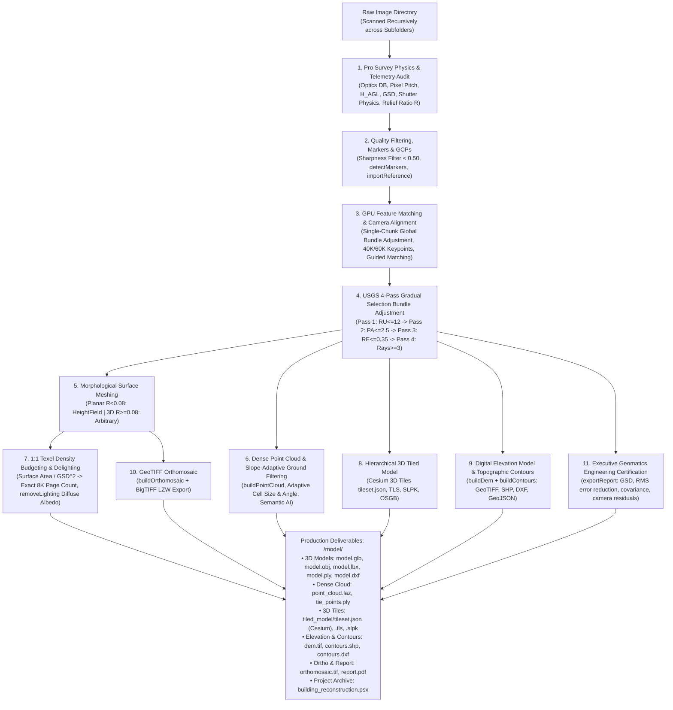

# High-Precision 3D Photogrammetry, Survey Physics Engine & Complete Metashape Processing

Autonomous end-to-end photogrammetry and aerial survey pipeline transforming raw image folders (drone surveys, architectural captures, ground inspections) into high-density textured 3D models (`.obj`, `.mtl`, `.glb`, `.fbx`, `.ply`), classified dense point clouds (`.laz`, `.las`, `.ply`, `.e57`), hierarchical 3D Tiled Models (Cesium 3D Tiles, TLS, SLPK, OSGB), Digital Elevation Models (`dem.tif`), topographic contour vector maps (`.shp`, `.dxf`, `.geojson`, `.kml`), GeoTIFF orthomosaic maps (`orthomosaic.tif`), executive calibration quality reports (`report.pdf`), and native Agisoft Metashape Professional projects (`.psx`).

---

## When To Use

Use this skill when:
- The user provides an image folder (drone survey, building inspection, or ground photogrammetry) and requests 3D models, classified point clouds, digital elevation models, topographic contours, or orthomosaic maps.
- The user requests an agent that acts like a **Senior Certified Photogrammetrist & Geomatics Engineer**: never relying on simplistic preset heuristics, but systematically auditing survey physics (physical sensor dimensions, pixel pitch in $\mu\text{m}$, flying height $H_{AGL}$, true Ground Sampling Distance GSD in $\text{cm/px}$, forward/lateral overlap geometry, mechanical leaf vs CMOS electronic rolling shutter distinction, dynamic range shadow clipping, and topographic relief ratio $R = \Delta Z / D_{diag}$).
- Professional bundle adjustment optimization is required: executes the **USGS 4-Pass Gradual Selection protocol** (`ReconstructionUncertainty` $\to$ `ProjectionAccuracy` $\to$ `ReprojectionError` $\to$ `ImageCount` multiplicity) with staged camera parameter unfreezing ($f, cx, cy \to k_1..k_3, p_1..p_2 \to k_4, b_1, b_2$ with adaptive fitting) to guarantee sub-pixel reprojection residuals ($< 0.35\text{ px}$).
- 1:1 Ground Texel Density Budgeting is needed: calculates the exact texture atlas page count required to match camera optical resolution on the 3D surface, eliminating blurry textures or bloated empty UV sheets.
- Dense 3D Point Clouds are required: generates point clouds directly from depth maps (`chunk.buildPointCloud()`), filters low-confidence points, performs slope-adaptive ground classification (`classifyGroundPoints`), or applies AI semantic classification (`classifyPoints`) with export to compressed LAZ, LAS, PLY, E57, or XYZ.
- Hierarchical 3D Tiled Models (LOD) are required: generates streaming LOD tilesets in Cesium 3D Tiles (`tileset.json` + `b3dm`), Agisoft TLS (`.tls`), Esri Scene Layer Package (`.slpk`), or OpenSceneGraph (`.osgb`) for massive web GIS applications.
- Topographic Digital Elevation Models (DEM/DSM/DTM) or vector contour lines (ESRI Shapefile, AutoCAD DXF, GeoJSON, KML) are needed at custom elevation intervals (e.g., 0.5m, 1m, 2m, 5m).
- Texture Delighting / Shadow Removal is needed: removes harsh direct sunlight shadows and ambient occlusion using `chunk.removeLighting()` to recover true photographic diffuse albedo textures for game engines and VFX.
- Survey Ground Control Points (GCP) or RTK antenna coordinates CSV/TXT need to be imported (`chunk.importReference()`) to establish millimeter-accurate georeferencing.
- Coded target markers or AprilTags need to be automatically detected across photos (`chunk.detectMarkers()`).
- Radiometric color calibration and white balance equalization across cameras is required (`chunk.calibrateColors()`).
- Reconstructing architectural structures, buildings, urban environments, or complex terrain requiring metric accuracy, flat walls, and crisp 90-degree corners.
- Exporting into multiple CAD/DCC formats: Autodesk FBX, Stanford PLY, AutoCAD DXF, alongside binary glTF and Wavefront OBJ.

Do not use this skill when:
- Synthesizing 3D models from single images, sketches, or text prompts without multi-view photographic overlap.
- Running pure 2D image enhancement without 3D geometric triangulation.

---

## Workflow



### 1. Senior Photogrammetrist Operating Protocol

As a Senior Certified Photogrammetrist & Geomatics Specialist, the agent follows strict physics-based engineering rules:
1. **Never guess or cite rigid presets**: Analyze the raw image headers and telemetry to extract physical sensor properties and flight geometry.
2. **Execute the Survey Physics Audit First**: Run `--profile` or compute the optics metrics before proposing or executing a reconstruction.
3. **Respect Camera Shutter Physics**:
   - For **Mechanical Leaf / Global Shutters** (e.g. DJI Phantom 4 Pro `FC6310`, Mavic 3 Enterprise Wide `FC3411`, Zenmuse P1, Phase One, Hasselblad): **Rolling shutter compensation must be DISABLED**. Enabling rolling shutter compensation on mechanical leaf shutters introduces ill-conditioned parameters into bundle adjustment and causes synthetic elevation drift.
   - For **Electronic CMOS Rolling Shutters** (e.g. DJI Mini series, Mavic Air, Air 2S, Mavic Pro, consumer smartphones): Enable `Metashape.Shutter.Model.Regularized` to eliminate flight-velocity shear.
4. **Execute the USGS 4-Pass Gradual Selection Protocol**:
   Never accept raw sparse tie points. Staged parameter unfreezing is mandatory:
   - **Pass 1 (Reconstruction Uncertainty $\le 12.0$)**: Prunes tie points with shallow ray intersection angles. Unfreezes basic interior orientation: $f, cx, cy$ only.
   - **Pass 2 (Projection Accuracy $\le 2.5\text{ px}$)**: Prunes tie points with ambiguous pixel correlation. Unfreezes radial distortion: $f, cx, cy, k_1, k_2, k_3, p_1, p_2$.
   - **Pass 3 (Reprojection Error $\le 0.35\text{ px}$)**: Prunes high-residual outlier points. Unfreezes complete polynomial model: $f, cx, cy, k_1..k_4, b_1, b_2, p_1, p_2$ with adaptive fitting and tie point covariance.
   - **Pass 4 (Image Multiplicity $\ge 3$)**: Discards fragile 2-ray intersections. Locks in bundle adjustment geometry and reports initial vs final RMS reprojection error.
5. **Derive Slope-Adaptive Ground Point Filtering**:
   Calculate the terrain relief ratio $R = \Delta Z / D_{diag}$:
   - Planar terrain ($R < 0.08$): `cell_size = 35.0m`, `max_angle = 12.0 deg`, `max_distance = 0.6m`, meshing as `HeightField`.
   - High relief / 3D architecture ($R \ge 0.08$): `cell_size = 12.0m`, `max_angle = 28.0 deg`, `max_distance = 0.3m`, meshing as `Arbitrary`.
6. **Enforce 1:1 Ground Texel Density Budgeting**:
   Texture page count must be budgeted from the measured 3D mesh surface area $A_{m^2}$ and optical GSD:
   $$N_{pages} = \text{clamp}\left(\text{ceil}\left(\frac{A_{m^2} \times 10^4}{\text{GSD}^2 \times 67,108,864} \times 1.25\right), 1, 32\right)$$
7. **Present the Executive Geomatics Engineering Summary**:
   Provide the user with an authoritative engineering report:
   ```
   ================================================================================
     PRO PHOTOGRAMMETRY & GEOMATICS ENGINEERING REPORT
   ================================================================================
     Sensor Hardware:     DJI Mavic 3 Enterprise Wide (FC3411)
     Sensor Geometry:     17.3 x 13.0 mm  |  Pixel Pitch: 3.28 µm
     Shutter Physics:     Mechanical Leaf / Global Shutter [RS Comp: DISABLED]
     Optics & Altitude:   Focal Length: 12.29 mm  |  Flying Height: 85.0 m AGL  |  GSD: 2.26 cm/px
     Overlap Geometry:    Forward: 82.4%  |  Lateral: 68.2% [PASS]
     Dynamic Range:       Shadow Clipping: 18.2%  |  Delighting: ACTIVATED (Diffuse Albedo)
     Topographic Relief:  Span: 342.1m  |  Delta Z: 12.4m  |  R = 0.036 -> HEIGHTFIELD Meshing
     USGS 4-Pass Bundle:  Pass 1 (RU<=12) -> Pass 2 (PA<=2.5) -> Pass 3 (RE<=0.35) -> Pass 4 (Multiplicity>=3)
     Reprojection RMS:    Initial: 1.182 px  ->  Optimized: 0.284 px  (RMS Reduction: 75.9%)
     Multi-ray Tiepoints: 18,420 robust tie points locked in (pruned 6,840 fragile rays)
     1:1 Texel Budget:    Mesh Surface Area: 38,200 m² @ 2.26 cm GSD -> 2x 8K Pages (1.18 cm/texel)
   ================================================================================
   ```

### 2. Complete Metashape Processing Functions

1. **Ingestion, Quality Filtering & Georeferencing**:
   - Recursively traverses `<images_dir>` across all subdirectories, ingesting standard rasters (`.jpg`, `.png`, `.tif`, `.webp`, `.exr`), drone RAW formats (`.dng`, `.cr3`, `.nef`, `.arw`), and radiometric sequences (`.seq`, `.ara`).
   - Executes `chunk.analyzeImages()` to calculate edge gradient sharpness ($<0.50$ disabled).
   - Target Marker Detection (`--detect-markers`, `--target-type`): detects circular coded targets (12-20 bit), cross targets, and AprilTags via `chunk.detectMarkers()`.
   - GCP Reference Import (`--import-reference <path>`): loads ground survey reference CSV/TXT coordinates via `chunk.importReference()` and executes `chunk.updateTransform()`.

2. **Camera Alignment & Radiometric Calibration**:
   - Matching Quality: Medium (`downscale=2`) for optimal memory scaling.
   - Keypoint Limit: 40,000 (or 60,000 for $>30\text{MP}$); Tiepoint Limit: 25,000 tiepoints; Guided Matching enabled by default.
   - Single-Chunk Default (`--multi-chunk disable`): Solves all images globally in one bundle adjustment to prevent false alignment or chunk-merging offsets.
   - Radiometric Calibration (`--calibrate-colors`): Performs camera color and white balance equalization across frames via `chunk.calibrateColors()`.

3. **Bounding Box Cropping Strategies**:
   - `gps-square` (Default for Building): Horizontal square enclosing all camera GPS coordinates while leaving vertical altitude $Z$ uncropped.
   - `none` (Default for Map & Aerial Surveys): Retains the entire surveyed spatial footprint without clipping perimeter terrain.
   - `structure` (Iteratively Reweighted Least Squares): Computes the 3D line-of-sight intersection of all camera optical viewing axes.
   - `manual`: Saves project and pauses for manual region box positioning in Metashape Pro GUI.

4. **GPU Depth Maps & Dense Point Cloud**:
   - Computes dense per-pixel depth estimation using CUDA on NVIDIA GPUs.
   - Dense Point Cloud (`buildPointCloud`): Fuses depth maps into a 3D point cloud with RGB vertex colors and confidence indices.
   - Slope-Adaptive Ground Point Classification (`--classify-ground`): Separates bare-earth topography from vegetation and structures using slope-adaptive parameters (`cell_size`, `max_angle`, `max_distance`).
   - AI Semantic Classification (`--classify-points`): Applies multi-class deep learning classification assigning points to ASPRS standard classes (Ground, Low Veg, High Veg, Building, Road, Car).
   - Point Cloud Export: Exports dense point clouds in `.laz`, `.las`, `.ply`, `.e57`, or `.xyz` and sparse tie points via `--export-tie-points`.

5. **Surface Meshing, Smoothing & Decimation**:
   - Surface Type: HeightField (`--surface-type heightfield`) for planar terrain ($R < 0.08$) or Arbitrary (`--surface-type arbitrary`) for 3D structures and complex relief.
   - Planar Hole Closing: Seals window apertures and planar voids via `chunk.model.closeHoles(level=30)`.
   - Laplacian Smoothing (`--smooth-mesh`, `--smooth-strength 3.0`): Applies Laplacian smoothing preserving sharp feature edges.
   - Decimation (`--decimate-mesh <N>`): Decimates mesh geometry to target polygon face budget.
   - Multi-Format Mesh Export: Binary GLB, Wavefront OBJ + TIFF, Autodesk FBX (`--export-fbx`), Stanford PLY (`--export-ply`), and AutoCAD DXF (`--export-dxf`).

6. **Hierarchical 3D Tiled Model (LOD / Web GIS)**:
   - 3D Tiled Model Generation (`--build-tiled-model`): Builds multiresolution hierarchical LOD mesh tiles directly from depth maps (`chunk.buildTiledModel()`).
   - Format Support (`--tiled-model-format [cesium|tls|slpk|osgb]`): Exports Cesium 3D Tiles (`tileset.json` + `b3dm`) for web GIS (CesiumJS, Unreal Engine), Agisoft TLS (`.tls`), Esri Scene Layer Package (`.slpk`), or OpenSceneGraph (`.osgb`).

7. **Texture Atlas & Delighting (Shadow Removal)**:
   - Dynamically sizes UV atlas pages for 1:1 ground texel parity matching the camera GSD.
   - Projects photographic pixels with `MosaicBlending`, hole filling, and ghosting suppression.
   - Texture Delighting (`--remove-lighting`): Removes direct sunlight shadows and ambient occlusion using `chunk.removeLighting()` to output true diffuse albedo textures.

8. **Elevation Models, Contours & Orthomosaics**:
   - Digital Elevation Model (DEM / DSM / DTM, `--build-dem`): Generated via `chunk.buildDem()`; exported as GeoTIFF with BigTIFF LZW compression (`dem.tif` + `dem.tfw`).
   - Topographic Contour Vectors (`--build-contours`, `--contour-interval 1.0`): Generates vector contour lines at user-specified elevation intervals (`chunk.buildContours()`); exported as ESRI Shapefile (`.shp`), AutoCAD (`.dxf`), GeoJSON (`.geojson`), or Google Earth (`.kml`).
   - GeoTIFF Orthomosaic (`--ortho`): Generated via `chunk.buildOrthomosaic()` projected onto the surface mesh; exported as GeoTIFF with BigTIFF LZW compression and ESRI world file (`orthomosaic.tif` + `orthomosaic.tfw`).
   - Executive PDF Quality & Calibration Report (`--export-report`): Generated via `chunk.exportReport()` documenting camera calibrations, tie-point statistics, reprojection error histograms, ground sampling distance (GSD), and survey overlap.

### 3. Multi-Project Sequential Batch Processing Protocol

When a parent directory contains multiple independent survey projects (e.g. `Surveys/Project_A/`, `Surveys/Project_B/`):

1. **Inspection**: Enumerate all immediate subdirectories in the parent folder. Verify photo counts and telemetry profiles.
2. **Sequential Execution**:
   - Execute each project independently using the Pro Photogrammetry Engine:
     ```powershell
     & "C:/Program Files/Agisoft/Metashape Pro/metashape.exe" -r scripts/metashape_reconstruction.py --images "<parent>/<project>" --preset pro
     ```
   - Nested subfolders within a project (e.g. `Project_A/Flight_1`, `Project_A/Flight_2`) are solved in a single global bundle adjustment by default, ensuring zero chunk-merging false alignment.
3. **Verification Gate**:
   - Check `<project>/<project_name>/` contains deliverables (`<project_name>.obj`, `<project_name>.glb`, `<project_name>.psx`).
   - Confirm camera alignment registration rate $\ge 90\%$.
   - Confirm exit code 0 and zero unhandled exceptions.
4. **Progressive Advancement**: Advance to Project $N+1$ only after Project $N$ passes verification.
5. **Batch Summary**: Present a consolidated Markdown table reporting photo counts, aligned cameras, face counts, and deliverable paths.

### 4. CLI Recipes & Usage

```powershell
# Pro Photogrammetry & Geomatics Engine (Default):
& "C:/Program Files/Agisoft/Metashape Pro/metashape.exe" -r scripts/metashape_reconstruction.py --images "D:/Surveys/Site_A" --preset pro

# Full Drone Topographic Survey with Point Cloud, DEM, Contours & Cesium 3D Tiles:
& "C:/Program Files/Agisoft/Metashape Pro/metashape.exe" -r scripts/metashape_reconstruction.py \
    --images "D:/Surveys/Topography" \
    --preset pro \
    --build-point-cloud --point-cloud-format laz --classify-ground \
    --build-dem --build-contours --contour-interval 1.0 --contours-format shp \
    --build-tiled-model --tiled-model-format cesium \
    --export-report

# Heritage Architectural Facade with Coded Target Detection, GCP Import, Delighting & FBX:
& "C:/Program Files/Agisoft/Metashape Pro/metashape.exe" -r scripts/metashape_reconstruction.py \
    --images "D:/Surveys/HeritageSite" \
    --preset pro \
    --detect-markers --target-type circular12 \
    --import-reference "D:/Surveys/HeritageSite/gcps.csv" \
    --calibrate-colors --remove-lighting \
    --export-fbx --export-ply \
    --export-report

# Standalone Optics & Telemetry Profiling (Inspect Only):
& "C:/Program Files/Agisoft/Metashape Pro/metashape.exe" -r scripts/metashape_reconstruction.py --images "D:/Surveys/Site_A" --profile

# Checkpoint Resume:
& "C:/Program Files/Agisoft/Metashape Pro/metashape.exe" -r scripts/metashape_reconstruction.py --images "D:/Surveys/Site_A" --resume
```

---

## Validation

Reconstruction outputs must satisfy the following quality criteria:
1. **Camera Quality Filtering**: All active cameras must have sharpness quality $\ge 0.50$ (blurry frames disabled).
2. **Camera Registration**: At least $90\%$ of active input images must be successfully registered in space.
3. **Reprojection Residuals**: Bundle adjustment re-optimization must achieve RMS reprojection error $\le 0.35\text{ px}$.
4. **Tie-Point Multiplicity**: Multi-ray intersections must maintain multiplicity $\ge 3$ rays (fragile 2-ray ties eliminated).
5. **Shutter Mechanics Conformance**: Rolling shutter compensation verified as DISABLED for mechanical leaf shutters (e.g. DJI FC3411, FC6310, Zenmuse P1) to protect elevation accuracy.
6. **Point Cloud Integrity**: When point cloud generation is requested, `point_cloud.laz` (or `.las`, `.ply`, `.e57`) must be generated and non-empty.
7. **Surface Topology**: Arbitrary or HeightField surface mesh targeting specified face count ($600\text{K} - 2\text{M}$), free from degenerate zero-area faces.
8. **1:1 Texel Density**: Texture atlas resolution $\ge 8192\times 8192$ budgeted for 1:1 ground texel parity with zero unmapped black voids.
9. **Elevation Models & Contours**: GeoTIFF files (`dem.tif`, `orthomosaic.tif`) and vector shapefiles (`contours.shp`) exported with accompanying world/projection files.
10. **Tiled Model**: Cesium 3D Tiles (`tileset.json`) or TLS archive exported with valid LOD bounding hierarchy.
11. **Quality Report**: `report.pdf` generated containing camera calibration parameters and error estimates.
12. **Native Project**: Native `.psx` file must be successfully saved and loadable in Agisoft Metashape Professional GUI.

---

## Maintenance

- Ensure `metashape.exe` is installed at `C:/Program Files/Agisoft/Metashape Pro/metashape.exe` or configured on the system PATH.
- Verify NVIDIA GPU CUDA runtime with `nvidia-smi` to ensure Metashape GPU acceleration is active.
- Keep `scripts/metashape_reconstruction.py` updated to match Agisoft Metashape Python API versions.
- Maintain synchronization between `scripts/metashape_reconstruction.py`, `scripts/metashape_export.py`, and `scripts/autometashape_gui.py`.

---

## References

- [evaluations.md](evaluations.md)
- [scripts/metashape_reconstruction.py](../../../scripts/metashape_reconstruction.py)
- [scripts/metashape_export.py](../../../scripts/metashape_export.py)
- [scripts/autometashape_gui.py](../../../scripts/autometashape_gui.py)
- [Agisoft Metashape Professional User Manual (v2.x)](https://www.agisoft.com/downloads/user-manuals/)
- [Open Geospatial Consortium (OGC) 3D Tiles Specification](https://www.ogc.org/standards/3DTiles)
- [USGS National Geospatial Program Photogrammetry Standards](https://www.usgs.gov/core-science-systems/ngp)
- [ASPRS LAS 1.4 Specification & Point Classification Standards](https://www.asprs.org/divisions-committees/lidar-division/laser-las-file-format-exchange-activities)
