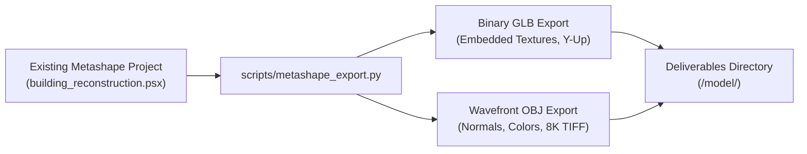

# Photogrammetry Production Asset Export

Lightweight export and packaging workflow converting existing or GUI-modified Agisoft Metashape projects (`.psx`) into production 3D assets (`.glb`, `.obj`, `.mtl`, `.tif`) without re-running hours of camera matching or depth maps.

---

## When To Use

Use this skill when:
- Re-exporting deliverables after opening `building_reconstruction.psx` in Metashape GUI to manually sculpt, clean stray geometry, crop, or tweak UV textures.
- Converting an existing Metashape project directly into standalone binary glTF (`.glb`) with embedded PBR textures.
- Packaging Wavefront OBJ (`.obj`) with multi-page uncompressed 8K TIFF texture maps for CAD or VFX tools.
- Exporting deliverables to a customized directory without reprocessing the input images.

Do not use this skill when:
- Processing raw camera photos from scratch (use `image-to-3d-model` instead).

---

## Workflow



### 1. Export Command
Run export operations directly against the existing project file:
```powershell
& "C:/Program Files/Agisoft/Metashape Pro/metashape.exe" -r scripts/metashape_export.py --project "<path_to_project>/building_reconstruction.psx"
```

### 2. Format Specifications
- **Binary glTF (`.glb`)**: `format=Metashape.ModelFormat.ModelFormatGLTF`, `embed_texture=True`, `save_normals=True`, `save_colors=True`.
- **Wavefront OBJ (`.obj`)**: `format=Metashape.ModelFormat.ModelFormatOBJ`, `texture_format=Metashape.ImageFormat.ImageFormatTIFF`, `save_texture=True`.
- **Destination**: Defaults to the folder containing the `.psx` project, keeping all deliverables co-located.

### 3. Optional Fast Texture Re-Baking
To re-bake UV mapping and 16-page 8K texture atlas directly from the solved mesh without re-running camera alignment or depth maps:
```powershell
& "C:/Program Files/Agisoft/Metashape Pro/metashape.exe" -r scripts/metashape_export.py --project "<path_to_project>/building_reconstruction.psx" --rebake-texture --texture-pages 16
```

---

## Validation

Verify exported assets:
1. File existence: verify `model.glb`, `model.obj`, `model.mtl`, and `model.tif` exist in the target directory.
2. Integrity check: load `.glb` in a 3D viewer to confirm textures are rendered without black voids.
3. Coordinate verification: confirm mesh vertex coordinates match expected metric scale.

---

## Maintenance

- Keep export format parameters aligned with Agisoft Metashape Python API versions.
- Ensure texture compression settings preserve photographic fidelity.

---

## References

- [evaluations.md](evaluations.md)
- [scripts/metashape_export.py](../../../scripts/metashape_export.py)
- [Agisoft Metashape User Manual](https://www.agisoft.com/downloads/user-manuals/)
