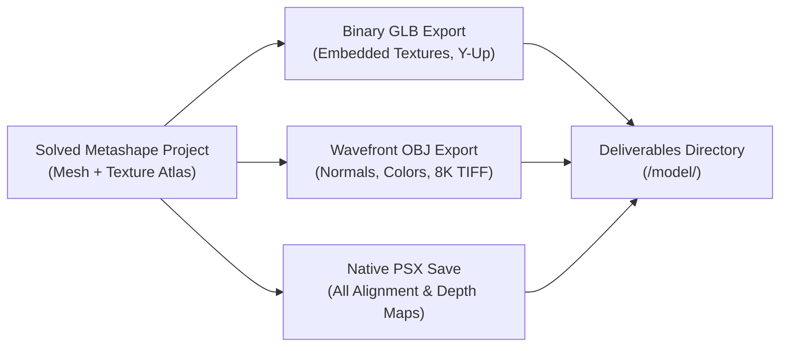

# Photogrammetry Production Asset Export

Autonomous export and packaging workflow converting solved Agisoft Metashape projects into multi-format production 3D assets (`.glb`, `.obj`, `.mtl`, `.tif`, `.psx`) for web viewing, DCC software, CAD, and game engine deployment.

---

## When To Use

Use this skill when:
- Exporting a reconstructed 3D mesh into binary glTF (`.glb`) with embedded PBR textures for instant web viewing.
- Generating Wavefront `.obj` files with multi-page uncompressed 8K TIFF textures for VFX or CAD tools.
- Preserving native `.psx` Metashape project archives with full metric camera georeferencing.
- Packaging deliverables into a clean distribution subfolder.

Do not use this skill when:
- Running initial feature matching or camera alignment from scratch.

---

## Workflow



### 1. Export Command
Run export operations from an existing project or via the autonomous pipeline:
```powershell
& "C:/Program Files/Agisoft/Metashape Pro/metashape.exe" -r scripts/metashape_reconstruction.py --images "<path_to_images>"
```

### 2. Format Specifications
- **Binary glTF (`.glb`)**: `format=Metashape.ModelFormat.ModelFormatGLTF`, `embed_texture=True`, `save_normals=True`, `save_colors=True`.
- **Wavefront OBJ (`.obj`)**: `format=Metashape.ModelFormat.ModelFormatOBJ`, `texture_format=Metashape.ImageFormat.ImageFormatTIFF`, `save_texture=True`.
- **Native Project (`.psx`)**: Saves document with full camera and depth map hierarchy.

---

## Validation

Verify exported assets:
1. File existence: verify `model.glb`, `model.obj`, `model.mtl`, `model.tif`, and `building_reconstruction.psx` exist in `model/`.
2. Integrity check: load `.glb` in a 3D viewer to confirm textures are rendered without black voids.
3. Coordinate verification: confirm mesh vertex coordinates match expected metric scale.

---

## Maintenance

- Keep export format parameters aligned with Agisoft Metashape Python API versions.
- Ensure texture compression settings preserve photographic fidelity.

---

## References

- [evaluations.md](evaluations.md)
- [scripts/metashape_reconstruction.py](../../../scripts/metashape_reconstruction.py)
- [Agisoft Metashape User Manual](https://www.agisoft.com/downloads/user-manuals/)
