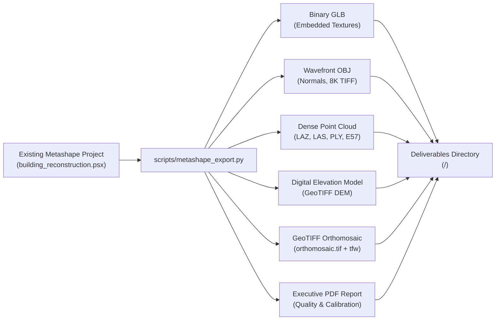

# Photogrammetry Production Asset Export

Lightweight export and packaging workflow converting existing or GUI-modified Agisoft Metashape projects (`.psx`) into production 3D assets (`.glb`, `.obj`, `.mtl`, `.tif`), dense point clouds (`.laz`, `.las`, `.ply`, `.e57`), Digital Elevation Models (`dem.tif`), GeoTIFF orthomosaics (`orthomosaic.tif`), and calibration quality reports (`report.pdf`) without re-running hours of camera matching or depth maps.

---

## When To Use

Use this skill when:
- Re-exporting deliverables after opening `building_reconstruction.psx` in Metashape GUI to manually sculpt, clean stray geometry, crop, or tweak UV textures.
- Converting an existing Metashape project directly into standalone binary glTF (`.glb`) with embedded PBR textures.
- Packaging Wavefront OBJ (`.obj`) with multi-page uncompressed 8K TIFF texture maps for CAD or VFX tools.
- Exporting dense 3D point clouds (`.laz`, `.las`, `.ply`, `.e57`, `.xyz`) directly from existing project chunks.
- Exporting Digital Elevation Models (DEM/DSM/DTM GeoTIFF with BigTIFF LZW compression) or GeoTIFF orthomosaics from existing projects.
- Generating executive PDF quality and camera calibration reports (`report.pdf`).
- Re-baking UV parameterization and multi-page 8K texture atlases from an updated mesh without recomputing dense depth maps.
- Exporting deliverables to a customized output directory without reprocessing input images.

Do not use this skill when:
- Processing raw camera photos from scratch (use `image-to-3d-model` instead).

---

## Workflow



### 1. Basic Export Command
Run export operations directly against the existing project file:
```powershell
& "C:/Program Files/Agisoft/Metashape Pro/metashape.exe" -r scripts/metashape_export.py \
    --project "<path_to_project>/building_reconstruction.psx"
```

### 2. Exporting Point Clouds, Elevation Models & Reports
Export dense point clouds, DEM, orthomosaic, and executive calibration reports from an existing project:
```powershell
& "C:/Program Files/Agisoft/Metashape Pro/metashape.exe" -r scripts/metashape_export.py \
    --project "<path_to_project>/building_reconstruction.psx" \
    --export-point-cloud \
    --point-cloud-format laz \
    --export-dem \
    --export-orthomosaic \
    --export-report \
    --report-title "Production Site Verification Audit"
```

### 3. Optional Fast Texture Re-Baking
To re-bake UV mapping and a 16-page 8K texture atlas directly from the solved mesh without re-running camera alignment or depth maps:
```powershell
& "C:/Program Files/Agisoft/Metashape Pro/metashape.exe" -r scripts/metashape_export.py \
    --project "<path_to_project>/building_reconstruction.psx" \
    --rebake-texture \
    --texture-pages 16
```

### 4. Format Specifications
- **Binary glTF (`.glb`)**: `format=Metashape.ModelFormat.ModelFormatGLTF`, `embed_texture=True`, `save_normals=True`, `save_colors=True`.
- **Wavefront OBJ (`.obj`)**: `format=Metashape.ModelFormat.ModelFormatOBJ`, `texture_format=Metashape.ImageFormat.ImageFormatTIFF`, `save_texture=True`.
- **Point Cloud (`.laz`, `.las`, `.ply`, `.e57`)**: `chunk.exportPointCloud()`, preserving coordinates, colors, normals, confidence, and classifications.
- **Elevation Model (`dem.tif`)**: BigTIFF LZW GeoTIFF with ESRI `.tfw` world file.
- **Orthomosaic (`orthomosaic.tif`)**: BigTIFF LZW GeoTIFF with alpha channel and `.tfw` world file.
- **Quality Report (`report.pdf`)**: Camera calibration, reprojection errors, and survey statistics.

---

## Validation

Verify exported assets:
1. File existence: verify requested assets (`model.glb`, `model.obj`, `model.mtl`, `model.tif`, `point_cloud.laz`, `dem.tif`, `orthomosaic.tif`, `report.pdf`) exist in the target directory.
2. Integrity check: load `.glb` in a 3D viewer to confirm textures are rendered without black voids.
3. Coordinate verification: confirm mesh vertex coordinates and point clouds match expected metric scale.

---

## Maintenance

- Keep export format parameters aligned with Agisoft Metashape Python API versions.
- Ensure texture compression settings preserve photographic fidelity.

---

## References

- [evaluations.md](evaluations.md)
- [scripts/metashape_export.py](../../../scripts/metashape_export.py)
- [Agisoft Metashape User Manual](https://www.agisoft.com/downloads/user-manuals/)
