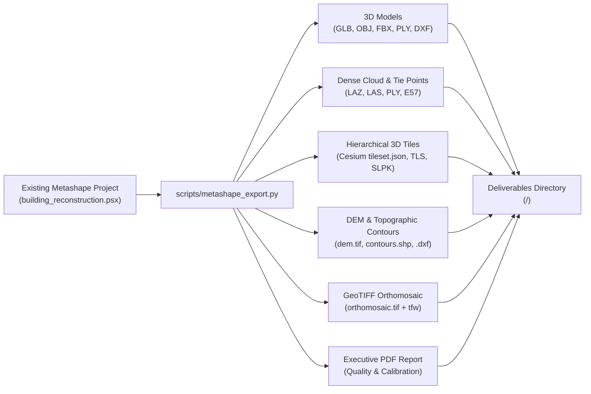

# Photogrammetry Production Asset Export

Lightweight export and packaging workflow converting existing or GUI-modified Agisoft Metashape projects (`.psx`) into production 3D assets (`.glb`, `.obj`, `.mtl`, `.tif`, `.fbx`, `.ply`, `.dxf`), dense point clouds (`.laz`, `.las`, `.ply`, `.e57`), hierarchical 3D Tiled Models (Cesium 3D Tiles, TLS, SLPK, OSGB), Digital Elevation Models (`dem.tif`), topographic contour shapefiles (`.shp`, `.dxf`), GeoTIFF orthomosaics (`orthomosaic.tif`), and calibration quality reports (`report.pdf`) without re-running hours of camera matching or depth maps.

---

## When To Use

Use this skill when:
- Re-exporting deliverables after opening `building_reconstruction.psx` in Metashape GUI to manually sculpt, clean stray geometry, crop, or tweak UV textures.
- Executing decoupled pipelined asset exports on the Host CPU while GPU cluster workers crunch the next project in the batch queue.
- Converting an existing Metashape project directly into standalone binary glTF (`.glb`), Wavefront OBJ (`.obj`), Autodesk FBX (`.fbx`), Stanford PLY (`.ply`), or AutoCAD DXF (`.dxf`).
- Packaging hierarchical 3D Tiled Models (Cesium 3D Tiles `tileset.json` + `b3dm`, Agisoft `.tls`, Esri `.slpk`, `.osgb`) for streaming web GIS and Unreal Engine.
- Exporting dense 3D point clouds (`.laz`, `.las`, `.ply`, `.e57`, `.xyz`) or sparse tie points directly from existing project chunks.
- Exporting Digital Elevation Models (DEM/DSM/DTM GeoTIFF with BigTIFF LZW compression) or GeoTIFF orthomosaics from existing projects.
- Generating vector topographic contour lines (ESRI Shapefile, AutoCAD DXF, GeoJSON, KML) from saved elevation models.
- Re-baking UV parameterization and multi-page 8K texture atlases with optional texture delighting (shadow and ambient light removal).
- Generating executive PDF quality and camera calibration reports (`report.pdf`).
- Exporting deliverables to a customized output directory without reprocessing input images.

Do not use this skill when:
- Processing raw camera photos from scratch (use `image-to-3d-model` instead).

---

## Workflow



### 1. Basic Export Command
Run export operations directly against the existing project file:
```powershell
& "C:/Program Files/Agisoft/Metashape Pro/metashape.exe" -r scripts/metashape_export.py \
    --project "<path_to_project>/building_reconstruction.psx"
```

### 2. Exporting Point Clouds, Elevation Models, Contours & 3D Tiles
Export dense point clouds, DEM, vector contours, Cesium 3D Tiles, and executive calibration reports from an existing project:
```powershell
& "C:/Program Files/Agisoft/Metashape Pro/metashape.exe" -r scripts/metashape_export.py \
    --project "<path_to_project>/building_reconstruction.psx" \
    --export-point-cloud --point-cloud-format laz \
    --export-dem \
    --export-contours --contour-interval 1.0 --contours-format shp \
    --export-tiled-model --tiled-model-format cesium \
    --export-fbx --export-ply \
    --export-orthomosaic \
    --export-report \
    --report-title "Production Site Verification Audit"
```

### 3. Optional Fast Texture Re-Baking & Delighting
To re-bake UV mapping, a 16-page 8K texture atlas, and apply delighting (shadow removal) directly from the solved mesh without re-running camera alignment or depth maps:
```powershell
& "C:/Program Files/Agisoft/Metashape Pro/metashape.exe" -r scripts/metashape_export.py \
    --project "<path_to_project>/building_reconstruction.psx" \
    --rebake-texture --texture-pages 16 \
    --remove-lighting
```

### 4. Decoupled Pipelined Overlap Export
In the AutoMetashape Studio architecture, `scripts/metashape_export.py` functions as the decoupled background exporter:
- As soon as the GPU reconstruction cluster finishes meshing a project, it triggers this script in the background on the Host CPU.
- Operates concurrently with bounded concurrency limits (1 to 4, default 2), isolating project folders and `.psx` document locks.
- Command recipe generated automatically by the coordinator:
```powershell
& "C:/Program Files/Agisoft/Metashape Pro/metashape.exe" -r scripts/metashape_export.py \
    --project "D:/Exports/Project_A/Project_A.psx" \
    --output "D:/Exports/Project_A" \
    --export-glb --export-obj --texture-format tiff \
    --export-dem --export-orthomosaic
```

### 5. Format Specifications
- **3D Models**: Binary glTF (`.glb`), Wavefront OBJ (`.obj` + `.mtl` + `.png` / `.tif`), Autodesk FBX (`.fbx`), Stanford PLY (`.ply`), AutoCAD DXF (`.dxf`).
- **Dense Point Cloud (`.laz`, `.las`, `.ply`, `.e57`)**: `chunk.exportPointCloud()`, preserving coordinates, colors, normals, confidence, and classifications.
- **Hierarchical 3D Tiled Model**: Cesium 3D Tiles (`tiled_model/tileset.json` + `.b3dm`), Agisoft TLS (`.tls`), Esri Scene Layer Package (`.slpk`), OpenSceneGraph (`.osgb`).
- **Topographic Contours (`.shp`, `.dxf`, `.geojson`, `.kml`)**: Vector contour polylines with metric elevation attributes.
- **Elevation Model (`dem.tif`)**: BigTIFF LZW GeoTIFF with ESRI `.tfw` world file.
- **Orthomosaic (`orthomosaic.tif`)**: BigTIFF LZW GeoTIFF with alpha channel and `.tfw` world file.
- **Quality Report (`report.pdf`)**: Camera calibration, reprojection errors, and survey statistics.

---

## Validation

Verify exported assets:
1. File existence: verify requested assets (`model.glb`, `model.obj`, `model.fbx`, `point_cloud.laz`, `dem.tif`, `contours.shp`, `tileset.json`, `orthomosaic.tif`, `report.pdf`) exist in the target directory.
2. Integrity check: load `.glb` in a 3D viewer or Cesium 3D Tiles in CesiumJS to confirm LOD hierarchies and textures render without errors.
3. Coordinate verification: confirm mesh vertex coordinates, contours, and point clouds match expected metric scale.

---

## Maintenance

- Keep export format parameters aligned with Agisoft Metashape Python API versions.
- Ensure texture compression settings preserve photographic fidelity.

---

## References

- [evaluations.md](evaluations.md)
- [scripts/metashape_export.py](../../../scripts/metashape_export.py)
- [Agisoft Metashape User Manual](https://www.agisoft.com/downloads/user-manuals/)
- [Open Geospatial Consortium (OGC) 3D Tiles Specification](https://www.ogc.org/standards/3DTiles)
