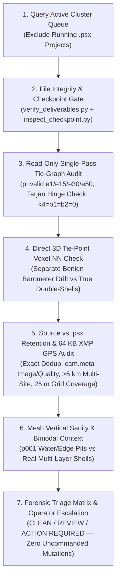

# Read-Only Photogrammetry Forensic Quality & Alignment Audit

Comprehensive, strictly read-only forensic auditing protocol for completed Agisoft Metashape Pro projects (`.psx`), raw multi-flight capture directories, and exported 3D deliverables (`.obj`, `.mtl`, `_orthomosaic.tif`). Bridges the gap between file-level deliverable checks (`scripts/verify_deliverables.py`) and true 3D geometric integrity by catching hidden double-shells, detached Stage-4 ICP fragments, mixed multi-site input folders, and false GPS-spike coverage loss under the Operator Authority Gate.

---

## When To Use

Use this skill when:
- Auditing one or more completed photogrammetry projects after `scripts/verify_deliverables.py` reports `PASS` to verify true 3D geometric fusion integrity before production sign-off.
- Diagnosing suspected double-shells, ghost roofs, shifted manual/oblique facades, or elevated vertical noise in an existing `.psx` archive or exported `.obj` mesh.
- Investigating unexplained photo count drops between raw source directories and aligned `.psx` cameras (separating exact-copy deduplication, blurry-frame pruning, mixed multi-site folders `> 5 km` apart, and over-pruned GPS spikes).
- Performing a fleet-wide retrospective quality sweep across completed project archives on shared network storage (`\\HOST_PC\ResultSSD`) to decide which historical sites require re-processing on newer alignment/ICP commits.
- Verifying lens-lock conformance (`k4 = b1 = b2 = 0`), single-block or cleanly bridged tie-graph topology, and spatial coverage completeness without opening GUI sessions or mutating archives.

Do not use this skill when:
- Launching new end-to-end reconstructions from raw photos (use `skills/user/autonomous-photogrammetry/` or `skills/user/image-to-3d-model/`).
- Monitoring live cluster queue health, worker RAM/GPU telemetry, or storage headroom (use `skills/user/cluster-supervisor/`).
- Exporting, re-baking textures, or converting asset formats from a verified `.psx` project (use `skills/user/photogrammetry-export/`).
- Executing queue aborts, moving raw photo folders, or re-submitting batches without explicit real-time operator authorization (strictly prohibited by the Operator Authority Gate).

---

## Workflow



### 1. Non-Destructive Safety & Read-Only Invariants

Before inspecting any `.psx` archive or source directory, enforce these four invariants:
1. **Strict Operator Authority Gate**: Forensic audits are 100% read-only. Never edit `.psx` files, move/split raw source images, delete deliverables, or submit/abort cluster batches without explicit operator approval after presenting the audit report.
2. **Never Open Currently Running `.psx` Archives**: Always query the cluster coordinator first (`scripts/cluster_monitor.py --server <SERVER_IP>`) and explicitly exclude every project currently being written by a worker.
3. **Safe Metashape Archive Opening**: Always open finished projects with `doc.open(psx_path, read_only=True, ignore_lock=True)` inside a `try ... finally: doc.clear()` block. Note that `metashape.exe -r` requires a `.py` script file path on disk (it does **not** support `-c` inline execution); store temporary read-only audit scripts strictly inside `.agents/` or the session scratch folder (never commit them and never author ad-hoc queue mutation scripts).
4. **Verify Actual Share Topology**: Check both root and nested result directories on shared storage (for example, `\\HOST_PC\Share\BatchA\Result\<project>` vs `\\HOST_PC\Share\ResultSSD\<project>`) before marking deliverables missing.

### 2. Baseline File & Checkpoint Verification

Run the canonical read-only utilities first to establish structural baseline state:

```powershell
# 1. Check active cluster batches so running .psx archives are excluded
python scripts/cluster_monitor.py --server <SERVER_IP> --result-share "\\HOST_PC\ResultSSD"

# 2. Verify deliverable file headers, OBJ faces, MTL links, and GeoTIFF CRS
python scripts/verify_deliverables.py --dir "\\HOST_PC\ResultSSD\<project>" --expect obj ortho

# 3. Inspect chunk labels, camera counts, tie points, depth maps, and mesh presence
python scripts/inspect_checkpoint.py --project "\\HOST_PC\ResultSSD\<project>\<project>.psx"
```

> [!IMPORTANT]
> A `PASS` result from `scripts/verify_deliverables.py` proves only that files exist with valid headers and linked textures. It does **not** guarantee single-surface 3D alignment or complete site coverage; always continue through Steps 3–6 when auditing geometric quality.

### 3. Single-Pass Tie-Graph, Sub-Island & Lens-Lock Audit

Avoid running separate `tie_points.projections` loops for each threshold (4 passes can take ~150 s on a 3,000-camera chunk). Build the `pt.valid`-filtered shared-track camera adjacency map in **one single pass** (~5–36 s per project) and inspect:
1. **Valid-Track Island Topology (`e1`, `e15`, `e30`, `e50`)**:
   - Filter tracks to `pt.valid` (`p.valid` on `chunk.tie_points.points`) so pruned outliers and 2D-only tracks never mask detached rogue sub-blocks.
   - Evaluate connected components at `edge >= 15` both raw and with `build_tie_point_islands(chunk, edge_min=15, cut_weak_hinges=True)` from `source/autometashape/core/alignment_hygiene.py`.
   - Flag any **fragile 1-edge cross-regime hinge** holding `>= 12`-cam blocks across a zoom discontinuity (`>= 1.25x`), sensor mismatch (`w < 50`), altitude jump (`>= 15 m`), or GPS residual jump (`>= 1.5 m`).
2. **ICP-Merged Chunk Fragment Audit (`e1` Check)**:
   - Remember that Stage-4 Open3D ICP bridging uses `mergeChunks(merge_tiepoints=False)`, so a cleanly bridged `Mission + Manual` chunk naturally contains `>= 2` disconnected tie-point islands (`e1` count `>= 2`).
   - Flag any **tiny detached internal fragment (`< 12` cameras)** inside an ICP-merged chunk (e.g., an older pre-`7353286` `_ICP_Rescue` chunk that shattered into `[19, 8, 5]` and leaked shifted `8`-cam and `5`-cam ghost fragments into the final block).
3. **Lens-Lock & Reprojection Audit**:
   - Inspect every `sensor.calibration` in `chunk.sensors`: verify `k4 == 0.0`, `b1 == 0.0`, `b2 == 0.0`, physically plausible `f`, and healthy RMS reprojection error (target `<= 0.50–0.80 px`). Flag any sensor with nonzero `k4` (`|k4| >= 0.05` indicates radial dome blowup risk).

### 4. Separating Benign Barometer Drift from True 3D Double-Shells

Never declare a double-shell from raw GPS Z-residuals alone: consumer non-RTK UAVs routinely exhibit 5–40 m barometer datum offsets across batteries, flights, or drones even when 3D visual alignment is sub-centimeter accurate.

1. **Dual-Residual Decomposition**:
   - Compare raw GPS residual (`est.z - ref.z`) against physics-normalized residual (`est.z - (anchor_z0 + DJI/RelativeAltitude)`).
   - Uniform raw Z offsets that vanish under `anchor_z0 + RelativeAltitude` indicate benign barometer datum differences, not 3D misalignment.
2. **Direct 3D Tie-Point Voxel Nearest-Neighbor (NN) Fusion Check**:
   - Partition valid 3D tie points by source folder, sensor group, or disconnected `e1` tie-graph island (e.g., `Main` vs `Bridged_Island_2`).
   - Project points into local metric UTM/ECEF meters, bin into a spatial voxel hash (e.g., `0.5 m` cells), and compute nearest-neighbor 3D offsets (`med_dX`, `med_dY`, `med_dZ`, `p90_3D`) across overlapping regions within a `1.5–3.0 m` search radius:
     - **Healthy Fusion**: `|med_dX|`, `|med_dY|`, `|med_dZ| < 0.05–0.10 m` (typical clean ICP bridge sits around `0.02–0.06 m`).
     - **Borderline / Inspect**: `0.10–0.25 m` (check overlap geometry, sensor focal length, or isolated wing drift).
     - **Confirmed Double-Shell / Misalignment**: `> 0.25–0.50 m` (for example, `+1.27 m` invalid-track glued manual roof or `±2.07 m` detached ICP rescue fragments).

### 5. Source-vs-`.psx` Photo Retention, 64 KB XMP GPS & Spatial Coverage Audit

A project with `98%` alignment inside `.psx` can still be missing half the site if photos were dropped or disabled before meshing. Audit end-to-end retention from the raw input directory:

1. **Exact-Copy Deduplication vs Post-Ingest Drops**:
   - Run `discover_image_subfolder_groups(..., deduplicate=True)` from `source/autometashape/core/telemetry.py` on the raw source folder to measure unique source images vs exact byte-identical duplicates across copied subfolders.
   - Compare `(raw_disk_count -> unique_after_dedup -> psx_total_cameras -> psx_enabled_aligned)`.
2. **Sharpness Quality Metadata Gotcha (`cam.meta`, NOT `cam.photo.meta`)**:
   - In Agisoft Metashape Pro, `analyzeImages()` stores image sharpness on **`cam.meta["Image/Quality"]`** (not `cam.photo.meta`).
   - Separate disabled/unaligned cameras into genuinely blurry frames (`Image/Quality < 0.50`) versus sharp dropped frames (`Image/Quality >= 0.50`).
3. **64 KB XMP Header Read for Mixed Multi-Site Detection**:
   - **DJI XMP Offset Gotcha**: DJI JPEG XMP blocks (`drone-dji:GpsLatitude`, `GpsLongitude`, `AbsoluteAltitude`, `RelativeAltitude`, `DigitalZoomRatio`) often reside at byte offsets `35–55 KB`. Reading only `32768` bytes silently misses XMP tags; always read at least **`65536` bytes (`64 KB`)** per JPEG header.
   - Compute pairwise/cluster Haversine spread across all raw images. If distinct spatial clusters lie `> 5 km` apart inside one raw project directory, Stage-2 GPS outlier sanitization will neutralize the smaller site and drop its frames. Flag as **Mixed Multi-Site Folder** and report exact photo counts, timestamps, and coordinates for operator-authorized folder splitting.
4. **25 m Spatial Grid Coverage Check**:
   - Bin raw GPS positions and aligned camera positions into `25 m × 25 m` UTM/metric grid cells and compute the uncovered cell percentage.
   - High uncovered area (`> 25–30%`) paired with sharp unaligned/disabled cameras (`Image/Quality >= 0.50`) diagnoses **false GPS-spike over-pruning** (smooth multi-battery barometer drift exceeding old global thresholds before commit `5ee4c18`) or an **unbridged oblique/zoom flight band**.

### 6. 3D Mesh Vertical Sanity & Bimodal Planar-Cell Context

When inspecting an exported `.obj` mesh or `chunk.model` vertices:
1. **Extreme Z Quantiles (`z_min`, `p001`, `p50`, `p999`, `z_max`)**:
   - Flag severe lower-tail pits (`p001` or `z_min` plunging tens of meters below site median elevation), typically caused by glossy water reflections or uncropped perimeter edges, and note whether a targeted GUI crop suffices versus full re-alignment.
2. **Contextualize Bimodal `(X, Y)` Planar-Cell Splits**:
   - Architectural eaves, balconies, overhangs, vertical facades, and tree canopies legitimately produce ~2–6% vertically bimodal `(X, Y)` cells on single-surface buildings.
   - Never classify a mesh as double-shelled from mesh Z-bimodality alone; always corroborate against Step 3 (tie-graph islands/hinges) and Step 4 (direct 3D tie-point voxel NN offset).

### 7. Forensic Triage Matrix & Operator Escalation

Present findings in a structured executive table and wait for explicit operator authorization before performing any remediation:

| Verdict | Criteria | Recommended Operator Action |
|---|---|---|
| **`CLEAN`** | Deliverable `PASS`, `k4=b1=b2=0`, 3D voxel NN `< 10 cm`, no detached `< 12`-cam ICP fragments, healthy coverage | Sign off for production delivery |
| **`REVIEW`** | Deliverable `PASS` and clean 3D fusion, but minor non-structural note (benign exact-copy dedup, small peripheral dropout, or water-edge `z_min` pit) | Optional GUI cleanup / `photogrammetry-export` re-export |
| **`ACTION REQUIRED`** | Confirmed double-shell (`> 25 cm` voxel NN), detached ICP fragments (`< 12` cams), `k4` blowup, mixed multi-site folder (`> 5 km`), or severe coverage loss (`> 30%` sharp cells dropped) | Present exact root cause; upon operator approval, split mixed folders or re-queue on latest `main` (`5ee4c18` + `7353286`) via `scripts/submit_cluster_batch.py` |

---

## Validation

Verify that the forensic audit references, underlying hygiene/ICP verification engines, and skill contracts pass repository checks:

```powershell
# 1. Validate skill schema, links, and discovery aliases
python tools/skills/cli.py check

# 2. Run unit tests covering alignment hygiene, ICP sub-island isolation, and deliverable verification
python -m unittest tests/test_alignment_hygiene.py tests/test_icp_bridge.py tests/test_verification.py

# 3. Verify canonical read-only inspection CLIs
python scripts/verify_deliverables.py --help
python scripts/inspect_checkpoint.py --help
python scripts/cluster_monitor.py --help
```

---

## Maintenance

- Keep forensic thresholds aligned with constants in `source/autometashape/core/alignment_hygiene.py` (`edge_min=15`, `min_bridge_cams=12`, Tarjan hinge thresholds, neighbor-continuity spike guards) and `source/autometashape/core/icp_bridge.py` (`_isolate_coherent_sub_islands()`, Pre-MVS Quality Gate limits).
- Update DJI XMP header read depth (`64 KB`) if future camera firmware moves XMP blocks past `65536` bytes.
- Re-verify Metashape metadata key locations (`cam.meta["Image/Quality"]` vs `cam.photo.meta`) across Agisoft Metashape Pro major version upgrades.

---

## References

- Contributing guide & Operator Authority Gate: [CONTRIBUTING.md](../../../CONTRIBUTING.md)
- Forensic audit evaluation scenarios: [evaluations.md](evaluations.md)
- Alignment hygiene engine: [source/autometashape/core/alignment_hygiene.py](../../../source/autometashape/core/alignment_hygiene.py)
- Zero-neural ICP bridge engine: [source/autometashape/core/icp_bridge.py](../../../source/autometashape/core/icp_bridge.py)
- Telemetry & exact-copy deduplication: [source/autometashape/core/telemetry.py](../../../source/autometashape/core/telemetry.py)
- Deliverable verification engine: [source/autometashape/core/verification.py](../../../source/autometashape/core/verification.py)
- Canonical checkpoint inspector: [scripts/inspect_checkpoint.py](../../../scripts/inspect_checkpoint.py)
- Canonical deliverable verifier: [scripts/verify_deliverables.py](../../../scripts/verify_deliverables.py)
- Cluster Supervisor skill: [skills/user/cluster-supervisor/SKILL.md](../cluster-supervisor/SKILL.md)
- Image-to-3D Model skill: [skills/user/image-to-3d-model/SKILL.md](../image-to-3d-model/SKILL.md)
- Cluster Fleet Operations skill: [skills/user/cluster-fleet-operations/SKILL.md](../cluster-fleet-operations/SKILL.md)
